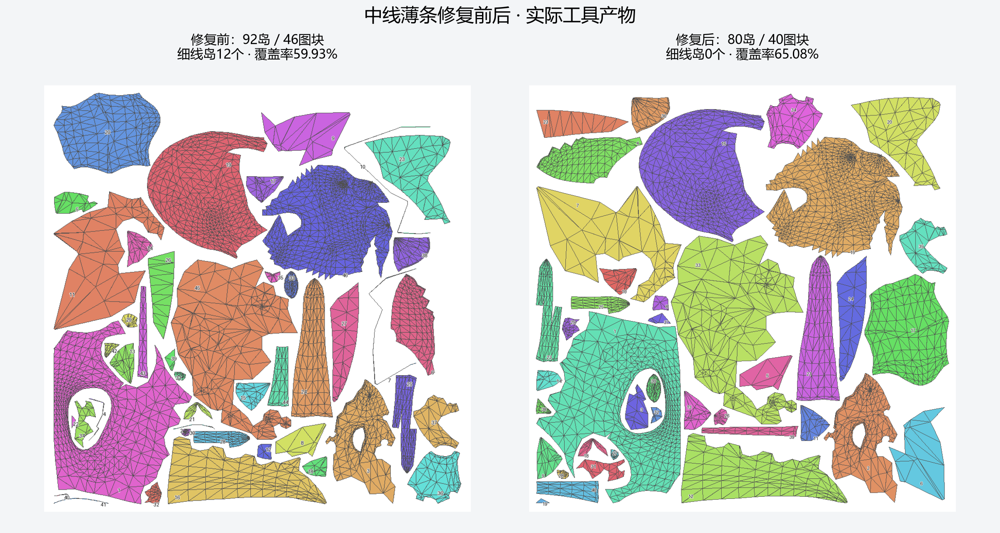
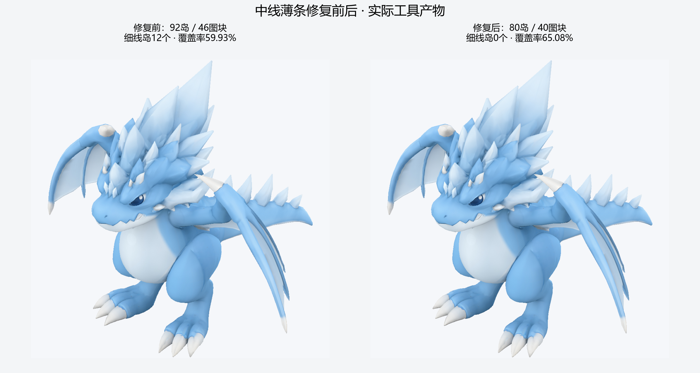

# 中线薄条修复版龙模型

[详细报告](../../results/dragon-midplane-cleanup.md) · [完整GLB](dragon.glb) · [实际BaseColor](texture/BaseColor_mip0.png) · [核验与指标](summary.json) · [文件哈希](manifest.json)。`[verified: 对应交付文件]`

12个中线细条岛已消除，92→80连通岛、46→40独立图块，覆盖率59.93%→65.08%。这是独立镜像几何变体的修复；原模型保留，当前颜色/接缝检查通过、严格渲染拒绝，作为预览交付。`[verified: independent_audit.json；mirror_variant.json；validation.json]`

texture目录包含2048完整mip链；来源NPZ分两层追溯到父变体及原模型。JSON中的历史本机路径仅作归档来源，发布文件使用本目录相对链接。`[verified: manifest.json files]`

