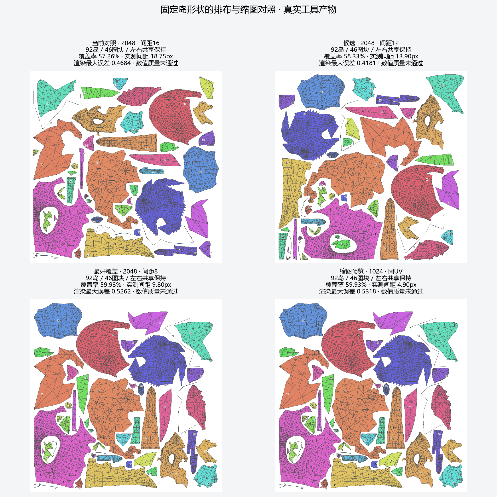
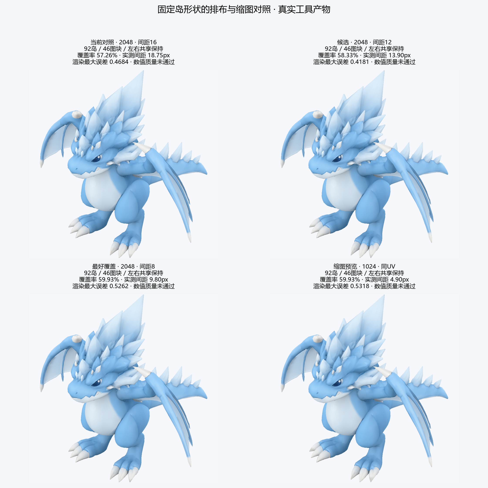

# 龙UV排布搜索交付

[详细报告](../../results/dragon-packing-search.md) · [全部数据](summary.json) · [配置](protocol.json) · [文件哈希](manifest.json)。`[verified: 对应交付文件]`

92岛／46图块保持不变，覆盖率57.26%→59.93%；该提升仅对应约4.45%的固定有效纹素面积余量。数值质量仍拒绝，1024版本单列为失败的缩图探索。`[verified: summary.json cases与same_density_equivalent_side；opinion: 面积换算解释]`

|候选|完整模型|真实BaseColor|状态|
|---|---|---|---|
|12px、种子17、2048|[GLB](gap12_seed17/dragon.glb)|[PNG](gap12_seed17/texture/BaseColor_mip0.png)|覆盖率58.33%，颜色/接缝通过，渲染拒绝。`[verified: summary.json cases[1]]`|
|8px、种子0、2048|[GLB](gap8_seed0/dragon.glb)|[PNG](gap8_seed0/texture/BaseColor_mip0.png)|覆盖率59.93%，颜色/接缝通过，渲染拒绝。`[verified: summary.json cases[2]]`|
|同UV缩至1024|[GLB](gap8_seed0_1024/dragon.glb)|[PNG](gap8_seed0_1024/texture/BaseColor_mip0.png)|颜色/接缝/渲染均拒绝；不作为同质量缩图成果。`[verified: summary.json cases[3]]`|

每个texture目录提供完整mip链。归档JSON内的作者本机路径只用于追溯，发布文件通过本目录相对路径访问；manifest记录来源及SHA-256。`[verified: manifest.json files]`

