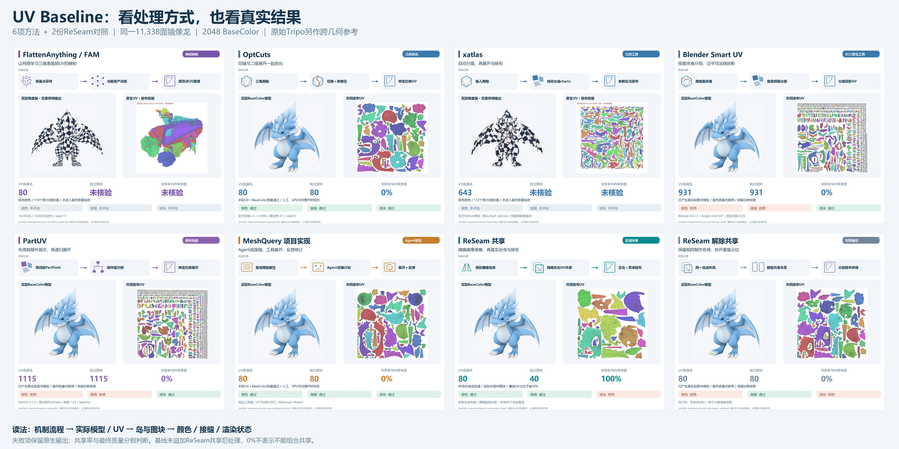

# UV Baseline可视化介绍

[FlattenAnything / FAM](flatten_anything.png)

[OptCuts](optcuts.png)

[xatlas](xatlas.png)

[Blender Smart UV](blender_smart.png)

[PartUV](partuv.png)

[MeshQuery 项目实现](meshquery_project.png)

[ReSeam 共享](reseam_shared.png)

[ReSeam 解除共享](reseam_unshared.png)

卡片中的模型、UV和指标均来自measurements.json绑定的实际资产。流程图标仅作机制说明；验收状态保持原结论。`[verified: manifest.json input_assets；measurements.json rows]`
