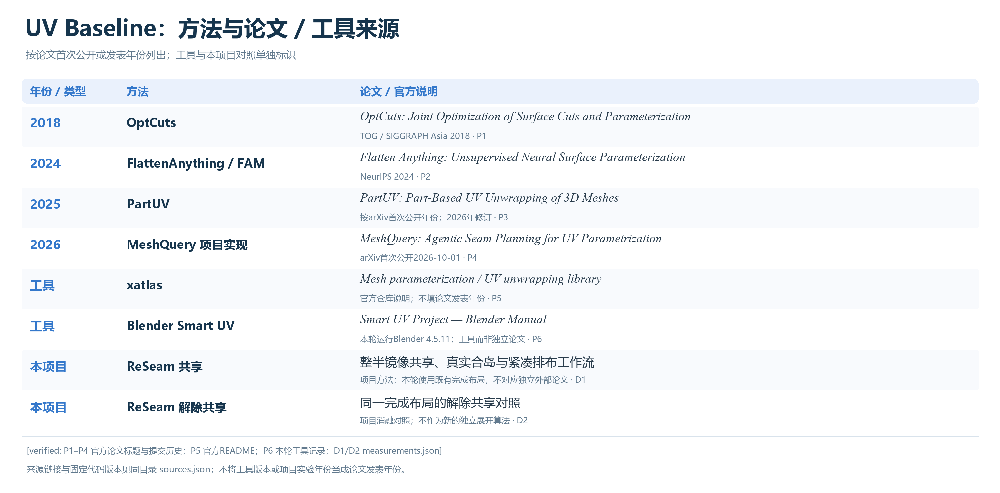
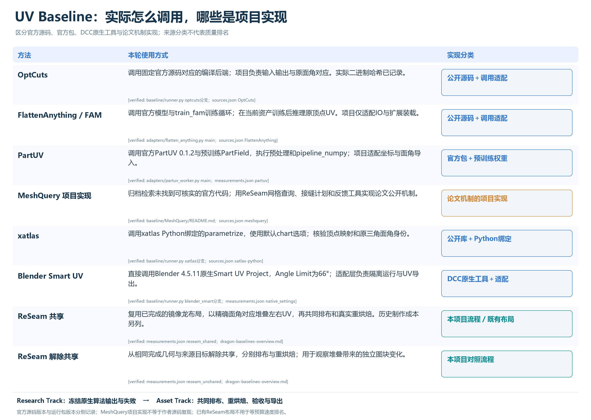
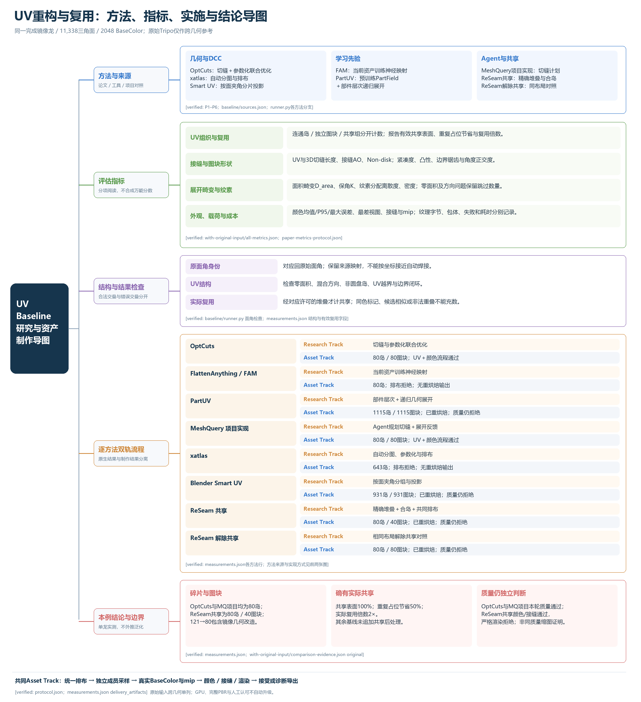

# 三张Baseline介绍图

本组按用户提供的三种参考结构制作；论文、工具和项目对照分别标识。实际执行与结果来自固定龙模型记录，未重新运行算法或烘焙。`[verified: sources.json methods与source_files；measurements.json各方法行]`

来源链接、代码版本依据、输入文件及输出图片哈希见[sources.json](sources.json)。可重新生成脚本：[build_baseline_reference_figures.py](../../../../scripts/build_baseline_reference_figures.py)。`[verified: sources.json；对应脚本]`
