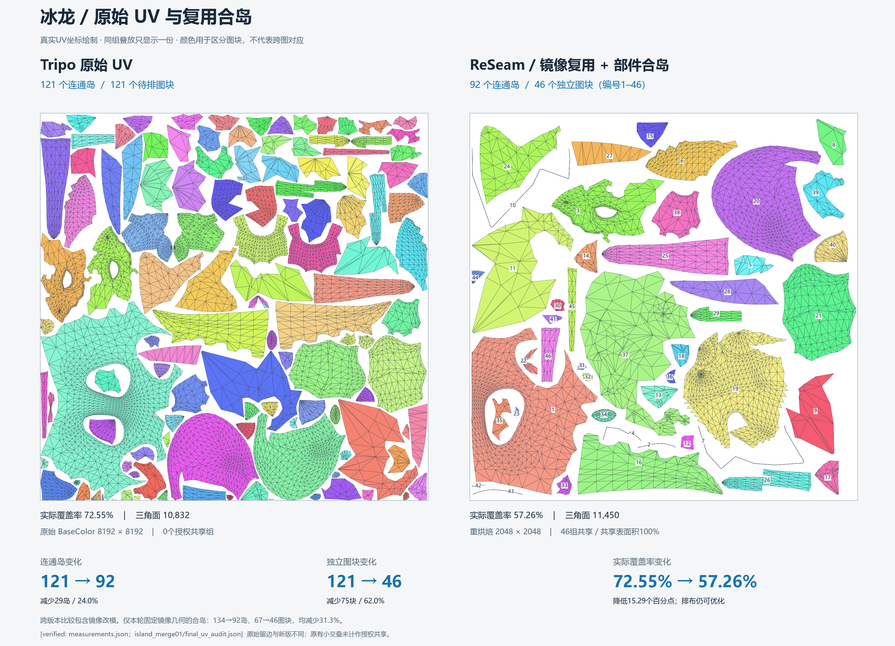
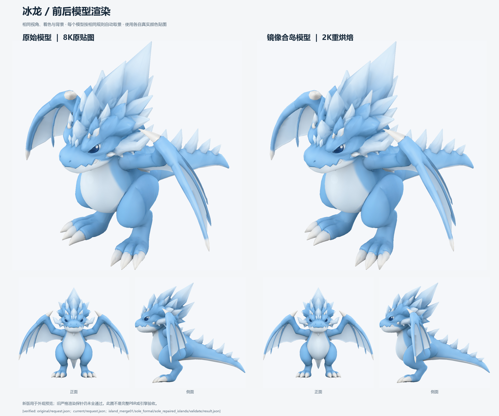

# 龙模型与UV对照交付

本目录随Git提交，克隆后可直接查看；文件来源、大小和SHA256见[清单](manifest.json)。清单中的历史`source`路径仅供追溯，交付文件使用本目录相对路径。`[verified: manifest.json files]`

- [彩色UV与数据对照](uv_before_after.png) · [矢量PDF](uv_before_after.pdf)。`[verified: manifest.json 对应文件]`
- [模型前后渲染](model_before_after.png) · [实际贴图对照](texture_before_after.png)。`[verified: manifest.json 对应文件]`
- [完整龙GLB](dragon.glb) · [BaseColor](texture/BaseColor_mip0.png)，`texture/`包含完整mip链。`[verified: manifest.json texture文件]`
- [统计与成本](experiment-summary.json) · [几何／UV核验](uv-audit.json) · [重导入核验](reimport.json) · [质量结论](quality-result.json)。`[verified: 对应JSON文件]`

最原始121岛→当前92岛、121→46图块，包含用户授权的镜像几何改造。本轮固定镜像几何的实际合岛为134→92岛、67→46图块。原始与当前覆盖率分别72.55%和57.26%，减少图块不等于提高填充率。`[verified: measurements.json；uv-audit.json]`

新版保留为Agent看图接受的预览：颜色和接缝通过，严格渲染探针拒绝；不宣称完整PBR、GPU或工业艺术验收通过。历史运行目录、缓存和全部中间快照仍按仓库忽略规则保留在本地，报告中的历史`artifacts/`链接不属于此可携带交付包。`[verified: quality-result.json；根目录.gitignore /artifacts/；opinion: 交付边界]`

