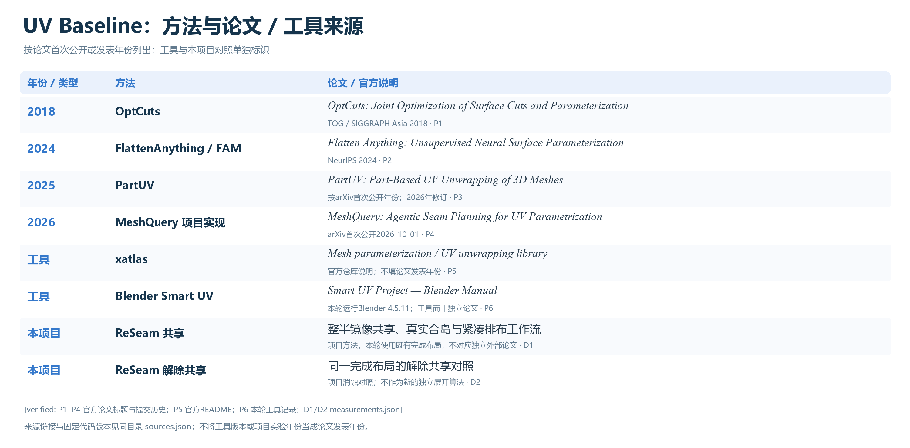
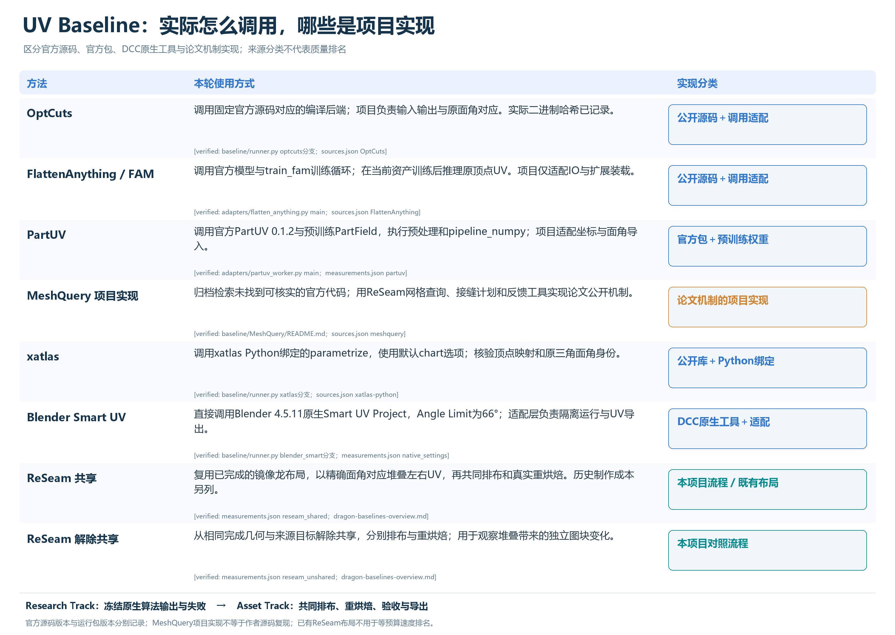
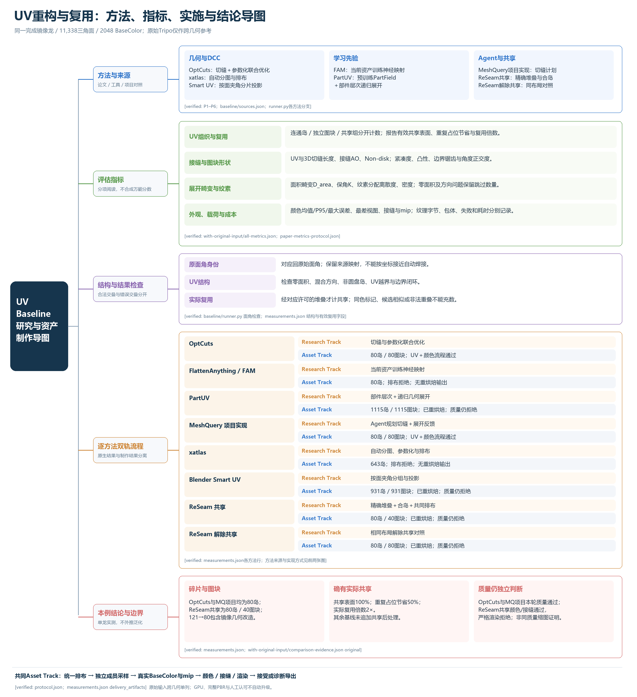

# 龙模型UV实验：各Baseline的原理、执行方式与实际结果

本说明参考[《七种网格简化方法》](https://moonton.feishu.cn/wiki/ZcFRwRiWOiiVxFkx8CZcYisvnoc)可见目录的组织方式：先解释评估，再按方法分别介绍Research Track与Asset Track，最后汇总结果。这里介绍的是UV展开与接缝方法；方法原理来自官方论文/源码，本地结果来自固定龙模型实验。`[verified: 参考Wiki可见目录“评估指标”“Research Track”“Asset Track”“Conlusion”；baseline/sources.json；assets/dragon-paper-baselines/measurements.json]`

Research Track回答“原算法输出了什么”；Asset Track回答“这些UV在统一排布、真实重烘焙与导出后表现如何”。先区分这两个问题，能够解释为什么一个算法运行完成，仍可能没有可接受的最终资产。`[opinion]`

## 比较对象与共同流程

原始Tripo输入为10832面、121岛、8192贴图；正式八条路径固定完成镜像龙的11338面几何，以其冻结2048 BaseColor作为参考。前者作为跨几何来源参考，正式方法之间比较同一父几何。`[verified: assets/dragon-paper-baselines/with-original-input/comparison-evidence.json original；assets/dragon-paper-baselines/measurements.json input]`

共同Asset Track为：原生UV输出→统一Blender轮廓排布→成员独立采样/颜色重建→生成2048真实BaseColor与完整mip→颜色、接缝及渲染验收→保留接受或诊断导出。使用8px间距/边界/烘焙留边；论文的0.001排布间距另列。失败、超时和未产出均保留。`[verified: assets/dragon-paper-baselines/protocol.json；assets/dragon-paper-baselines/measurements.json rows与delivery_artifacts]`

## 三张介绍图

三张图分别对应论文/工具索引、实际调用与源码分类、完整方法导图；[高清图片与来源记录](assets/dragon-paper-baselines/overview-figures/README.md)。原有[实际模型/UV卡片](assets/dragon-paper-baselines/method-visuals/README.md)及[原始输入对照图](assets/dragon-paper-baselines/with-original-input/uv-and-checker-comparison.png)保留作为补充。`[verified: overview-figures/sources.json outputs；对应PNG]`

## FlattenAnything：用神经映射学习展开

**核心思路。** FAM学习表面点与二维坐标之间的映射，以双向映射组织切割、展开等功能；它直接处理离散点，不依赖传统网格连通关系来完成映射。来源：[NeurIPS 2024论文](https://arxiv.org/abs/2405.14633)、[官方代码](https://github.com/keeganhk/FlattenAnything)。`[verified: FAM论文Abstract；baseline/FlattenAnything/README.md开头]`

**Research Track。** 本轮调用官方模型与`train_fam`，使用10000点、10000迭代、seed17；然后在全部原始顶点上推理UV。这里确实包含当前资产的训练/优化。项目适配负责IO与依赖装载，输出转为原面角UV时保留原三角形。`[verified: baseline/adapters/flatten_anything.py main；baseline/runner.py flatten_anything分支]`

**Asset Track。** 当前映射的80个原生连通岛中检测到110个零UV面积面、3208个岛内混合方向面，后续排布拒绝，没有生成合格的重烘焙贴图或GLB。其用途是检验点式神经参数化在这份固定网格上能否形成可用传统UV，而不能用80岛单独宣布成功。`[verified: assets/dragon-paper-baselines/measurements.json rows.flatten_anything；opinion: 结果解释]`

产物：[实际UV](assets/dragon-paper-baselines/flatten_anything/uv.png)、[棋盘格](assets/dragon-paper-baselines/flatten_anything/front.png)。`[verified: measurements.json rows.flatten_anything.delivery_artifacts]`

## OptCuts：让切缝与展开共同优化

**核心思路。** OptCuts将接缝选择和二维参数化共同优化，在用户要求的畸变范围内压低接缝长度。这里的切割拓扑描述UV如何断开和连接。来源：[SIGGRAPH Asia 2018项目页](https://www.cs.ubc.ca/labs/imager/tr/2018/OptCuts/)、[官方代码](https://github.com/liminchen/OptCuts)。`[verified: 项目标题及baseline/OptCuts/README.md首段]`

**Research Track。** 本轮使用固定官方源码及已记录哈希的二进制，headless模式、λ=0.999、畸变界4.1、seed0。输出经原面角对应检查后写回同一固定父几何，不将已有ReSeam UV提供给原生算法。`[verified: baseline/runner.py write_geometry、optcuts分支；baseline/sources.json OptCuts]`

**Asset Track。** 得到80岛、80图块，统一排布后覆盖率63.30%，颜色、接缝和渲染均通过。它在本例中提供“无需Agent参与的几何优化能做到什么”的对照；本轮没有再给它追加镜像共享阶段，0%共享不表示不能与共享工具组合。`[verified: measurements.json rows.optcuts；opinion: 比较用途与边界]`

产物：[UV](assets/dragon-paper-baselines/optcuts/uv.png)、[真实颜色](assets/dragon-paper-baselines/optcuts/color.png)、[实际贴图](assets/dragon-paper-baselines/optcuts/texture.png)、[GLB](assets/dragon-paper-baselines/optcuts/model.glb)。`[verified: measurements.json rows.optcuts.delivery_artifacts]`

## xatlas：通用自动分图、展开与排布

**核心思路。** xatlas提供完整的图集生成库：将网格划成charts、计算各片参数化，再排入图集；其API也允许将分图与排布分开运行。来源：[官方代码与说明](https://github.com/jpcy/xatlas)。`[verified: baseline/xatlas/README.md “Generate an atlas”“ComputeCharts”“PackCharts”]`

**Research Track。** 本轮调用Python绑定的`xatlas.parametrize`与默认chart选项；检查输出的顶点映射和三角形索引能恢复原始面角身份。没有把本例另写的修补算法算成xatlas原生能力。`[verified: baseline/runner.py xatlas分支；measurements.json rows.xatlas.native_settings]`

**Asset Track。** 得到643个原生岛，检测到112个零UV面积面，统一排布拒绝。没有可接受的重烘焙输出，形状指标仍保留531个非零面积岛的统计及跳过数量。该失败是本输入和本配置的实际结果，不能外推为库在所有资产上失效。`[verified: measurements.json rows.xatlas；with-original-input/paper-metrics.json rows.xatlas.paper_metrics；opinion: 适用范围]`

产物：[原生UV](assets/dragon-paper-baselines/xatlas/uv.png)、[棋盘格](assets/dragon-paper-baselines/xatlas/front.png)。`[verified: measurements.json rows.xatlas.delivery_artifacts]`

## Blender Smart UV：按夹角分片并投影

**核心思路。** Smart UV Project根据面之间的夹角分组，沿各组的平均法线投影并排布；Angle Limit控制分片和失真的取舍。官方说明将机械与建筑物体列为适用例子。来源：[Blender 4.5 LTS手册](https://docs.blender.org/manual/en/4.5/modeling/meshes/editing/uv.html#smart-uv-project)。`[verified: Blender 4.5 Manual “Smart UV Project”“Angle Limit”]`

**Research Track。** 本轮直接调用Blender 4.5.11的原生工具，Angle Limit=66°、原生Island Margin=0.03；随后进入共同排布，而不是把不同原生排布直接当成公平覆盖率比较。`[verified: baseline/runner.py blender_smart分支；measurements.json rows.blender_smart.native_settings]`

**Asset Track。** 得到931岛、931图块，统一排布覆盖38.44%；颜色与接缝拒绝，渲染通过。它适合作为DCC工具自动操作基线，用来观察角度分片在这只龙上带来的碎片数量；该数量变化不直接证明所有曲面资产都会碎片化。`[verified: measurements.json rows.blender_smart；opinion: 比较用途与边界]`

产物：[UV](assets/dragon-paper-baselines/blender_smart/uv.png)、[真实颜色](assets/dragon-paper-baselines/blender_smart/color.png)、[实际贴图](assets/dragon-paper-baselines/blender_smart/texture.png)、[GLB](assets/dragon-paper-baselines/blender_smart/model.glb)。`[verified: measurements.json rows.blender_smart.delivery_artifacts]`

## PartUV：先理解部件层次，再递归展开

**核心思路。** PartUV以PartField提供的部件层次为基础，通过自顶向下递归和几何启发式，寻找满足畸变约束的较少图块。它的学习组件提供部件先验，几何流程执行UV展开。来源：[论文](https://arxiv.org/abs/2511.16659)、[官方代码](https://github.com/EricWang12/PartUV)。`[verified: PartUV论文Abstract；baseline/PartUV/README.md “Preprocessing”“Unwrapping”]`

**Research Track。** 本轮调用官方PartUV 0.1.2及预训练PartField权重，seed42、每面10点、分批100000点，畸变阈值1.25，执行`pipeline_numpy`。PartField本轮确实在这条路径中运行；其输出随后通过几何对齐和原面角导入检查。`[verified: baseline/adapters/partuv_worker.py main；baseline/runner.py partuv分支；measurements.json rows.partuv.native_settings]`

**Asset Track。** 得到1115岛、1115图块，统一排布覆盖40.09%；颜色与接缝拒绝，渲染通过。这是固定三角龙与本轮适配设置下的结果；部件先验不自动保证每个资产都得到少量岛，也不自动产生左右UV堆叠。`[verified: measurements.json rows.partuv；opinion: 结果边界]`

产物：[UV](assets/dragon-paper-baselines/partuv/uv.png)、[真实颜色](assets/dragon-paper-baselines/partuv/color.png)、[实际贴图](assets/dragon-paper-baselines/partuv/texture.png)、[GLB](assets/dragon-paper-baselines/partuv/model.glb)。`[verified: measurements.json rows.partuv.delivery_artifacts]`

## MeshQuery项目实现：Agent规划切缝，几何工具执行

**核心思路。** MeshQuery将网格属性变成可查询信息，让VLM用选边程序表达接缝计划，再根据展开后的指标和视图反复修订。其重点是高层切缝决策与工具接口。来源：[论文§3](https://arxiv.org/html/2610.02507v1#S3)。`[verified: MeshQuery论文§3.1—§3.4]`

**Research Track。** 本次归档未找到可核实的官方实现，采用ReSeam已有网格查询、选边、预览、计划与反馈工具，由当前Agent做决策。本例依据4个环带的拓扑反馈补测地连接，使用Minimum Stretch展开。正式名称必须保留“项目实现”；Agent、三角网格、语义预处理及Blender版本都与论文配置有区别。`[verified: baseline/MeshQuery/README.md；baseline/sources.json meshquery；results/dragon-paper-baselines.md MeshQuery说明]`

**Asset Track。** 得到80岛、80图块，覆盖62.72%，颜色、接缝和渲染均通过；补算Non-disk为0%。本轮这条路径执行接缝规划和无共享展开，共享率为0；它与ReSeam共享后处理的贡献分别记录。`[verified: measurements.json rows.meshquery_project；with-original-input/paper-metrics.json rows.meshquery_project.paper_metrics]`

产物：[UV](assets/dragon-paper-baselines/meshquery_project/uv.png)、[真实颜色](assets/dragon-paper-baselines/meshquery_project/color.png)、[实际贴图](assets/dragon-paper-baselines/meshquery_project/texture.png)、[GLB](assets/dragon-paper-baselines/meshquery_project/model.glb)。`[verified: measurements.json rows.meshquery_project.delivery_artifacts]`

## ReSeam共享：把完整部件共享与真实合岛接起来

**核心思路。** 本项目在已授权的新镜像变体中构建精确左右面角对应，复制UV形成共享；再对头冠、脚部等自然表面重展开、修正必要切口，并按共享主图块排布、重采样真实颜色。Agent承担部件与操作判断，几何与烘焙工具执行。`[verified: results/dragon-whole-half-reuse.md；results/dragon-uv-island-merge.md；results/dragon-midplane-cleanup.md]`

**Research Track。** 本轮共享结果从此前完成的80岛镜像龙布局派生，属于PRECOMPUTED输入；历史制作成本未完整测量，不能据此宣称比从零运行的基线更快。当前轮共享/解除共享使用同一几何与目标，主要观察堆叠的贡献。`[verified: measurements.json input.historical_reseam_cost、rows.reseam_shared.algorithm_status；results/dragon-paper-baselines.md ReSeam对照说明]`

**Asset Track。** 连通岛仍为80，实际只排40个独立图块；全部表面参与左右共享，重复UV占位节省约50%，复用倍数约2。统一排布覆盖62.93%；颜色和接缝通过、严格渲染拒绝。它已证明本例发生实际UV共享，完整质量通过和同质量纹理内存节省仍须分别验证。`[verified: measurements.json rows.reseam_shared；opinion: 结论边界]`

产物：[UV](assets/dragon-paper-baselines/reseam_shared/uv.png)、[真实颜色](assets/dragon-paper-baselines/reseam_shared/color.png)、[实际贴图](assets/dragon-paper-baselines/reseam_shared/texture.png)、[GLB](assets/dragon-paper-baselines/reseam_shared/model.glb)。`[verified: measurements.json rows.reseam_shared.delivery_artifacts]`

## ReSeam解除共享：保持制作布局，拆开重复占位

这条路径从同一已完成布局解除共享后重新排布，保留80个连通岛，恢复为80个独立图块。它用于分离堆叠与展开本身的贡献，是同几何对照，不是另一个全新展开算法。`[verified: measurements.json rows.reseam_unshared；results/dragon-paper-baselines.md ReSeam对照说明；opinion: 比较用途]`

本例覆盖62.10%，接缝通过、颜色与渲染拒绝。六份成功烘焙输出仍统一为2048 RGBA8和12级mip，每份22369620字节；图块数减半尚未在本轮转化为同质量的纹理载荷下降。`[verified: measurements.json rows.reseam_unshared、payload_bytes；assets/dragon-paper-baselines/verification.json models_reimported]`

产物：[UV](assets/dragon-paper-baselines/reseam_unshared/uv.png)、[真实颜色](assets/dragon-paper-baselines/reseam_unshared/color.png)、[实际贴图](assets/dragon-paper-baselines/reseam_unshared/texture.png)、[GLB](assets/dragon-paper-baselines/reseam_unshared/model.glb)。`[verified: measurements.json rows.reseam_unshared.delivery_artifacts]`

## 怎样读这轮对照

OptCuts、xatlas、Smart UV主要提供几何/工具基线；PartUV检验部件先验；FAM检验神经参数化；MeshQuery项目实现检验Agent切缝规划；ReSeam共享与解除共享用于观察项目工作流的实际堆叠贡献。这样的划分便于解释不同机制，但本轮并非锁定全部后端与前处理的单变量消融。`[opinion]`

本例OptCuts和MeshQuery项目实现均达到80岛，ReSeam共享的额外结果集中在40个独立图块。原始121→80包含镜像几何改造，历史65.08%与本轮62.93%属于不同排布设置；这些量分别呈现。失败行及单项加粗数值不构成最终质量通过。`[verified: measurements.json各行；with-original-input/comparison-evidence.json original；results/dragon-midplane-cleanup.md；opinion: 比较边界]`

完整数值与证据：[69项合并总表](assets/dragon-paper-baselines/with-original-input/all-metrics.md)、[CSV](assets/dragon-paper-baselines/with-original-input/all-metrics.csv)、[来源与版本](../baseline/sources.json)、[实际执行报告](results/dragon-paper-baselines.md)。`[verified: 对应文件]`
