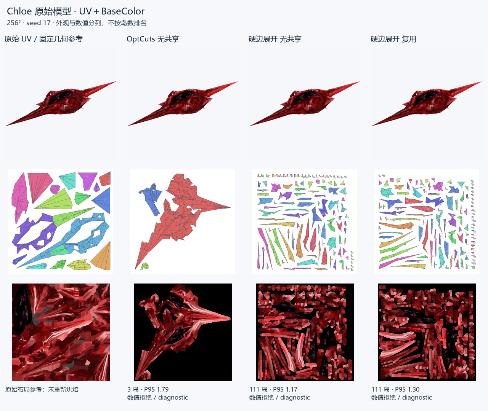
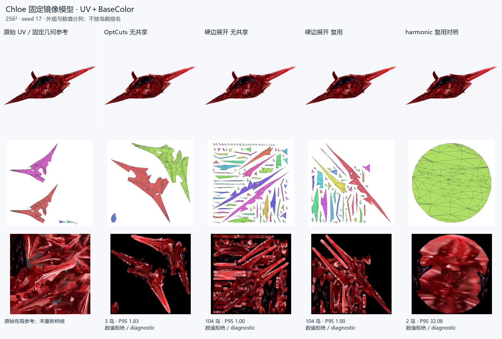

# Chloe 硬边展开与 UV 复用对照

原始与镜像几何分别固定；外观优先、数值辅助，岛数增加不作为失败。`[opinion]`

原始模型分支使用几何AO辅助侧面连接排序；镜像分支的折角路线已成功，AO仅计算供诊断。两者读取导入自定义逐角法线与原多边形身份；本资产没有绑定normal/height/AO贴图。静态BaseColor不代表Unity动态材质或完整PBR。`[verified: original/candidates/polygon_fan_plan/hard_edges.json surface_cue_sources；mirror/state.json hard_choice]`

先比较30/45/60度折角候选；保留失败后改用有限原多边形侧面片及dual-tree开口。AO仅影响相邻侧面连接优先级，不是强制断缝。45度/最多8多边形均为启发式。`[opinion]`

## 原始450面模型

|路径 / 种子|岛 / 图块|拉伸 P95 / 最大|实际共享表面|数值质量 / 回读|证据|
|---|---|---|---|---|---|
|OptCuts 无共享 / 17|3 / 3|1.791 / 3.807|0.000|False / True|[实际产物](E:/ReSem/artifacts/chloe_hard_surface/round01/original/evaluate/optcuts_unshared/seed17) `[verified: 对应 inspect/uv_metrics.json、quality/validation.json、reimport.json]`|
|OptCuts 无共享 / 29|3 / 3|1.791 / 3.807|0.000|False / True|[实际产物](E:/ReSem/artifacts/chloe_hard_surface/round01/original/evaluate/optcuts_unshared/seed29) `[verified: 对应 inspect/uv_metrics.json、quality/validation.json、reimport.json]`|
|OptCuts 无共享 / 43|3 / 3|1.791 / 3.807|0.000|False / True|[实际产物](E:/ReSem/artifacts/chloe_hard_surface/round01/original/evaluate/optcuts_unshared/seed43) `[verified: 对应 inspect/uv_metrics.json、quality/validation.json、reimport.json]`|
|硬边展开 无共享 / 17|111 / 111|1.171 / 2.152|0.000|False / True|[实际产物](E:/ReSem/artifacts/chloe_hard_surface/round01/original/evaluate/hard_unshared/seed17) `[verified: 对应 inspect/uv_metrics.json、quality/validation.json、reimport.json]`|
|硬边展开 无共享 / 29|111 / 111|1.171 / 2.152|0.000|False / True|[实际产物](E:/ReSem/artifacts/chloe_hard_surface/round01/original/evaluate/hard_unshared/seed29) `[verified: 对应 inspect/uv_metrics.json、quality/validation.json、reimport.json]`|
|硬边展开 无共享 / 43|111 / 111|1.171 / 2.152|0.000|False / True|[实际产物](E:/ReSem/artifacts/chloe_hard_surface/round01/original/evaluate/hard_unshared/seed43) `[verified: 对应 inspect/uv_metrics.json、quality/validation.json、reimport.json]`|
|硬边展开 复用 / 17|111 / 108|1.299 / 75.323|0.022|False / True|[实际产物](E:/ReSem/artifacts/chloe_hard_surface/round01/original/evaluate/hard_shared/seed17) `[verified: 对应 inspect/uv_metrics.json、quality/validation.json、reimport.json]`|
|硬边展开 复用 / 29|111 / 108|1.299 / 75.323|0.022|False / True|[实际产物](E:/ReSem/artifacts/chloe_hard_surface/round01/original/evaluate/hard_shared/seed29) `[verified: 对应 inspect/uv_metrics.json、quality/validation.json、reimport.json]`|
|硬边展开 复用 / 43|111 / 108|1.299 / 75.323|0.022|False / True|[实际产物](E:/ReSem/artifacts/chloe_hard_surface/round01/original/evaluate/hard_shared/seed43) `[verified: 对应 inspect/uv_metrics.json、quality/validation.json、reimport.json]`|

Agent 外观判断：seed17总体红黑结构与尖端保留，但256像素背面细节有模糊；仅作有限视角预览。硬边无共享相较OptCuts降低拉伸。近似共享出现最大各向异性75.32的局部退化，不推荐作为最终共享交付，保留失败证据。`[verified: E:\ReSem\artifacts\chloe_hard_surface\round01\original\appearance_review.json]`

## 固定590面镜像模型

|路径 / 种子|岛 / 图块|拉伸 P95 / 最大|实际共享表面|数值质量 / 回读|证据|
|---|---|---|---|---|---|
|OptCuts 无共享 / 17|3 / 3|1.832 / 3.393|0.000|False / True|[实际产物](E:/ReSem/artifacts/chloe_hard_surface/round01/mirror/evaluate/optcuts_unshared/seed17) `[verified: 对应 inspect/uv_metrics.json、quality/validation.json、reimport.json]`|
|OptCuts 无共享 / 29|3 / 3|1.832 / 3.393|0.000|False / True|[实际产物](E:/ReSem/artifacts/chloe_hard_surface/round01/mirror/evaluate/optcuts_unshared/seed29) `[verified: 对应 inspect/uv_metrics.json、quality/validation.json、reimport.json]`|
|OptCuts 无共享 / 43|3 / 3|1.832 / 3.393|0.000|False / True|[实际产物](E:/ReSem/artifacts/chloe_hard_surface/round01/mirror/evaluate/optcuts_unshared/seed43) `[verified: 对应 inspect/uv_metrics.json、quality/validation.json、reimport.json]`|
|硬边展开 无共享 / 17|104 / 104|1.000 / 1.002|0.000|False / True|[实际产物](E:/ReSem/artifacts/chloe_hard_surface/round01/mirror/evaluate/hard_unshared/seed17) `[verified: 对应 inspect/uv_metrics.json、quality/validation.json、reimport.json]`|
|硬边展开 无共享 / 29|104 / 104|1.000 / 1.002|0.000|False / True|[实际产物](E:/ReSem/artifacts/chloe_hard_surface/round01/mirror/evaluate/hard_unshared/seed29) `[verified: 对应 inspect/uv_metrics.json、quality/validation.json、reimport.json]`|
|硬边展开 无共享 / 43|104 / 104|1.000 / 1.002|0.000|False / True|[实际产物](E:/ReSem/artifacts/chloe_hard_surface/round01/mirror/evaluate/hard_unshared/seed43) `[verified: 对应 inspect/uv_metrics.json、quality/validation.json、reimport.json]`|
|硬边展开 复用 / 17|104 / 52|1.000 / 1.002|1.000|False / True|[实际产物](E:/ReSem/artifacts/chloe_hard_surface/round01/mirror/evaluate/hard_shared/seed17) `[verified: 对应 inspect/uv_metrics.json、quality/validation.json、reimport.json]`|
|硬边展开 复用 / 29|104 / 52|1.000 / 1.002|1.000|False / True|[实际产物](E:/ReSem/artifacts/chloe_hard_surface/round01/mirror/evaluate/hard_shared/seed29) `[verified: 对应 inspect/uv_metrics.json、quality/validation.json、reimport.json]`|
|硬边展开 复用 / 43|104 / 52|1.000 / 1.002|1.000|False / True|[实际产物](E:/ReSem/artifacts/chloe_hard_surface/round01/mirror/evaluate/hard_shared/seed43) `[verified: 对应 inspect/uv_metrics.json、quality/validation.json、reimport.json]`|
|harmonic 复用对照 / 17|2 / 1|32.080 / 119.546|1.000|False / True|[实际产物](E:/ReSem/artifacts/chloe_hard_surface/round01/mirror/evaluate/harmonic_shared/seed17) `[verified: 对应 inspect/uv_metrics.json、quality/validation.json、reimport.json]`|
|harmonic 复用对照 / 29|2 / 1|32.080 / 119.546|1.000|False / True|[实际产物](E:/ReSem/artifacts/chloe_hard_surface/round01/mirror/evaluate/harmonic_shared/seed29) `[verified: 对应 inspect/uv_metrics.json、quality/validation.json、reimport.json]`|
|harmonic 复用对照 / 43|2 / 1|32.080 / 119.546|1.000|False / True|[实际产物](E:/ReSem/artifacts/chloe_hard_surface/round01/mirror/evaluate/harmonic_shared/seed43) `[verified: 对应 inspect/uv_metrics.json、quality/validation.json、reimport.json]`|

Agent 外观判断：seed17硬边共享保留镜像父几何的红黑纹理结构，棋盘格呈低拉伸；104岛/52组需与2岛harmonic路径分开比较。256像素细节与接缝仍有质量问题，预览接受不等于数值或人工通过。`[verified: E:\ReSem\artifacts\chloe_hard_surface\round01\mirror\appearance_review.json]`

## 完整证据

[完整矩阵及数值](../assets/chloe-hard-surface/round01/summary.json) · [CSV](../assets/chloe-hard-surface/round01/measurements.csv) · [全部失败](../assets/chloe-hard-surface/round01/failures.json) · [请求、纹理、mip、模型和逐步记录](E:/ReSem/artifacts/chloe_hard_surface/round01)

拉伸为逐面Jacobian奇异值之比，统计不按面积加权；共享率统计组内双方的实际正面积交叠。覆盖率、图块及岛数各自报告，不能由共享率推断同质量存储节省。`[verified: metrics.anisotropy_definition；inspect/uv_metrics.json measurement_method]`

开发轮dev01/dev02/dev03保留；正式轮使用冻结源码和新烘焙，三种子独立从同一方法父快照排布。原始既存UV冲突只作参考。验收LOD为0/1/2；完整mip文件不代表其它LOD通过。`[verified: code_freeze.json；各 request.json 与 validation.json profile]`
