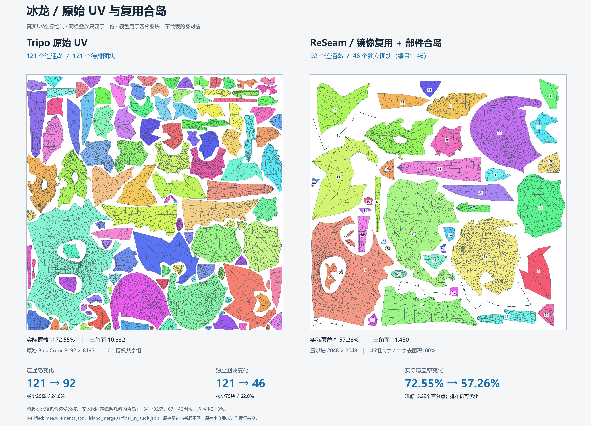
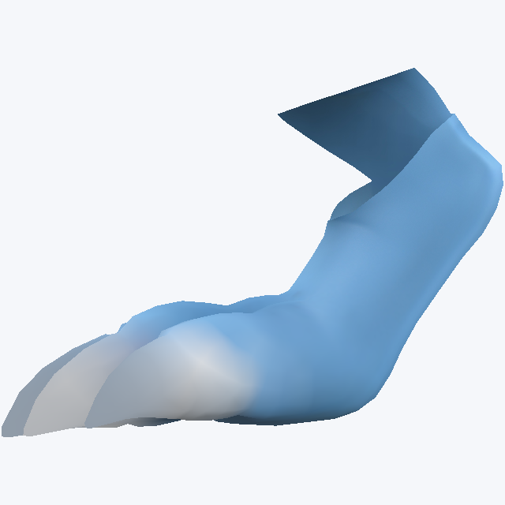
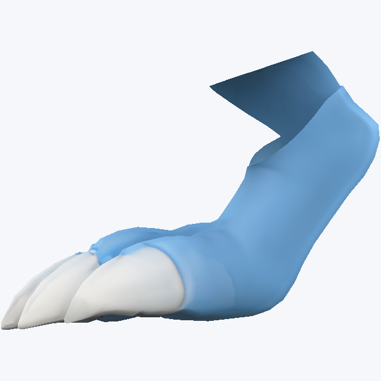
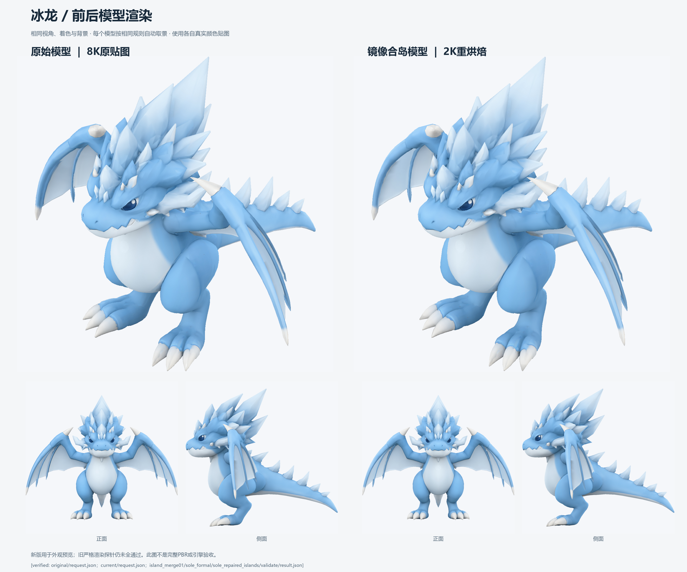
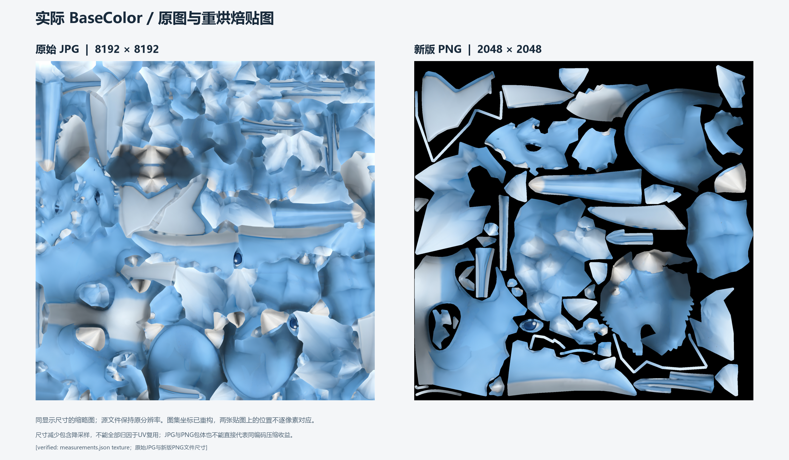

# 最后一轮龙模型 UV 复用与真实合岛：完整过程复盘

## 最新状态（2026-11-04）

最新预览已推进到[中线薄条修复版](dragon-midplane-cleanup.md)：80个连通UV岛、40个独立图块，覆盖率65.08%，12个已定位的中线细条岛消失。[最新GLB](../assets/dragon-midplane-cleanup/dragon.glb)、[真实BaseColor](../assets/dragon-midplane-cleanup/texture/BaseColor_mip0.png)与[修复前后图](../assets/dragon-midplane-cleanup/uv_before_after.png)均已交付；颜色/接缝通过、严格渲染拒绝，继续作为外观预览。`[verified: dragon-midplane-cleanup/independent_audit.json；summary.json quality/coverage]`

|已完成环节|岛／独立图块|覆盖率|比较范围|
|---|---|---|---|
|原始Tripo|121／121|72.55%|原始几何与UV参考。`[verified: dragon-uv-final/measurements.json original]`|
|ABF++合岛与脚底切口修正|92／46|57.26%|同一镜像几何内真正合岛；下文历史复盘。`[verified: dragon-uv-final/experiment-summary.json cases[2]]`|
|固定岛形状多起点排布|92／46|59.93%|保持几何与岛形状，收紧间距并重排。`[verified: dragon-packing-search/summary.json cases[2]]`|
|中线裁切薄条修复|80／40|65.08%|新镜像几何变体；不能归因为固定几何UV收益。`[verified: dragon-midplane-cleanup/summary.json audit/variant/coverage]`|

最近两轮补齐的经验是：相同图块的排布搜索只得到有限收益；孤立细线需要追溯到来源面与实际裁切平面。此次在授权新变体中修正平面、继承主侧已合并UV、再排布和重烘焙，未将已有好图块拆碎。完整经过见[排布实验](dragon-packing-search.md)与[薄条修复](dragon-midplane-cleanup.md)。`[verified: 对应报告及midplane-cleanup/independent_audit.json source_uv_barycentric_error]`

## 历史交付复盘：92岛版本

本文整理已经交付的“镜像变体 → 整半复用 → 部件合岛 → 脚底切口修正 → 排布与真实贴图 → 对照图和仓库交付”过程，复盘对象为提交 `067a51b9efece1885b85edc3e090c62abf259e05` 中的龙模型交付包。本次整理不重新运行求解，也不把计划中的全部工具或实验写成这轮实际使用的步骤。`[verified: Git 提交标题 Implement MeshQuery UV tools and publish dragon reuse results；交付包 experiment-summary.json calls]`

**该历史交付实际做成的是：先生成一份完全镜像的新龙，让左右使用相同 UV；再把头冠和脚部内部的碎片重新展开成整块，并修正脚底切口。得到 92 个连通 UV 岛、46 个独立排布图块和一套 2048 BaseColor。下文“最终/当前”均指该历史交付的状态，最新80岛版本见开头。** `[verified: 下列证据 E1 cases、E3、E4；最新状态对应summary.json]`

## 证据入口与阅读口径

下文 E 编号是本文件内的证据索引；JSON 字段可直接打开核对。交付包内文件随仓库保存，`artifacts/` 下的完整运行请求及中间快照属于本地历史证据，不能假定新克隆已包含它们。`[verified: 交付包 README「历史运行目录、缓存和全部中间快照」；manifest.json files]`

|编号|证据|主要用途|
|---|---|---|
|E1|[实验汇总](../assets/dragon-uv-final/experiment-summary.json)|`cases`、`calls`、`tool_cost_seconds`、最终选择范围。`[verified: 对应 JSON 字段]`|
|E2|[原始与当前测量](../assets/dragon-uv-final/measurements.json)|原始/最终快照、面数、岛数、共享组及覆盖率。`[verified: original/current 条目]`|
|E3|[合岛不变量核验](../assets/dragon-uv-final/uv-audit.json)|几何是否改变、旧岛是否拆碎、镜像 UV 差、原边连通分量。`[verified: 对应 JSON 字段]`|
|E4|[最终质量结果](../assets/dragon-uv-final/quality-result.json)|实际验收范围、宽松几何配置、渲染拒绝。`[verified: scope、geometry_profile、render_valid]`|
|E5|[独立重导入结果](../assets/dragon-uv-final/reimport.json)|三份 GLB 的几何、UV、嵌入纹理回读。`[verified: exports、all_passed]`|
|E6|[对照图核验](../assets/dragon-uv-final/verification.json)|原 UV 保留、变化比例、图像尺寸、相机比较口径。`[verified: 对应 JSON 字段]`|
|E7|[镜像与排布原报告](dragon-whole-half-reuse.md)|裁切镜像、共享/无共享、矩形/轮廓排布及缩图失败。`[verified: 报告各对照表]`|
|E8|[真实合岛原报告](dragon-uv-island-merge.md)|头冠、脚部、切口修正与同轮质量比较。`[verified:「从碎片到连贯部件」「切口修正的实际效果」]`|
|E9|[交付文件清单](../assets/dragon-uv-final/manifest.json)|来源、文件字节数和 SHA-256。`[verified: files 条目]`|

## 结果先看：三种变化不能混算

|比较范围|连通 UV 岛|独立图块|能说明什么|
|---|---|---|---|
|原始 Tripo → 最终预览|121 → 92，减少 29，约 23.97%|121 → 46，减少 75，约 61.98%|包含几何镜像改造、重新展开与排布，是跨版本交付比较。`[verified: E2；E6 island_reduction_percent/independent_tile_reduction_percent]`|
|同一镜像几何：未共享 → 整半共享|134 → 134|134 → 67|左右图块真正堆叠，但网格两侧没有因堆叠而连成一个岛。`[verified: E7「已验证的几何共享」]`|
|已经整半共享：旧接缝 → 最终合岛|134 → 92，减少 42，约 31.34%|67 → 46，减少 21，约 31.34%|固定镜像几何之后，额外删除多余接缝与重展开的收益。`[verified: E1 cases；E3 vertices_unchanged/faces_unchanged]`|

**连通岛**按网格身份与 UV 连续性计数；**独立图块**表示堆叠之后需要在图集中单独安排的位置。两个脚各是一张连续 UV，叠在同一位置后仍是两个连通岛，却只占一个独立图块。本轮采用这一统计口径。`[verified: E7 共享/未共享表；E8「下限、验收与复现边界」]`

最终 46 组中每组包含左右成员，共有 92 个连通岛，全部 11,450 面参与共享；“共享表面积 100%”指两侧表面都参与，不代表贴图省掉 100%。对于这份精确镜像资产，成对堆叠把相同布局下需要独立摆放的图块数减半；纹理尺寸是否也能降低，还要另做质量比较。`[verified: E1 cases.shared_surface；E3 shared_groups/shared_faces；opinion: 存储解释]`



## 从原始资产到完全镜像的新父模型

原始 `tripo_p2` 的统计是 10,832 个三角面、121 个 UV 岛，原始 BaseColor 为 8192 纹理。用于展示原始版本的快照恢复了可追溯的原始邻接身份，其逐面角 UV 与导入时一致，没有先将全模型拆成独立三角面。`[verified: E2 original；E6 original_corner_uv_unchanged_from_import；E7「独立只读复算」]`

用户随后允许“保留一半、镜像另一半”，因此最后成功的大面积复用走了一个新几何变体。它与“保持原模型所有左右差异、再求近似对应”的路线分开：原始输入保留，新模型采用正 X 半侧，在 X=0 裁切，再复制镜像。`[verified: E7 开头的裁切说明与 original_asset 修改记录；用户镜像授权]`

实际操作由 `asset.mirror_variant` 完成，记录如下：`[verified: E7「来源 10832 面→新变体 11450 面」；skills/reseam-uv/SKILL.md「用户授权的镜像几何变体」]`

1. 保留正 X 一侧，跨越中线的面在新变体中裁切、重新组织；来源模型不覆盖。`[verified: E7 裁切说明与 variant 记录]`
2. 保留侧生成 5,725 面，再镜像生成另外 5,725 面，总计 11,450 面。`[verified: E7 variant 面数]`
3. 新面角通过原始面 ID 和重心坐标追溯来源，来源记录保存在 `source_correspondence.npz`。`[verified: E7「逐面角来源对应」]`
4. 镜像面采用 `[0,2,1]` 面角顺序；镜像 UV 随对应角复制，避免将反射后的面角顺序当作未反射顺序。`[verified: E7 mirrored_corner_permutation；opinion: 顺序用途解释]`
5. 中线不按位置自动焊接，两侧保留独立身份；不能据此宣称已完成水密性或动画生产验收。`[verified: E7 midplane_geometry；opinion: 验收边界]`

直观理解：此时另一半是由主半边精确生成的，所以对应关系已知，不需要再靠“70% 相似”判断每个部件能否复制 UV。“70%”仍是此前候选探索的取舍，不是这次 100% 共享面积的计算来源。`[opinion]`

## 整半共享和紧凑排布：先解决重复占位

新镜像模型一开始有 134 个 UV 岛。保留原切缝时，左右各 67 岛：不共享要摆 134 个图块，共享后只摆 67 个主图块，另一侧使用完全相同的位置。此时岛数没有降低，复用已经发生。`[verified: E7「已验证的几何共享」]`

排布使用 `uv.pack backend=blender_concave`。每个共享组只将主图块送入排布，再将相同的旋转、缩放和平移回放到其余成员，保持堆叠关系。原矩形排布作为对照保留。`[verified: skills/reseam-uv/SKILL.md「紧凑排布与缩图」；E7 正式矩阵]`

早期 2048 同轮共享比较中，矩形排布实际覆盖率为 27.98%，轮廓排布为 57.95%；两者都通过当轮声明范围的 BaseColor 检查。最后合岛轮次开启了统一纹素密度，因此重新跑出的旧接缝基线是 59.13%；这两个基线不能混作同一次实验。`[verified: E7 正式矩阵 shared_rectangles/shared_blender_concave；E8「对照结果」；E1 retained_islands.coverage]`

早期也试过缩图：1024 可作为有限视角的外观预览，但数值渲染拒绝；512 近景外观不推荐；1536 被 `BASECOLOR_REUSE_REQUIRES_POWER_OF_TWO_RESOLUTION` 拒绝，只有排布产物不能算烘焙完成。最后合岛交付选择了 2048。`[verified: E7 选定产物、正式矩阵及 1536 拒绝记录；E1 最终 cases]`

## 真正合岛：找的是同一表面上的多余切缝

下一步不再全局找左右相似，而是检查**主半边内部，哪些本来相连的表面被旧 UV 切碎了**。按原边邻接，主半边有 46 块连通表面，却分成 67 个 UV 岛。多出的碎片集中在两个区域，其余 44 块已经各自是一岛。`[verified: E8「从碎片到连贯部件」；E3 original_edge_component_count]`

|区域|主侧面数|主侧原岛数|主侧新岛数|整龙岛数变化|
|---|---|---|---|---|
|头冠/角刺簇，历史 component36|363|16|1|134 → 104，左右各减少 15。`[verified: E8 步骤1、2；island_merge01/merge_results.json regions[0]]`|
|脚部及脚爪连接区域，历史 component18|1198|7|1|104 → 92，左右各减少 6。`[verified: E8 步骤1、3；island_merge01/merge_results.json regions[1]]`|

实际执行链是：**解除选定组共享 → 删除主侧内部旧切分并重展开 → 检查精确镜像对应 → 将主侧新 UV 复制到对侧 → 恢复共享**。只处理这些完整自然区域，未将未选区域逐面拆碎。`[verified: E1 calls 中 unshare/reparameterize/check/apply；E3 old_charts_split=[]]`

这轮真正合岛采用 `uv.reparameterize backend=blender_abf`，即 Blender ABF++。两处先试的 `blender_lscm` 都被几何检查拒绝，报告中的原因是方向不一致；之后 ABF++ 成功。复制采用 `reuse.check_pair mode=exact`，结果方法为 `exact_reflection_copy`，随后 `reuse.apply` 写新快照。**这里不是 OptCuts 完成了最终合岛，也没有调用近似 `paired_domain` 来迁移这两个区域。** `[verified: island_merge01/merge_results.json 两个 regions.attempts；E8 步骤2、3；sole_check/request.json mode]`

这说明最后成功的关键变化是问题条件：允许先做精确镜像，之后只需把主侧做好，再精确复制。它不证明在原始不完全对称几何上也已经实现相同的整龙结果。`[opinion]`

## 为什么合成一岛之后还要补脚底切口

直接把脚部 7 岛变成 1 岛后，工具可以生成 UV 和贴图，颜色与接缝数值检查也通过，但实际脚部图里白爪边界模糊，渲染检查拒绝。Agent 没有因岛数已经降到 92 就停止，而是保留失败结果、回到脚部修改前的父状态。`[verified: E1 merged_islands；E8「从碎片到连贯部件」步骤3、4；opinion: 看图判断]`

修正保留头冠合岛结果，对整脚重新设计可展开的开口：从后踝经过脚底走向脚趾，并设置通向其它脚趾的分支。实际调用三次 `seam.select geodesic`，合并得到 52 条原网格边，然后以这些边作为显式 `seam_edges`，重新 ABF++ 展开、精确复制、排布和烘焙。`[verified: E8 步骤4；island_merge01/sole_cut_plan.json waypoints；sole_reparameterize_request.json seam_edges/backend]`

**切一条口子不一定把一块表面分成两块。** 这次脚底切口为展开提供开口，但剩余面仍保持连通，因此单脚仍然只有 1 个岛。最终仍为 92 岛/46 图块，修正的是 UV 在脚爪附近的展开方式。`[verified: E8「脚底开口后仍是单岛」；opinion: 切口解释]`

|旧接缝对照|直接合岛，外观拒绝|补切口，最终预览|
|---|---|---|
||||

上图是历史同镜头脚部证据；白爪改善属于 Agent 外观判断，不能替代独立数值结果。`[verified: E8「切口修正的实际效果」；opinion: 外观评价边界]`

## 真实颜色如何转移到新 UV

最后三条合岛路径都使用同一镜像父几何和镜像来源颜色。`material.target policy=source_original` 先冻结来源目标，再由 `material.bake mode=basecolor_reuse` 根据新 UV 生成真实 BaseColor 和 mip；修改 UV 后不沿用旧候选贴图，也不由候选图反向定义目标。这里的 source 指镜像变体的源颜色，不意味着恢复原龙两侧各自不同的细节。`[verified: island_merge01/formal_config.json、sole_formal_config.json 的 target/bake 请求；E7 镜像来源说明]`

|设置|最后合岛比较的实际值|
|---|---|
|几何|同一个 11,450 面镜像父资产。`[verified: E3 face_count/vertices_unchanged/faces_unchanged]`|
|排布|`blender_concave`，`density_normalize=true`。`[verified: formal_config.json actions.pack.request]`|
|分辨率|2048×2048。`[verified: formal_config.json actions.bake.request.resolution；E5 embedded_texture_dimensions]`|
|图块间距/边界/烘焙填充|请求为 16 px / 8 px / 8 px；实际测量与请求参数应区分。`[verified: formal_config.json profile、bake.request.padding_pixels；opinion: 指标解释]`|
|颜色目标|同一 `source_original` 镜像来源信号。`[verified: formal_config.json actions.target.request.policy]`|
|验收|`basecolor_reuse`，LOD 0/1/2，渲染探针 `render_size=96`。`[verified: E4 scope；sole_formal_config.json validate.request]`|
|几何取舍|`quality_constraints=false`，显式绑定 `preserve_source_uv`，严格几何配置未启用。`[verified: E4 geometry_profile、strict_geometry_profile_applied]`|
|导出|保留 `mode=diagnostic` 的真实模型与贴图。`[verified: formal_config.json actions.export.request.mode]`|

完整 mip 文件写出，与“所有 mip 都被验收”是两件事；此次验收声明限于 LOD 0、1、2。宽松来源保留配置也不等于严格全局无交叠。`[verified: E4；E9 texture 文件；opinion: 验收范围解释]`

## 同轮对照：减少碎片有收益，严格质量仍有缺口

|路径|岛/图块|覆盖率|最差视图平均误差|最大渲染误差|质量结论|
|---|---|---|---|---|---|
|保留旧接缝，已左右复用|134/67|59.13%|0.006160|0.178086|声明范围通过。`[verified: E1 cases[0]]`|
|直接合岛，未补脚底切口|92/46|56.10%|0.036666|1.007841|颜色/接缝通过，渲染拒绝。`[verified: E1 cases[1]]`|
|合岛并修正脚底切口|92/46|57.26%|0.008121|0.468383|颜色/接缝通过，渲染仍拒绝；选作外观预览。`[verified: E1 cases[2]、selection_scope]`|

因此，最后保留了两个不同用途的结果：134 岛版本作为已通过声明协议的对照；92 岛版本作为更少碎片、经 Agent 看图接受的预览。不能把预览被选中写成所有质量门禁都通过。`[verified: E1 quality_accepted/selection_scope；E8 开头交付说明]`

本轮所有路径均为 2048 RGBA8，完整 mip 载荷都是 **22,369,620 字节**；运行时纹理载荷没有因合岛进一步减少。完整 mip PNG 文件总量为 4,547,245 → 4,299,538 字节，约减少 5.45%，属于文件编码后的变化，不能当作同质量 UV 共享收益。`[verified: E1 cases.payload_bytes/png_mip_bytes；opinion: 收益归因边界]`

原始 8192 到最终 2048 的边长缩为四分之一，像素数缩为十六分之一；但两者几何、来源目标、编码与质量条件不同，所以不能直接宣称“UV 优化同质量节省 93.75%”。原始与最终实际覆盖率也从 72.55% 变成 57.26%，岛更少并没有让最终图集覆盖率超过原始图集。`[verified: E2 coverage；E7 原8192来源；E5 最终尺寸；opinion: 比较边界]`

## 怎么确认不是只改了颜色标签或统计口径

固定镜像几何的最终核验给出了以下实际不变量：`[verified: E3]`

|核验项|记录|
|---|---|
|顶点坐标与三角面数组|`vertices_unchanged=true`、`faces_unchanged=true`。`[verified: E3]`|
|是否先拆碎旧岛|`old_charts_split=[]`，没有旧岛被分到多个新岛。`[verified: E3]`|
|实际 UV 顶点|使用到的 UV 顶点 7642 → 7326。`[verified: E3 old_used_uv_vertices/new_used_uv_vertices]`|
|镜像对应角是否真的同 UV|`mirror_uv_max_error=0.0`。`[verified: E3]`|
|共享是否覆盖整龙|46 组、11,450 面，无重复组成员。`[verified: E3 shared_groups/shared_faces/no_duplicate_membership]`|
|原边连通分量|92 个，最终 92 岛。`[verified: E3 original_edge_component_count/new_charts]`|

在保持这份网格原边连接、不将不相邻部件人为连接的条件下，每个表面分量已经只有一个岛，92 是这个定义下的下限。改变几何连接方式之后的下限不在这次结论范围内；将左右 UV 叠起来本身也不会建立网格邻接。`[verified: E3；opinion: 有条件下限推论]`

三条路径的 GLB 都曾独立重新解析。最终版本位置误差为 0，面角 UV 最大误差约 `4.46e-8`，嵌入贴图像素一致；这些核验覆盖导出正确性，不等于 GPU 渲染或人工艺术通过。`[verified: E5 exports[2]、verification_scope、gpu_verified/human_accepted]`

## LLM/Agent 与几何工具各自做了什么

|角色|本轮实际工作|
|---|---|
|用户|允许新建完全镜像模型，接受细小颜色差异，并要求实际合岛与前后对照。`[verified: 本次对话的镜像授权、颜色取舍与对照要求]`|
|Agent|结合部件图与统计决定处理头冠、脚部；读取 LSCM 失败，切换 ABF++；发现脚爪问题，调整脚底切口；选择保留哪些对照与预览。`[verified: E8 步骤1–4；E1 calls、selection_scope；opinion: 外观判断]`|
|确定性工具|裁切镜像、维护面角来源、选原边路径、参数化、精确复制、组排布、真实颜色烘焙、验收与导出。`[verified: E7；E1 calls]`|
|数值核验|记录岛/图块/覆盖率、质量拒绝、UV 一致性和导出回读，不用同色显示替代实际 UV。`[verified: E1–E6]`|

这条实际路线没有要求训练专门的 UV 网络。Skill 中的 LLM 就是调用工具的当前 Agent；此次合岛调用清单没有神经网络训练步骤。它也不是对参考文章作者真实内部流程的证明。`[verified: skills/reseam-uv/SKILL.md 开头；E1 calls；opinion: 对外归因边界]`

合岛运行记录了 43 次工具调用，合计约 1030.919 秒，包含失败、基线、修正与额外视图；不包括 Agent 思考和只读分析。token 与费用为未知值。事后选择理由标记为 post-hoc，不冒充预注册实验；这轮合岛没有修改生产工具源码。`[verified: E1 calls/tool_cost_seconds/token_cost/fees/source_code_changed；E8 最后一段]`

## 对照图、模型和仓库交付怎么形成

最终图像不是重新生成一张“看起来像 UV”的示意图，而是使用真实 UV 与真实贴图的对照产物。原始/当前模型分别调用 `view.render`，各取三个匹配相机方向，采用相同自动取景策略；自动取景一致不等于两个不同几何版本具有完全相同的屏幕投影。`[verified: E6 render_calls；opinion: 比较解释]`

|产物|内容|
|---|---|
|[UV 对照 PNG](../assets/dragon-uv-final/uv_before_after.png)、[PDF](../assets/dragon-uv-final/uv_before_after.pdf)|彩色图块、原始/最终计数和覆盖率；PNG 为 3240×2340。`[verified: E6 files；E9 files]`|
|[模型对照图](../assets/dragon-uv-final/model_before_after.png)|真实颜色的三个匹配方向，2880×2400。`[verified: E6 files/render_calls]`|
|[贴图对照图](../assets/dragon-uv-final/texture_before_after.png)|原始与实际最终 BaseColor，2880×1680。`[verified: E6 files；交付包 README]`|
|[完整龙 GLB](../assets/dragon-uv-final/dragon.glb)|最终 92 岛预览模型，3,687,732 字节。`[verified: E9 dragon.glb 条目]`|
|[BaseColor](../assets/dragon-uv-final/texture/BaseColor_mip0.png)|2048 主层及目录中的完整 mip 链。`[verified: E5 embedded_texture_dimensions；E9 texture 条目]`|





上次交付将需要随克隆分发的文件复制到 `docs/assets/dragon-uv-final/`，通过 manifest 记录相对文件名、历史来源、字节数和 SHA-256；完整中间运行目录仍留在被忽略的 `artifacts/`。归档 JSON 内的旧绝对路径保留为原始记录，读者应通过 manifest 找到已发布文件，不能直接假定历史绝对路径可用。`[verified: E9 file/source/bytes/sha256；交付包 README]`

历史交付提交为 [067a51b9](https://github.com/hamsterjiang23/ReSeam/commit/067a51b9efece1885b85edc3e090c62abf259e05)。本文是后补复盘，不属于该历史提交中的原始实验配置。`[verified: 本地 git log -1 的 SHA/标题；opinion: 文档版本范围]`

## 如何复查与继续使用

只查看成果时，打开上面的交付包即可；复跑完整实验需要原资产、Blender 后端，以及保存在本地的完整请求和父快照。发布 GLB 与统计摘要足以检查交付结果，但不是完整求解状态的替代品。`[verified: 交付包 README；E8 最后一段；opinion: 复跑边界]`

工具参数以 CLI 为准，以下是查询和执行形式，`request.json` 必须准备真实父状态和本机文件路径，`output` 必须使用新目录。这不是可直接粘贴就复现整龙的自包含脚本。`[verified: skills/reseam-uv/SKILL.md 开头执行合同]`

```powershell
uv run reseam tools describe asset.mirror_variant
uv run reseam tools describe uv.reparameterize
uv run reseam tools describe reuse.check_pair
uv run reseam tools describe seam.select
uv run reseam tools describe uv.pack
uv run reseam tools describe material.bake
uv run reseam tools run <工具名> --request request.json --output <新目录>
```

本地历史证据入口如下；仅用于已有完整工作目录的复跑与追溯，不承诺随普通克隆提供。`[verified: E8 最后一段；E9 source]`

- `artifacts/meshquery_v1/whole_half01/create/`：镜像新父几何、来源面角对应。`[verified: E7 变体链接]`
- `artifacts/meshquery_v1/island_merge01/merge_results.json`：头冠、脚部两轮展开失败/成功及父子快照。`[verified: regions.attempts]`
- `artifacts/meshquery_v1/island_merge01/sole_reparameterize_request.json`：1198 面整脚、52 条原边切口及 ABF++ 请求。`[verified: faces/seam_edges/backend]`
- `artifacts/meshquery_v1/island_merge01/formal_config.json`、`sole_formal_config.json`：基线、直接合岛、切口修正的实际配置。`[verified: cases/actions]`
- `artifacts/meshquery_v1/uv_comparison01/`：原始/最终测量、视图与绘图归档。`[verified: E9 source 字段]`

若下一步以可交付质量为优先，应保留 134 岛已通过对照，继续定位 92 岛版本的渲染超限区域，优先整体修正切口与纹素分配。若仍要降低 92 这个连通岛计数，需要明确是否修改原边连接和拓扑；单纯再堆叠不会改变该计数。这些是后续建议，不是本轮已经完成的结果。`[opinion]`
