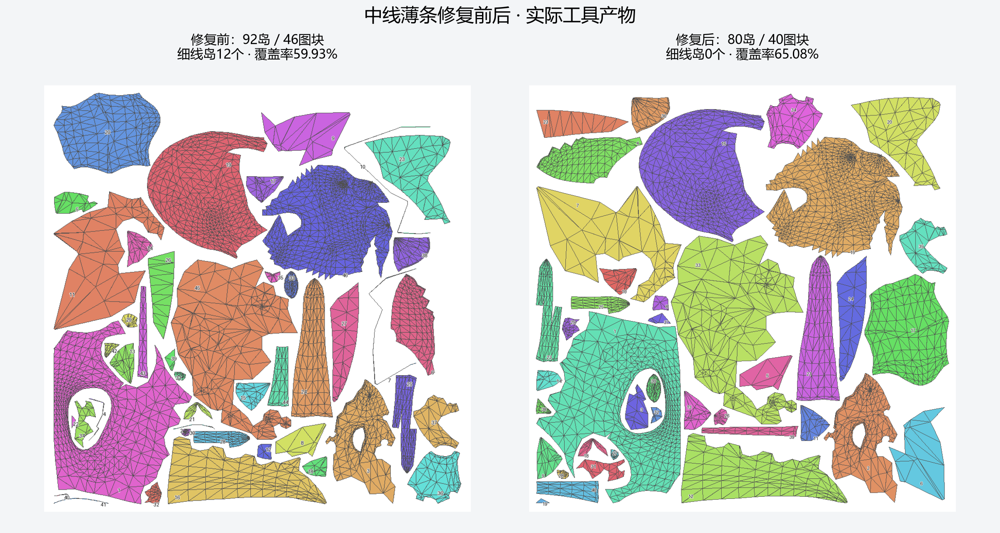
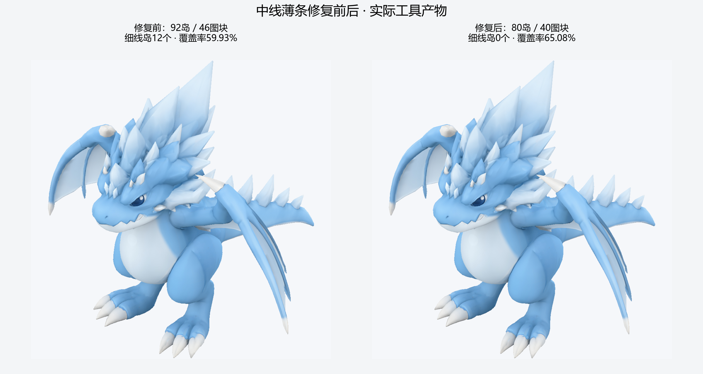

# 龙模型中线薄条修复

用户指出UV图中的孤立细线后，本轮定位到镜像裁切留下的6对极窄中线图块。调整新变体的裁切平面后，这12个细条岛消失，连通岛92→80、独立图块46→40；重新排布后的覆盖率59.93%→65.08%，仍保持整龙左右共享。此修复改变了独立镜像变体的几何，不归因为固定几何UV算法收益。`[verified: 交付包 independent_audit.json；mirror_variant.json；summary.json coverage]`

[修正版GLB](../assets/dragon-midplane-cleanup/dragon.glb) · [真实2048 BaseColor](../assets/dragon-midplane-cleanup/texture/BaseColor_mip0.png) · [全部数据](../assets/dragon-midplane-cleanup/summary.json) · [来源与文件哈希](../assets/dragon-midplane-cleanup/manifest.json)。新旧模型和历史输入均保留。`[verified: 对应交付文件；mirror_variant.json original_asset_modified=false]`

## 问题来源与实际处理

旧UV图给每个真实三角面填色、描边。中线条带中的三角形在2048贴图上的短高度中位数约0.43–0.56px，缩成展示图后几乎只能看到边线。它们不是绘图程序生成的虚线，也不是BaseColor中凭空画出的纹理。`[verified: views.py L410–412；independent_audit.json old_thin_charts]`

旧模型中这6对条带的正半侧都位于X=0到约0.00024417之间；以0作为裁切面会保留这段极窄表面并镜像。预检比较0、0.00024416、0.00025、0.0005四个平面：过于贴近顶点带的0.00024416产生退化面拒绝，0.00025和0.0005均无原来的细条；本例采用修改量较小的0.00025。数值仅适用于本资产，不能作为其他模型的默认对称平面。`[verified: 本轮PLANE预检输出；protocol.json plane_offset/reason；opinion: 选择理由]`

在上一轮最好排布快照上调用 `asset.mirror_variant`，显式 `offset=0.00025`、`keep_positive=true`。沿新平面裁切并反射，原有主侧UV通过来源面重心坐标插值继承，保留已完成的头冠/脚部连贯展开；没有将原有好图块重新拆碎，也没有只在UV展示中隐藏线条。`[verified: create_request.json；mirror_variant.json；independent_audit.json source_uv_barycentric_error=0]`

旧的336个薄条面不再进入新变体；其它跨平面的表面会重新裁切，因此最终总面数是11450→11338，不能将净减少112面与旧薄条面数336混淆。新旧表面积约1.496528→1.494195，约减少0.156%；几何对应和纹理来源按新变体重新记录。`[verified: independent_audit.json old_thin_face_count/all_old_thin_faces_removed_by_plane_clip/new_faces/old_area/new_area；mirror_variant.json clipped_source_faces/split_source_faces]`

## 修复后的UV与外观

|指标|修复前|修复后|
|---|---|---|
|连通岛|92|80 `[verified: independent_audit.json；上轮summary.json]`|
|独立图块／共享组|46|40 `[verified: mirror_variant.json shared_groups；summary.json]`|
|整岛薄条数量|12|0，按整岛三角形短高度中位数<1px定位 `[verified: independent_audit.json]`|
|实际UV面积并集覆盖率|59.93%|65.08% `[verified: summary.json coverage；上轮summary.json cases[2]]`|
|左右对应角UV差|0|0 `[verified: independent_audit.json mirror_uv_max_error]`|
|纹理尺寸|2048|2048，RGBA8完整mip仍22,369,620字节 `[verified: summary.json payload_bytes；validation.json]`|

修正后比较3个排布起点：种子0覆盖率63.34%、17为64.92%、29为65.08%，均保持80岛、40图块，选择29生成真实贴图与模型。统一gap8px、border8px，实际最小间距约10.32px，密度比例沿用主侧继承布局。`[verified: search.json；summary.json minimum_gap_pixels；seed29/pack请求]`

Agent查看了实际UV对照、斜视前后图与修正版底视，没有观察到明显的轮廓或爪子颜色破坏，接受为当前预览。颜色和接缝数值检查通过，严格渲染仍拒绝：最大误差0.526156→0.402645，最差视图平均误差0.008103→0.007780。此结论只覆盖声明的BaseColor与LOD0/1/2，不升级为完整PBR、GPU或人工艺术通过。`[verified: validation.json render/material/seams；上轮gap8_seed0 validation.json；opinion: Agent有限视角判断]`

## 避免重复出现

镜像工具新增 `midplane_strip_candidates` 和 `midplane_review_required`：按原模型尺度标出紧贴裁切平面的完整图块，提示核对真实中线及UV。诊断候选不会被自动删除，因为真实的薄鳍、翼膜也可能靠近中线。`offset=0`只是默认坐标，不代表已估计真实对称平面。`[verified: symmetry_variant.py build_symmetry_variant 新诊断；mirror_asset.py 返回值；opinion: 使用边界]`

两个检查不能混为一谈：工具的候选条件为整岛到平面的最大距离除以 `source.mesh.scale` 小于 `1e-3`；本例独立复核的“细线岛”条件为整岛三角形短高度中位数在2048下小于1px。前者用于发现可疑几何，后者描述这个案例的UV像素厚度；都不单独授权删除真实表面。`[verified: symmetry_variant.py band/depth判定；independent_audit.json old_thin_charts；opinion: 使用边界]`

复用流程固定以下分支：`[opinion]`

1. 从 `view.render` 的 `views.json → uv_label_mapping` 将展示编号映射到实际面；确认是填色难以显示的真实薄面，还是普通网格线。`[verified: views.py uv_mapping/uv_label_mapping；opinion: 定位顺序]`
2. 同时检查UV、三维表面与来源面角：几何正常而UV过窄时修正展开；裁切产生极窄几何时，在已有授权的新变体中调整平面；真实薄鳍/翼膜则保留并记录判断。`[opinion]`
3. 变体会重建面ID与资产身份，使用新输出重新选区、排布、冻结目标和烘焙。旧编号、提案和验收不能直接沿用；本例通过来源重心坐标继承已有好UV，减少重复重展开。`[verified: mirror_asset.py 新root及来源对应；opinion: 状态规则]`
4. 比较同镜头轮廓、保护颜色、独立薄条统计及实际mip，并保存完整来源链与拒绝结果。没有可疑几何提示不等于外观或所有质量项通过。`[opinion]`

本例回归检查验证了“默认平面产生候选、校正平面不再保留该薄条”，同时确认输入顶点未被修改；完整套件此前776项通过。此处记录既有检查结果，本次文档更新不另跑求解。`[verified: test_agent_tools_symmetry_variant.py test_near_plane_strip_is_reported_and_corrected_plane_removes_it；上一轮pytest 776 passed输出]`

Skill已增加对应检查：看到细线岛先查来源与中线，允许的新变体中调整几何后重烘焙；不能靠隐藏UV描边或修改接受阈值声称修复。本轮诊断为空且独立像素厚度检查无旧问题，不表示所有未来资产都可省略观察。`[verified: reseam-uv references/symmetry-reuse-and-merge.md 中线检查段；independent_audit.json；opinion: 后续规则]`

## 核验与追溯

新面位置与父面重心重建的最大误差约2.96e-8，来自GLB用float32表示坐标；UV重心重建误差0。最终GLB重新解析后位置误差0、面角UV误差小于1e-6、嵌入贴图与实际PNG像素一致。来源记录保留两层：本轮NPZ指向11450面父变体，upstream NPZ继续指向原始Tripo面集合。`[verified: independent_audit.json；summary.json reimport；两个source_correspondence.npz]`

工具调用约321.264秒，包含新变体、3次排布及真实烘焙/检查/导出/视图；不含小型预检、代码测试和报告制作，token与费用未知。完整本地请求与快照位于 `artifacts/meshquery_v1/midplane_cleanup01/`，可携带产物在本报告链接的交付目录；未将全部历史父快照打包。`[verified: summary.json calls/tool_seconds；manifest.json；opinion: 成本口径]`
