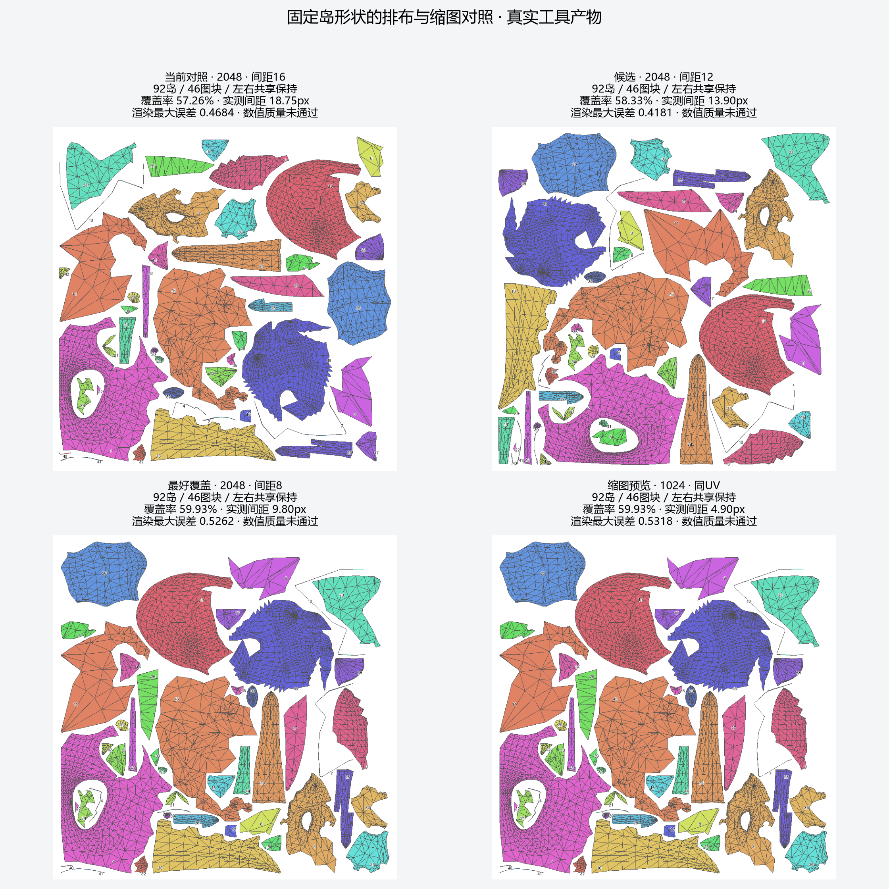
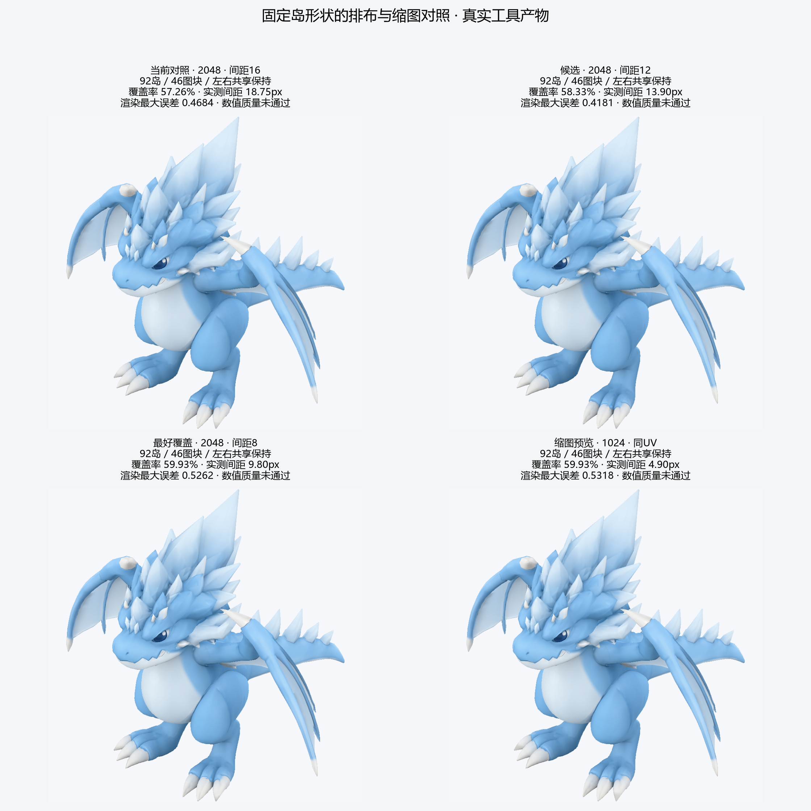

# 龙模型：固定岛形状的多起点排布与缩图对照

后续进展：[中线薄条修复](dragon-midplane-cleanup.md)在独立几何变体中将92岛／46图块推进到80岛／40图块，覆盖率65.08%。本报告保留固定形状排布轮次的59.93%结果，不能把后续改几何收益混入本轮。`[verified: dragon-midplane-cleanup/summary.json audit/coverage；本报告protocol.json]`

本轮在当前镜像龙的92岛／46图块状态上，执行3种间距×3个初始化种子的9次独立排布，最好覆盖率从57.26%提高到59.93%，增加2.67个百分点。几何、岛内部形状、相对纹素分配及左右共享关系保持不变；实际收益有限，没有得到同质量1024缩图结果。`[verified: 交付包 summary.json search/cases；independent_audit.json]`

[交付目录](../assets/dragon-packing-search/README.md) · [逐项数据](../assets/dragon-packing-search/summary.json) · [冻结配置](../assets/dragon-packing-search/protocol.json) · [九个候选核验](../assets/dragon-packing-search/independent_audit.json)。原来的134岛已通过对照仍见[合岛报告](dragon-uv-island-merge.md)，本轮的92岛父状态本身是数值拒绝的外观预览，重新执行后没有改变其身份。`[verified: summary.json cases[0].quality_accepted=false；原合岛报告「对照结果」]`

## 改动与控制条件

为 `uv.pack backend=blender_concave` 增加 `packing_seed`：0保留原初始化；非零种子可复现地改变主图块输入顺序和完整图块的初始旋转。仍由Blender凹轮廓排布，拟合并回放统一尺度的正向相似变换到全部共享成员。没有训练新模型或替换UV展开算法。`[verified: compact_packing.py compact_pack；tools describe uv.pack request.packing_seed；packing.json backend_report]`

所有搜索候选从同一不可变父快照独立生成，`density_normalize=false`，保持该父状态的岛间密度比例。2048图集、边界8px、安全量2px；只比较请求间距16/12/8px与种子0/17/29。烘焙padding固定8px，颜色目标为相同镜像来源，验收LOD0/1/2、render_size=96，阈值沿用原协议。来源保留几何策略继续绑定同一variant root，不能将通过该策略称为严格全局无交叠。`[verified: protocol.json；各pack/target/bake/validate请求；summary.json cases与对应validation.json]`

本轮先通过32项相关测试及真实Blender构造冒烟，之后冻结生产代码哈希再运行真实龙；正式运行期间没有修改所记录的生产代码。后续编写的绘图/汇总脚本仅处理结果。`[verified: 本轮 pytest 32 passed；protocol.json code_hashes；FROZEN_CODE_HASHES_PASS输出]`

## 九个排布候选全部结果

|请求间距|种子|实际覆盖率|结果|
|---|---|---|---|
|16px|0|57.07%|来源保留几何检查通过，未超过父状态。`[verified: search_results.json cases[0]]`|
|16px|17|56.22%|通过，未超过父状态。`[verified: search_results.json cases[1]]`|
|16px|29|53.63%|通过，未超过父状态。`[verified: search_results.json cases[2]]`|
|12px|0|57.77%|通过。`[verified: search_results.json cases[3]]`|
|12px|17|58.33%|该间距最好，进入真实烘焙。`[verified: search_results.json cases[4]]`|
|12px|29|58.16%|通过。`[verified: search_results.json cases[5]]`|
|8px|0|59.93%|全组最好，进入真实烘焙。`[verified: search_results.json cases[6]]`|
|8px|17|59.43%|通过。`[verified: search_results.json cases[7]]`|
|8px|29|59.25%|通过。`[verified: search_results.json cases[8]]`|

同一16px间距的三次排布均未超过原状态，说明增加起点不保证提高覆盖率。12px组相同间距下，种子17优于0；全局最好则来自间距缩小后的种子0。因此本轮主要可见收益来自允许收紧留边，不能全部归因于多起点搜索。`[verified: 上表；opinion: 有限候选下的归因解释]`

## 真实贴图、mip与渲染

|版本|覆盖率|实测最小间距|颜色／接缝／渲染|最差视图平均误差|最大渲染误差|
|---|---|---|---|---|---|
|当前92岛父状态，2048|57.26%|18.75px|通过／通过／拒绝|0.008121|0.468383 `[verified: summary.json cases[0]]`|
|12px、种子17，2048|58.33%|13.90px|通过／通过／拒绝|0.008181|0.418062 `[verified: summary.json cases[1]]`|
|8px、种子0，2048|59.93%|9.80px|通过／通过／拒绝|0.008103|0.526156 `[verified: summary.json cases[2]]`|
|相同最好UV，1024|59.93%|4.90px|拒绝／拒绝／拒绝|0.012883|0.531810 `[verified: summary.json cases[3]]`|

1024是对新增缩图意图的后续探索：固定8px候选的UV，将分辨率减半、验收gap/border同比换算为4/4px，烘焙padding保留8px；它不属于原9次排布搜索，也不是只改变单个像素参数的消融。各请求实际保存，失败不删除。`[verified: gap8_seed0_1024 的target/bake/validate请求；summary.json cases[3] minimum_gap_pixels]`

Agent检查了UV对照、2048最好候选斜视和1024底视，以及四版本同镜头图。有限视角下主体没有观察到大面积错贴，作为预览保留；不能凭这些视角覆盖颜色、接缝与渲染的数值拒绝。12px候选的最大渲染误差更低，8px候选覆盖率更高，分别提供模型供后续取舍，不覆盖已有通过对照。`[verified: 本轮实际查看的对应PNG；summary.json；opinion: Agent有限视角外观判断]`

## 究竟能缩小多少

|版本|RGBA8完整mip载荷|PNG完整mip文件总量|
|---|---|---|
|当前2048父状态|22,369,620字节|4,299,538字节 `[verified: summary.json cases[0]]`|
|12px候选2048|22,369,620字节|4,360,713字节 `[verified: summary.json cases[1]]`|
|8px候选2048|22,369,620字节|4,418,960字节 `[verified: summary.json cases[2]]`|
|同UV的1024预览|5,592,404字节|1,464,675字节 `[verified: summary.json cases[3]]`|

提高覆盖率不必然减少PNG文件大小，本轮两份2048候选PNG反而略大。2048运行时载荷未变；1024载荷约减少75%，同时质量拒绝，不能称为同质量节省。`[verified: 上表；opinion: 存储比较边界]`

假设有效纹素面积不变，仅按覆盖率换算，59.93%相对于57.26%约能减少4.45%的图集面积，等效边长2048→2001.92。2002只是连续面积估计，不是本轮已烘焙尺寸，当前颜色路径也要求二次幂。因此仅靠这轮排布，尚不足以得到保持原有效纹素数量的1024结果。`[verified: summary.json same_density_equivalent_side；本轮面积计算输出；color_reuse.py BASECOLOR_REUSE_REQUIRES_POWER_OF_TWO_RESOLUTION；opinion: 固定有效纹素面积的估算]`

## 不变量、成本与复现

独立核验9个候选的顶点、三角面、UV面角身份与共享组均保持不变；镜像角UV最大差均为0；每个岛的边长只乘统一尺度，独立计算三角形面积并集与工具覆盖率一致。所有候选保持92岛、46图块，原面集合没有拆碎。四份GLB重新解析，位置误差0、面角UV最大误差小于4.46e-8，嵌入贴图像素一致。`[verified: independent_audit.json；summary.json cases.reimport]`

33次工具调用共1155.748秒，含9次排布、基线与3个候选的target/bake/validate/export，以及展示视图；约19.26分钟，低于冻结的2400秒工具预算。测试、Agent分析、报告制作不计入该工具成本，token/费用未知。`[verified: summary.json calls/tool_seconds；protocol.json budget_seconds；opinion: 成本口径]`

完整本地请求、父子快照和编排在 `artifacts/meshquery_v1/compact_search01/`，发布文件及哈希见[manifest](../assets/dragon-packing-search/manifest.json)。发布包包含实际模型与完整mip，未包含全部历史父快照；不保证普通克隆仅靠摘要就能重跑全部历史输入。`[verified: manifest.json file/source；本轮交付复制范围]`

本轮完成固定形状的排布与间距实验；尚未改变图块形状，也未增加不同角刺组之间的共享。若继续追求明显缩图，下一步需要把少数难排图块的形状改善、进一步重复区域共享或不重要区域密度调整作为独立机制，而不是将当前约4.45%的面积余量说成已经足够降一档尺寸。`[opinion]`
