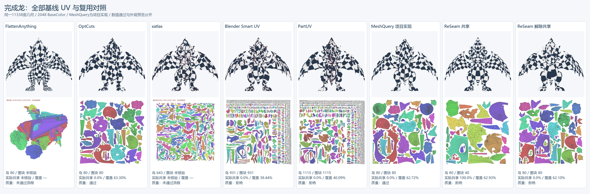
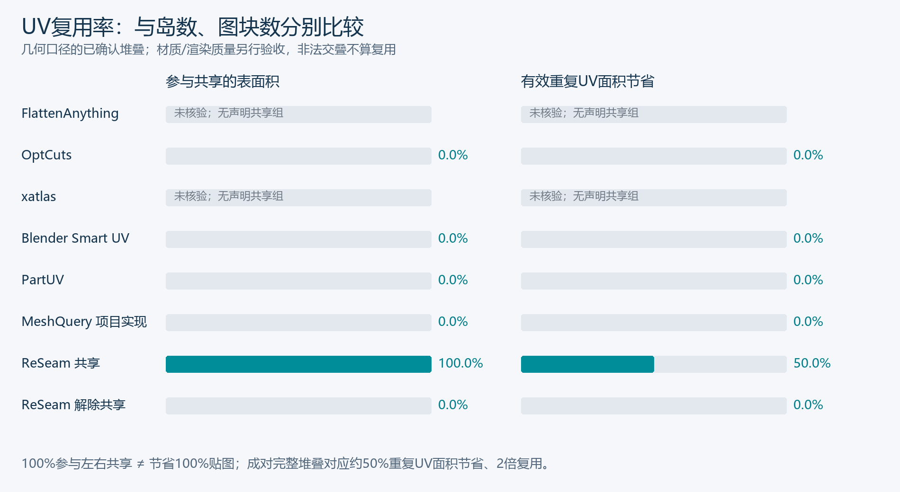
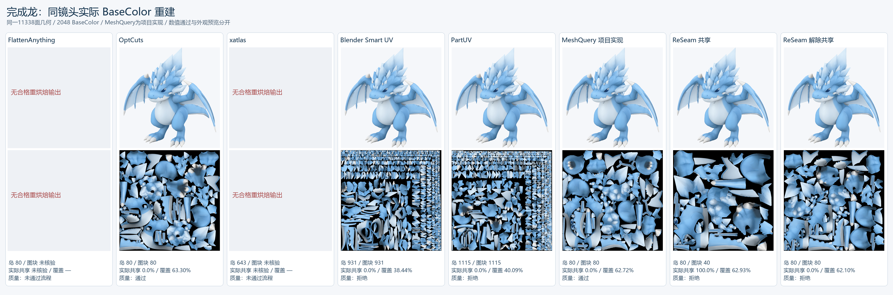

# 完成龙：MeshQuery 全基线对照

同一份已完成镜像龙的11338面几何与冻结2048 BaseColor参考；各原生算法输出从独立输入派生。`[verified: measurements.json input；各原生输入SHA256]`

上排为相同正视棋盘格，红线是实际切缝叠加；下排为UV。流程拒绝项展示完整原生坐标域并标记未完成排布，不与已排图集覆盖率混排。颜色对照图关闭切缝叠加，使用相同斜视镜头。`[verified: 各view.render请求；native-domain-full.png；clean_color_views请求]`

|方法|连通岛|独立图块|几何已确认共享表面|有效重复UV面积节省|复用倍数|覆盖率|质量|
|---|---:|---:|---:|---:|---:|---:|---|
|FlattenAnything|80|未核验|未核验|未核验|未核验|未核验|未评估/流程拒绝 `[verified: measurements.json rows.flatten_anything]`|
|OptCuts|80|80|0.00%|0.00%|1|63.30%|通过 `[verified: measurements.json rows.optcuts]`|
|xatlas|643|未核验|未核验|未核验|未核验|未核验|未评估/流程拒绝 `[verified: measurements.json rows.xatlas]`|
|Blender Smart UV|931|931|0.00%|0.00%|1|38.44%|拒绝 `[verified: measurements.json rows.blender_smart]`|
|PartUV|1115|1115|0.00%|0.00%|1|40.09%|拒绝 `[verified: measurements.json rows.partuv]`|
|MeshQuery 项目实现|80|80|0.00%|0.00%|1|62.72%|通过 `[verified: measurements.json rows.meshquery_project]`|
|ReSeam 共享|80|40|100.00%|50.00%|2|62.93%|拒绝 `[verified: measurements.json rows.reseam_shared]`|
|ReSeam 解除共享|80|80|0.00%|0.00%|1|62.10%|拒绝 `[verified: measurements.json rows.reseam_unshared]`|

共享表面比例计入共享组的两侧；整龙左右共享可为100%，对应重复UV面积节省约50%、复用倍数约2。三者均不是同质量内存节省。无有效共享组的基线声明共享率为0；若合法性失败，实测共享留空，不把自交当复用。`[verified: measurements.json共享与拒绝字段；opinion: 指标解释]`

MeshQuery未找到官方公开代码，使用现有ReSeam工具的项目实现：当前Agent观察几何，预览接缝计划，依据4个环带的拓扑拒绝反馈添加测地连接，再由Minimum Stretch展开。此路径不等同论文作者Claude/PartField/Blender5.1.2配置，也不作为作者结果。`[verified: baseline/MeshQuery/README.md；本轮meshquery计划与调用；opinion: 结果边界]`

FlattenAnything直接调用官方train_fam与模型，按公开mesh_verts测试思路在原始顶点推理UV；其点式神经映射到传统三角UV的转换并非MeshQuery作者公开实现，未发明额外切缝修补算法来伪造合法结果。原生点映射、权重、混合方向和后续拒绝均保留。`[verified: baseline/adapters/flatten_anything.py；FlattenAnything官方test_mesh.py；measurements.json native_settings]`

原生算法设置按论文附录A.4；所有方法后续统一使用本机Blender4.5.11轮廓排布、8px间距/边界、8px烘焙padding与LOD0/1/2。同论文.001间距存在明确差异。本例输入为完成的镜像三角网格，不能代表论文四边形数据集的排名或泛化。`[verified: protocol.json；各request.json；opinion: 适用范围]`

ReSeam共享与解除共享使用同一已完成布局，仅去掉共享关系后重排；历史制作成本不是0，也未计作本轮从零优化时间。源码优先官方，集中在baseline/，版本与许可见sources.json；开发失败、依赖适配和完整调用成本保留。`[verified: baseline/sources.json；各native_cache.json与receipt.json；opinion: 成本归因]`

为展示实际外观，所有路径使用相同规则：可保留各自原生输出中已有、未改变局部布局的冲突进行诊断重采样；新冲突仍检查。此策略不表示这些原生冲突符合严格几何协议，strict_geometry_valid、最终质量及失败原因另外保留。共享率使用声明的几何检查口径，不自动等于材质通过或人工接受。`[verified: 各请求geometry_profile.preserve_source_uv；measurements.json严格几何及质量字段；opinion: 解释边界]`

完整数字与产物索引：[measurements.json](../assets/dragon-paper-baselines/measurements.json)。人工艺术认可、完整PBR、GPU材质验证均未自动通过。`[verified: measurements.json各状态字段]`

|方法|颜色均值误差|最差视图均值误差|完整mip字节|原生算法调用秒|共同评估调用秒|
|---|---:|---:|---:|---:|---:|
|FlattenAnything|未核验|未核验|未核验|1083|108.7 `[verified: measurements.json rows.flatten_anything]`|
|OptCuts|0.001948|0.006442|2.237e+07|196.2|279.6 `[verified: measurements.json rows.optcuts]`|
|xatlas|未核验|未核验|未核验|1.563|5.578 `[verified: measurements.json rows.xatlas]`|
|Blender Smart UV|0.002088|0.007536|2.237e+07|1.86|297.2 `[verified: measurements.json rows.blender_smart]`|
|PartUV|0.002358|0.007493|2.237e+07|52.61|436.4 `[verified: measurements.json rows.partuv]`|
|MeshQuery 项目实现|0.001943|0.006633|2.237e+07|未核验|302.8 `[verified: measurements.json rows.meshquery_project]`|
|ReSeam 共享|0.00196|0.006327|2.237e+07|未核验|289.2 `[verified: measurements.json rows.reseam_shared]`|
|ReSeam 解除共享|0.00194|0.008198|2.237e+07|未核验|283.9 `[verified: measurements.json rows.reseam_unshared]`|

|方法|面积畸变D_area↓|保角K（所有非退化方向）↓|论文K（仅正向）↓|纹素分配离散度/octave↓|新增3D切缝长度|UV边界长度|
|---|---:|---:|---:|---:|---:|---:|
|FlattenAnything|4.291|16.3|64.87|1.786|0|70.18 `[verified: measurements.json rows.flatten_anything.distortion]`|
|OptCuts|1.19|1.497|1.497|0.1637|2.596|31.51 `[verified: measurements.json rows.optcuts.distortion]`|
|xatlas|1.112|1.53|1.567|0.1787|43.84|77.22 `[verified: measurements.json rows.xatlas.distortion]`|
|Blender Smart UV|1.095|1.231|1.231|0.1527|57.71|80.25 `[verified: measurements.json rows.blender_smart.distortion]`|
|PartUV|1.095|3.853|3.853|0.1543|55.58|73.15 `[verified: measurements.json rows.partuv.distortion]`|
|MeshQuery 项目实现|1.622|4.175|4.175|0.4464|0.43|30.02 `[verified: measurements.json rows.meshquery_project.distortion]`|
|ReSeam 共享|1.709|1.152|1.152|1.114|1.388|43.47 `[verified: measurements.json rows.reseam_shared.distortion]`|
|ReSeam 解除共享|1.709|1.152|1.152|1.114|1.388|30.54 `[verified: measurements.json rows.reseam_unshared.distortion]`|

面积畸变采用论文A.6的全局面积比归一化、10封顶和保留面普通平均；K同时给出原文正方向筛选和镜像友好的所有非退化方向。被剔除的退化/反向面数量保留在JSON，不能因有限平均较低而把非法候选算通过。纹素分配离散度按3D面积加权。切缝统计使用稳定原边；UV边界在共享两侧分别计数，不能将其当唯一图块占位。`[verified: report.py distortion_metrics；论文A.6；opinion: 解释边界]`

成本为实际工具调用，包含已记录的失败；MeshQuery规划调用另列planner_tool_cost_seconds，LLM思考时间/token/费用未知，不能写为0。重用原生输出的调用成本按原记录计入。`[verified: measurements.json成本字段、native_cache.json、receipt.json]`

开发轮冒烟、修正与失败另汇总在[cost-summary.json](../assets/dragon-paper-baselines/cost-summary.json)，不把已计入的5项原生算法重复相加。源码获取/安装、编程和LLM思考耗时未完整测量，留空；这些不是零成本。`[verified: cost-summary.json]`

复现：先按baseline/sources.json准备源码与runtime配置，再运行 `uv run python baseline/replay.py --input docs/assets/dragon-paper-baselines/input --output artifacts/dragon_paper_baselines/replay01` 重建本机路径的不可变父快照，然后使用baseline/README.md中的各阶段命令。`[verified: baseline/replay.py；opinion: 复现顺序]`

|方法|UV|真实颜色预览|实际BaseColor|模型|
|---|---|---|---|---|
|FlattenAnything|[uv](../assets/dragon-paper-baselines/flatten_anything\uv.png)|未产生|未产生|未产生 `[verified: manifest.json；measurements.json rows.flatten_anything.delivery_artifacts]`|
|OptCuts|[uv](../assets/dragon-paper-baselines/optcuts\uv.png)|[color](../assets/dragon-paper-baselines/optcuts\color.png)|[texture](../assets/dragon-paper-baselines/optcuts\texture.png)|[model](../assets/dragon-paper-baselines/optcuts\model.glb) `[verified: manifest.json；measurements.json rows.optcuts.delivery_artifacts]`|
|xatlas|[uv](../assets/dragon-paper-baselines/xatlas\uv.png)|未产生|未产生|未产生 `[verified: manifest.json；measurements.json rows.xatlas.delivery_artifacts]`|
|Blender Smart UV|[uv](../assets/dragon-paper-baselines/blender_smart\uv.png)|[color](../assets/dragon-paper-baselines/blender_smart\color.png)|[texture](../assets/dragon-paper-baselines/blender_smart\texture.png)|[model](../assets/dragon-paper-baselines/blender_smart\model.glb) `[verified: manifest.json；measurements.json rows.blender_smart.delivery_artifacts]`|
|PartUV|[uv](../assets/dragon-paper-baselines/partuv\uv.png)|[color](../assets/dragon-paper-baselines/partuv\color.png)|[texture](../assets/dragon-paper-baselines/partuv\texture.png)|[model](../assets/dragon-paper-baselines/partuv\model.glb) `[verified: manifest.json；measurements.json rows.partuv.delivery_artifacts]`|
|MeshQuery 项目实现|[uv](../assets/dragon-paper-baselines/meshquery_project\uv.png)|[color](../assets/dragon-paper-baselines/meshquery_project\color.png)|[texture](../assets/dragon-paper-baselines/meshquery_project\texture.png)|[model](../assets/dragon-paper-baselines/meshquery_project\model.glb) `[verified: manifest.json；measurements.json rows.meshquery_project.delivery_artifacts]`|
|ReSeam 共享|[uv](../assets/dragon-paper-baselines/reseam_shared\uv.png)|[color](../assets/dragon-paper-baselines/reseam_shared\color.png)|[texture](../assets/dragon-paper-baselines/reseam_shared\texture.png)|[model](../assets/dragon-paper-baselines/reseam_shared\model.glb) `[verified: manifest.json；measurements.json rows.reseam_shared.delivery_artifacts]`|
|ReSeam 解除共享|[uv](../assets/dragon-paper-baselines/reseam_unshared\uv.png)|[color](../assets/dragon-paper-baselines/reseam_unshared\color.png)|[texture](../assets/dragon-paper-baselines/reseam_unshared\texture.png)|[model](../assets/dragon-paper-baselines/reseam_unshared\model.glb) `[verified: manifest.json；measurements.json rows.reseam_unshared.delivery_artifacts]`|

本轮固定几何有80个按原边连接的表面分量；OptCuts和MeshQuery项目实现也达到80岛。共享版的区别在40个实际排布图块，而非宣称比所有基线更少连通岛。这里比较的是原生展开管线；未给其它基线额外添加本项目镜像堆叠阶段，0%不证明这些后端理论上不能配合共享工具。`[verified: meshquery/natural_plan/plan.json chart_count；measurements.json；opinion: 比较边界]`

共享版本轮颜色和接缝通过、严格渲染拒绝。当前共同排布种子0得到62.93%覆盖，区别于历史单独搜索种子29的65.08%；历史最好布局保留，不混入共同排布对照。本轮所有成功烘焙仍是2048 RGBA8及完整mip22369620字节，未做同质量缩图搜索，不声称实测节省运行时纹理内存。`[verified: measurements.json；dragon-midplane-cleanup.md历史排布记录；opinion: 结论边界]`
