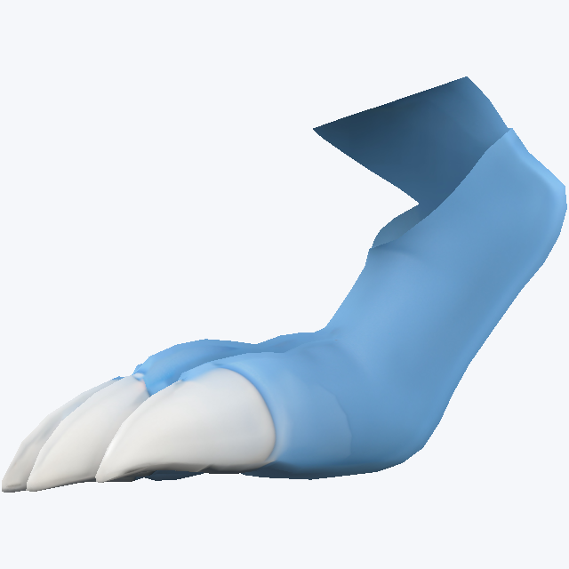
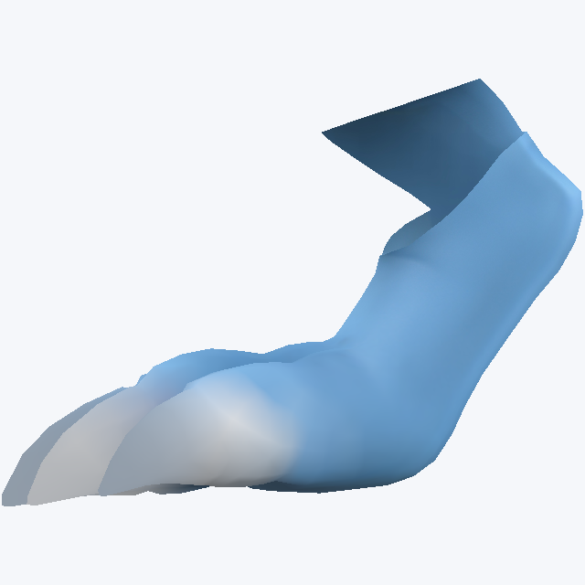
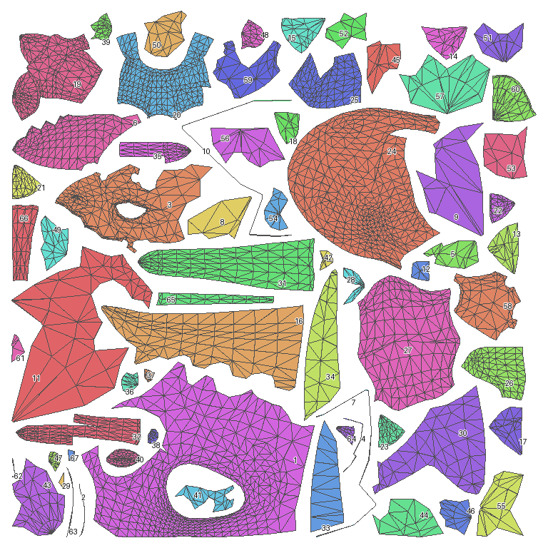
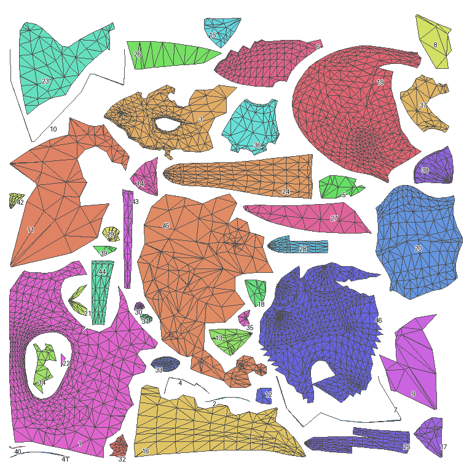
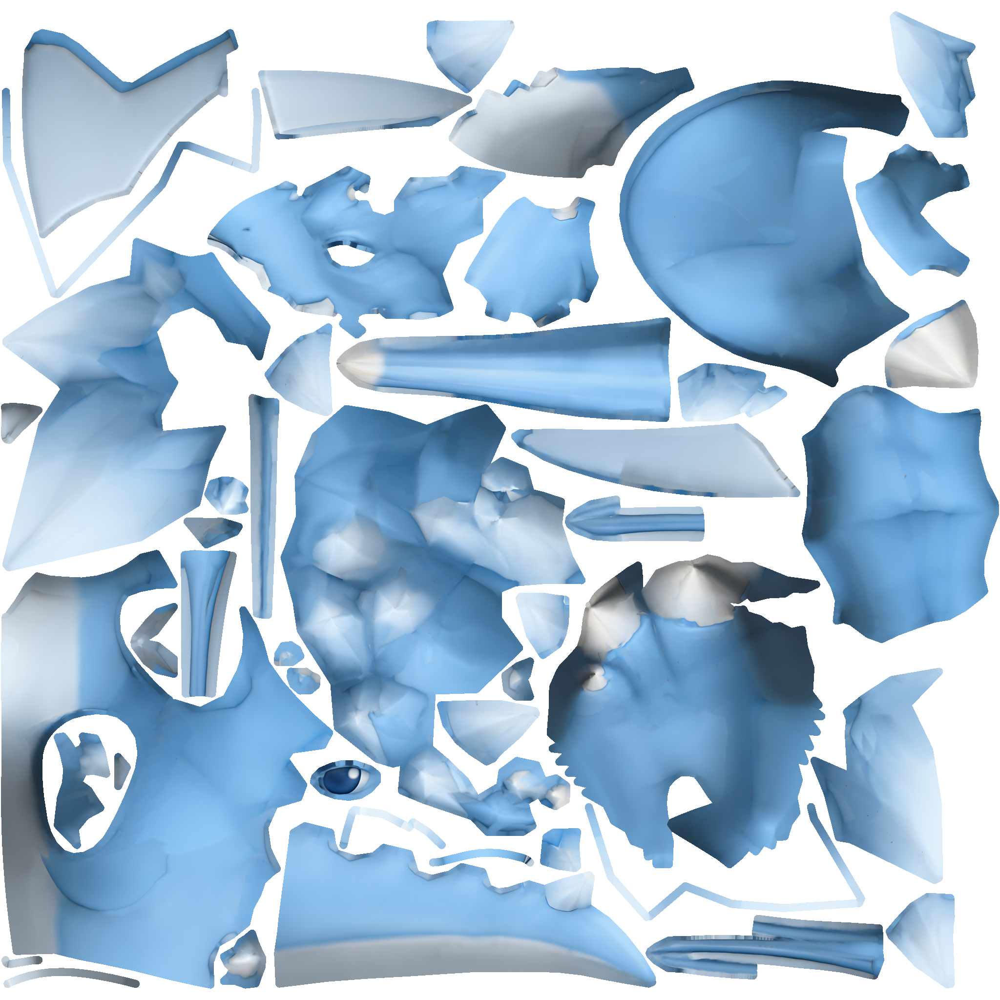
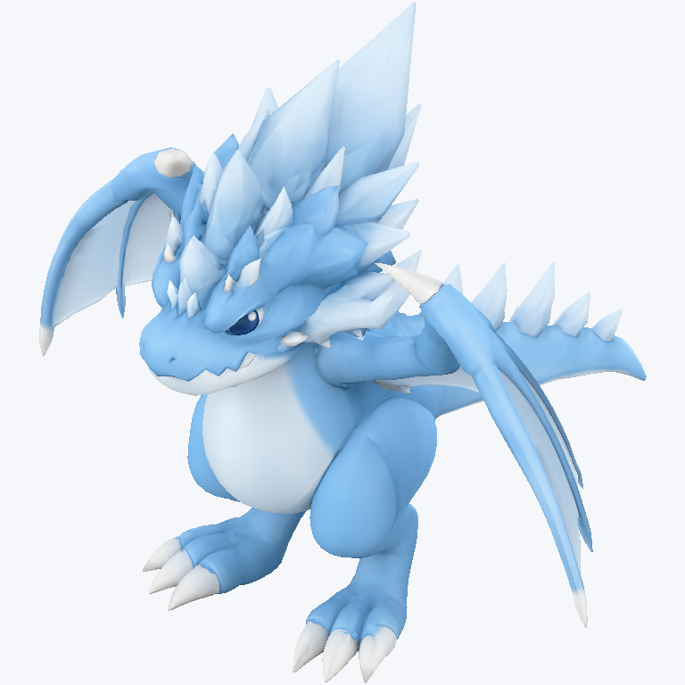

# 镜像龙：复用之后真正合并UV岛

新增从最原始121岛到当前92岛的[彩色UV数据对照](../assets/dragon-uv-final/uv_before_after.png)、[模型渲染对照](../assets/dragon-uv-final/model_before_after.png)及[实际贴图对照](../assets/dragon-uv-final/texture_before_after.png)。原始覆盖率72.55%，新版57.26%，已在图中标明；此跨版本比较包含镜像改模，区别于下文同一镜像几何上的134→92岛对照。`[verified: uv_comparison01/measurements.json、verification.json]`

整龙连通岛从134降到92，减少42岛（31.3%）；独立排布图块从67降到46，减少21块（31.3%）。镜像几何和11450个三角面完全不变，所有面仍参与左右复用。当前交付为Agent看图接受的2048预览；严格渲染探针仍有超限，保留已通过协议的134岛对照。`[verified: final_uv_audit.json；summary.json cases；opinion: 外观接受]`

[完整模型 GLB](../assets/dragon-uv-final/dragon.glb) · [实际 BaseColor](../assets/dragon-uv-final/texture/BaseColor_mip0.png) · [逐项汇总与成本](../assets/dragon-uv-final/experiment-summary.json) · [独立导出回读](../assets/dragon-uv-final/reimport.json)。`[verified: 对应导出文件；reimport_all.json all_passed]`

## 对照结果

三条路径使用同一镜像父几何、源颜色、2048分辨率、统一纹素密度、Blender轮廓排布、16像素间距、8像素边界和8像素padding。全部重新烘焙；颜色、接缝和渲染按相同LOD 0/1/2协议检查。此前未统一密度的57.95%排布结果单独留在旧报告，本表用本轮重新执行的基线。`[verified: formal_config.json cases；sole_formal_config.json cases]`

|路径|连通岛／独立图块|实际共享表面积比例|图集实际覆盖率|颜色／接缝／渲染|证据|
|---|---|---|---|---|---|
|保留旧接缝，已左右复用|134／67|100%|59.13%|通过／通过／通过|`[verified: formal/retained_islands/inspect/result.json、validate/result.json]`|
|直接合岛，没有补脚底切口|92／46|100%|56.10%|通过／通过／拒绝|`[verified: formal/merged_islands/inspect/result.json、validate/result.json]`|
|合岛并补脚底切口，当前预览|92／46|100%|57.26%|通过／通过／拒绝|`[verified: sole_formal/sole_repaired_islands/inspect/result.json、validate/result.json]`|

共享比例按两侧实际参与共享的表面积计算；100%不表示贴图节省100%。三条路径本来都已全体镜像共享，本轮收益是减少多余接缝和图块数量。覆盖率没有超过本轮基线，不能把岛数减少直接说成排布率提高。`[verified: 各inspect/uv_metrics.json global及measurement_method；opinion: 指标解释]`

三条路径RGBA8完整mip均为22,369,620字节，贴图尺寸未缩小。PNG完整mip文件总量分别为4,547,245、4,138,261、4,299,538字节；这属于实际PNG文件大小，不能替代相同质量下的运行时存储收益。`[verified: summary.json cases payload_bytes、png_mip_bytes；opinion: 结论边界]`

## 从碎片到连贯部件

1. 从67对已复用图块出发，按原网格边检查主半边：46块边连通表面包含67个UV岛。额外碎片集中在头冠（363面、16岛）和脚部（1198面、7岛）。其余部分保持原有连接。`[verified: topology_analysis.json；candidate_regions.json]`
2. 对头冠临时解除共享，删除内部旧接缝，共同展开主侧，再通过精确对应复制UV和面角身份到镜像侧。LSCM出现方向不一致而被拒绝，ABF++通过；左右各16岛成为1岛，整龙134→104岛。`[verified: component36_blender_lscm/reparameterization.json geometry.hard_errors；merge_results.json regions[0]]`
3. 脚部采用同一方式，LSCM同样拒绝、ABF++通过，左右各7岛成为1岛，整龙104→92岛。此时真实颜色图暴露白爪边界模糊，Agent拒绝这份外观；渲染协议也拒绝，未删除失败产物。`[verified: merge_results.json regions[1]；formal/merged_islands/validate/result.json；appearance_review.json；opinion: 看图拒绝]`
4. 保留头冠结果，回到脚部修改前的父状态。Agent选择后踝、脚底、趾尖的原边锚点，调用三次`seam.select geodesic`，构造52条原边组成的脚底分支切口；ABF++重展开后，单脚仍为1岛。再精确复制到对侧、统一排布并重烘焙。`[verified: sole_cut_plan.json；sole_trunk02/selection.json、sole_middle02/selection.json、sole_inner02/selection.json；sole_reparameterize/reparameterization.json result_chart_count]`

两次展开中间的解除共享没有切碎原来的岛。最终没有任何旧岛的面被分配到多个新岛，使用到的UV顶点从7642减到7326；顶点坐标和三角面数组逐元素相同，镜像面角UV最大差为0。`[verified: final_uv_audit.json old_charts_split、old_used_uv_vertices、new_used_uv_vertices、vertices_unchanged、faces_unchanged、mirror_uv_max_error]`

## 切口修正的实际效果

以下为相同脚部、相同镜头：保留旧接缝的对照、直接合岛的失败结果、补脚底切口后的结果。`[verified: 三份foot_*/request.json及views.json]`

在固定的12组视角／LOD探针中，最差视图平均误差从0.03667降至0.00812，最大误差从1.00784降至0.46838。该比较只改变脚底切口及其后续展开、排布、烘焙；采样、目标和阈值不变。改善明显，但仍未达到原协议全部通过。`[verified: summary.json cases worst_render_mean、worst_render_max；两份formal配置；opinion: 改善判断]`

## UV、真实贴图与完整模型预览

下图依次为同轮基线的67个独立图块、新版46个独立图块、新版真实贴图及整龙斜视图。图块数由实际UV计算，显示时同组只标记一次。`[verified: 对应inspect/uv_metrics.json及views/request.json uv_labels=owners]`

## 下限、验收与复现边界

当前网格有92个按共享原边连接的表面分量，最终恰好每个分量1个UV岛。在保持原边身份、不连接不相邻表面的条件下，92已达到该邻接定义的下限。此结论不涉及改变拓扑后的全局最优；左右图块叠在一起也不会自动建立跨部件的拓扑连接。`[verified: independent_uv_audit.json geometry_edge_connected_components；final_uv_audit.json original_edge_component_count；opinion: 下限适用条件]`

几何协议继续显式保留源UV已有冲突，不宣称严格全局无交叠。新版颜色、接缝检查通过，渲染检查拒绝；Agent检查了整龙斜视、侧视和底视及脚部对照，接受为当前外观预览。完整PBR、GPU与最终导出的人工评审未单独完成。`[verified: sole_formal/sole_repaired_islands/validate/result.json；appearance_review.json；opinion: Agent外观判断]`

三份GLB经独立解析重新导入，原面顺序下的几何、UV及嵌入贴图像素均通过核对。全部已记录CLI调用合计1030.919秒，包含失败、基线、修正和额外视图；不包含Agent思考和只读分析时间，token及费用未知。本轮没有修改生产工具源码。`[verified: reimport_all.json all_passed；summary.json calls、tool_cost_seconds、source_code_changed]`

调用链与原面集合保存在[合岛记录](../../artifacts/meshquery_v1/island_merge01/merge_results.json)、[脚底切口请求](../../artifacts/meshquery_v1/island_merge01/sole_reparameterize_request.json)、[同轮对照配置](../../artifacts/meshquery_v1/island_merge01/formal_config.json)、[切口修正配置](../../artifacts/meshquery_v1/island_merge01/sole_formal_config.json)及每个输出目录的request/provenance中。正式运行保存了代码与后端版本；选择理由的事后汇总明确标为post-hoc，未冒充运行前预注册。`[verified: 对应请求文件及agent_decision.json record_kind]`
