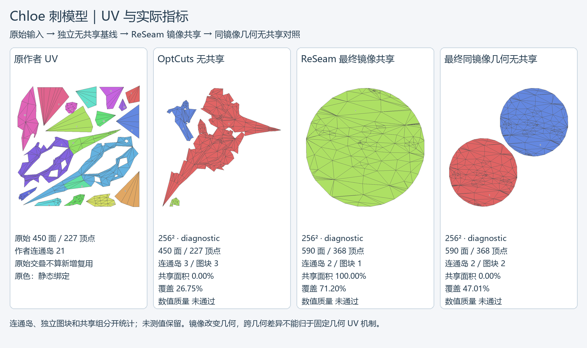
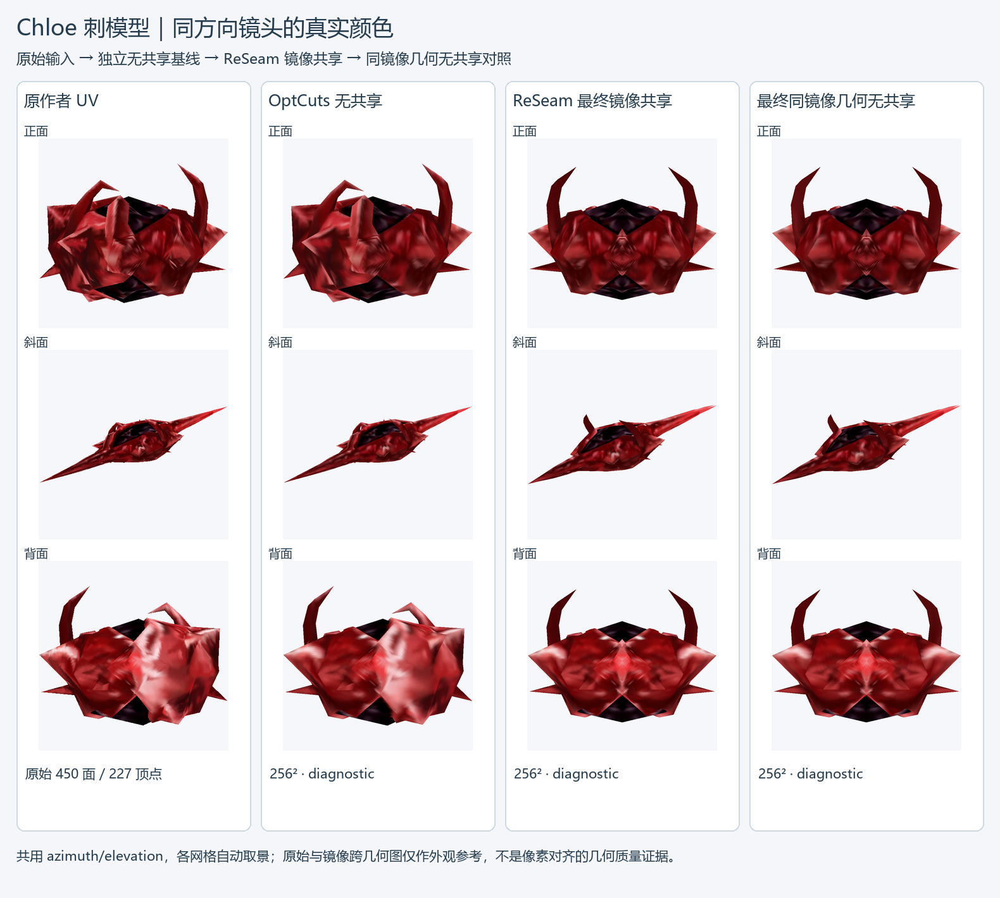
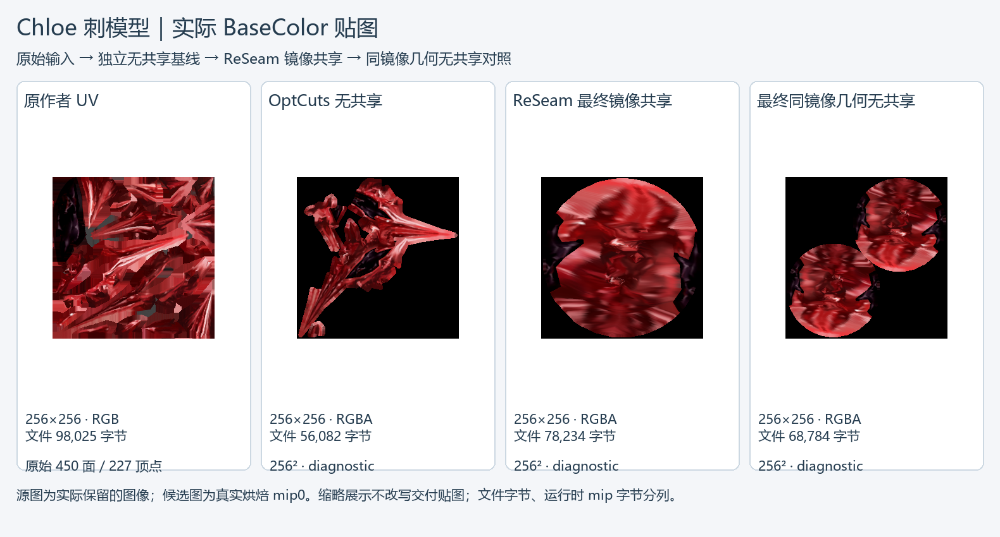
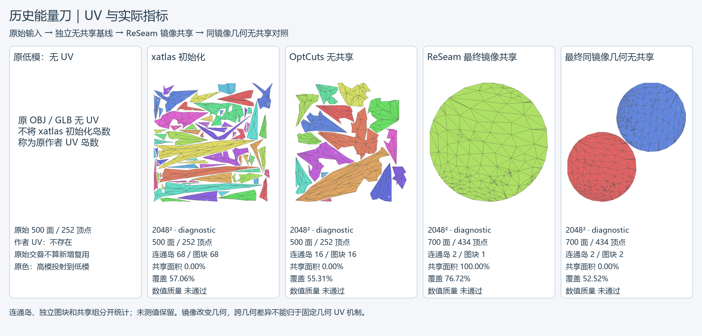
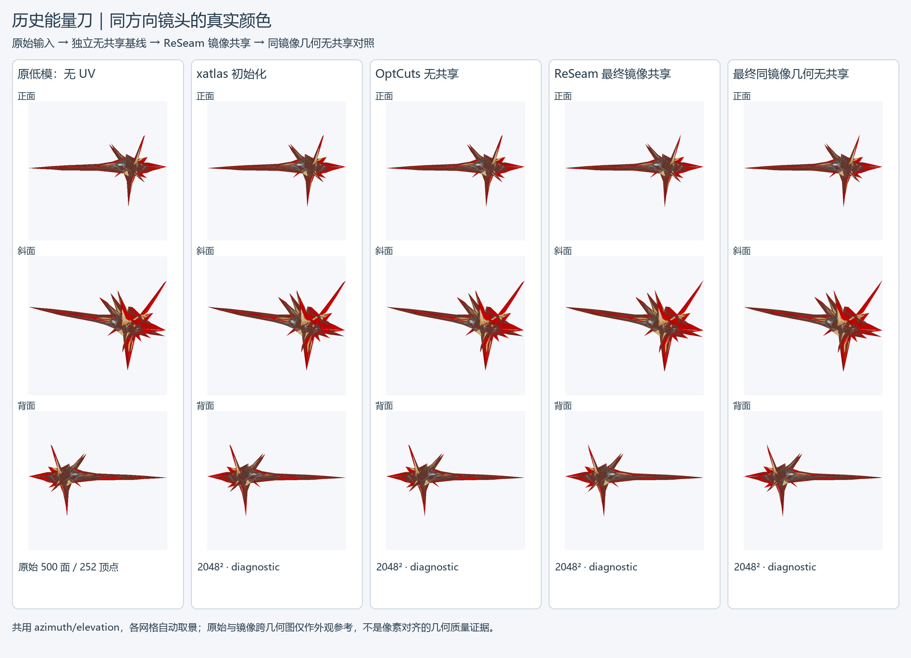
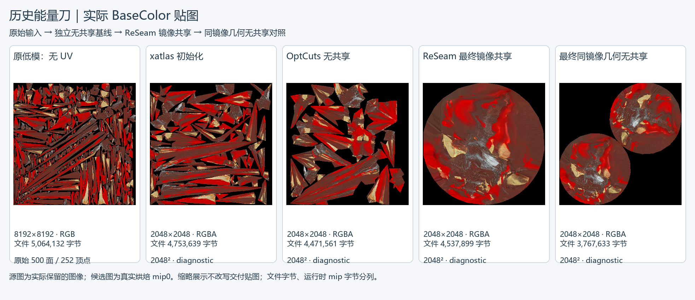
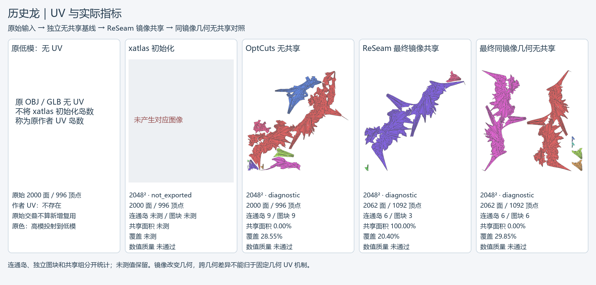
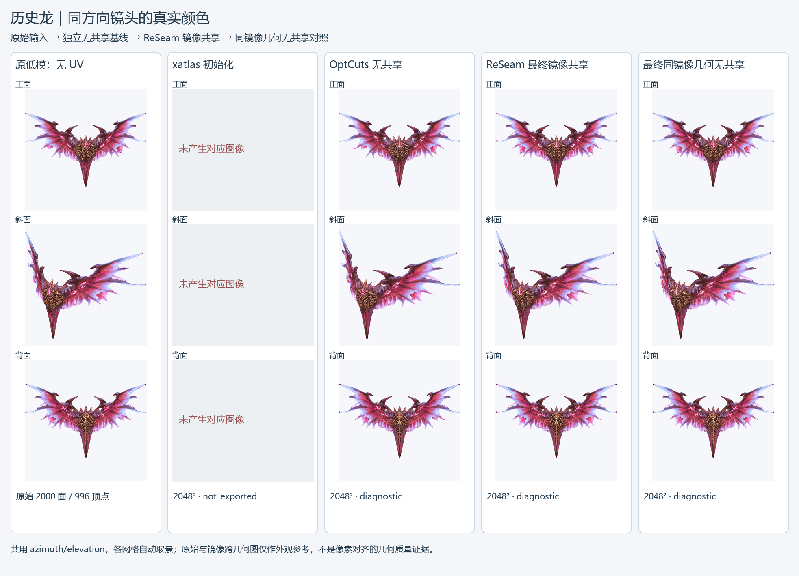
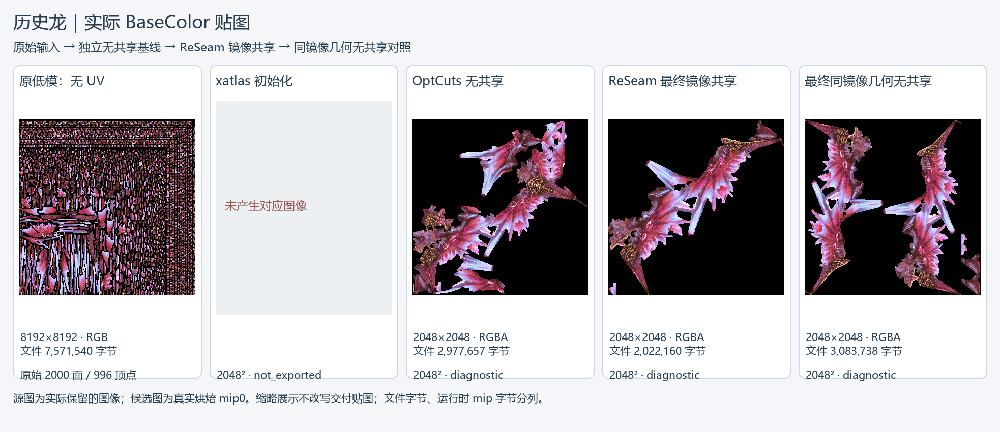

# 三个历史资产的 ReSeam UV 复用实测

实验结束状态：父任务已确认实验结束。`[verified: report.json experiment_finished_confirmed]`

范围：静态 CPU UV＋BaseColor；验证 LOD 0/1/2；完整 PBR、GPU、Unity 动态 Shader 与人工验收均独立。`[verified: evidence/protocol.json scope/mip_levels/gpu_verified/human_accepted/pbr_verified]`

## Chloe 刺模型







展示选择：`mirror_shared_final/256`；Agent 外观审阅指定；数值质量另列。`[verified: report.json selected.chloe]`

实测几何变化：原始 450 面 / 227 顶点 → 镜像变体 590 面 / 368 顶点。原始资产保持不变，镜像是独立新变体。`[verified: geometry_stages.json chloe；original_integrity.json]`

[实际 GLB](../assets/legacy-assets-reseam/round02/models/chloe/mirror_shared_final/256/asset.glb) · [BaseColor mip0](../assets/legacy-assets-reseam/round02/textures/chloe/mirror_shared_final/256/BaseColor_mip0.png) · [独立载入检查](../assets/legacy-assets-reseam/round02/models/chloe/mirror_shared_final/256/independent_reimport.json)。`[verified: report.json selected.chloe.key；reimport.json]`

原 FBX、作者 UV 和第二 UV 均保留；本轮使用指定图像和 UVChannel_1 做静态颜色绑定。Unity 材质中的 UV 变换、动画、混合与动态 Shader 没有复现。`[verified: inputs/chloe/identity.json；source_attributes.json chloe；reimport.json]`

全部尺寸、失败项与逐项数值保存在[CSV](../assets/legacy-assets-reseam/round02/measurements.csv)和[JSON](../assets/legacy-assets-reseam/round02/measurements.json)中，正文以实际比较图为主。`[verified: measurements.csv；measurements.json]`

## 历史能量刀







展示选择：`mirror_shared_final/2048`；Agent 外观审阅指定；数值质量另列。`[verified: report.json selected.energy_blade]`

实测几何变化：原始 500 面 / 252 顶点 → 镜像变体 700 面 / 434 顶点。原始资产保持不变，镜像是独立新变体。`[verified: geometry_stages.json energy_blade；original_integrity.json]`

[实际 GLB](../assets/legacy-assets-reseam/round02/models/energy_blade/mirror_shared_final/2048/asset.glb) · [BaseColor mip0](../assets/legacy-assets-reseam/round02/textures/energy_blade/mirror_shared_final/2048/BaseColor_mip0.png) · [独立载入检查](../assets/legacy-assets-reseam/round02/models/energy_blade/mirror_shared_final/2048/independent_reimport.json)。`[verified: report.json selected.energy_blade.key；reimport.json]`

原始低模没有UV；图中的xatlas岛数来自本轮新初始化，不能称为作者原始岛数。颜色从保留高模投射到固定低模，再通过来源对应继承到独立镜像变体。`[verified: source_attributes.json energy_blade；inputs/assets_v1_manifest.json]`

全部尺寸、失败项与逐项数值保存在[CSV](../assets/legacy-assets-reseam/round02/measurements.csv)和[JSON](../assets/legacy-assets-reseam/round02/measurements.json)中，正文以实际比较图为主。`[verified: measurements.csv；measurements.json]`

## 历史龙







展示选择：`mirror_shared_final/2048`；Agent 外观审阅指定；数值质量另列。`[verified: report.json selected.dragon]`

实测几何变化：原始 2000 面 / 996 顶点 → 镜像变体 2062 面 / 1092 顶点。原始资产保持不变，镜像是独立新变体。`[verified: geometry_stages.json dragon；original_integrity.json]`

[实际 GLB](../assets/legacy-assets-reseam/round02/models/dragon/mirror_shared_final/2048/asset.glb) · [BaseColor mip0](../assets/legacy-assets-reseam/round02/textures/dragon/mirror_shared_final/2048/BaseColor_mip0.png) · [独立载入检查](../assets/legacy-assets-reseam/round02/models/dragon/mirror_shared_final/2048/independent_reimport.json)。`[verified: report.json selected.dragon.key；reimport.json]`

原始低模没有UV；图中的xatlas岛数来自本轮新初始化，不能称为作者原始岛数。颜色从保留高模投射到固定低模，再通过来源对应继承到独立镜像变体。`[verified: source_attributes.json dragon；inputs/assets_v1_manifest.json]`

全部尺寸、失败项与逐项数值保存在[CSV](../assets/legacy-assets-reseam/round02/measurements.csv)和[JSON](../assets/legacy-assets-reseam/round02/measurements.json)中，正文以实际比较图为主。`[verified: measurements.csv；measurements.json]`

## 比较口径与保留边界

镜像生成新几何；共享与解除共享在同一镜像几何、同一冻结目标、同尺寸下比较。原始几何到镜像几何的轮廓、面数或贴图差异不能归因于固定几何 UV 复用。`[verified: evidence/protocol.json geometry_policy；steps.json；evaluations.json]`

连通岛按 UV 拓扑连接计数，独立图块按许可交叠后的真实连接计数，共享面积按实际许可正面积交叠测量；原始交叠不算新增复用，未完成几何测量的值保留为未测。共享面积统计组内双方，100%不能解释为贴图减少100%。`[verified: evidence/*/*/final/inspect/uv_metrics.json measurement_method/metrics_verified]`

图片使用真实保留的 UV 图、贴图和 CPU 渲染。模型列使用相同 azimuth/elevation 镜头方向，各网格自动取景；原始与镜像跨几何图只作外观参考，不是像素对齐的几何质量证据。共享／无共享正式对照的几何哈希、冻结目标及尺寸另列核对，相同几何具有相同边界范围。`[verified: evidence/protocol.json cameras；evidence/*/*/color_views/views.json coordinate_convention；matched_controls.json]`

烘焙与导出失败、严格数值拒绝以及超预算均保留；Agent 外观判断、数值验收与人工认可分别记录。完整 mip 写出只表示文件存在，验收层级仍由 quality.validate 的实际 profile 决定。`[verified: failure_index.json；evidence/*/evaluations.json；report.json selected]`

镜像变体的源颜色来自所保留半侧；变体内颜色球零差不表示原父模型另一侧未改色。跨几何外观变化由原始／镜像预览单列观察，数值重建与同目标对照仅在声明的变体内成立。`[verified: source_attributes.json；steps.json；report.json selected；opinion: 比较边界]`

共享按实际主侧连通图分组；同一主侧包含多个图时保留真实切口，分别建立共享组以便轮廓排布。迭代轮次、失败与来源筛选核验另见开发记录，不能把不同评价器版本的质量结果混作同轮排名。`[verified: evidence/protocol.json；steps.json；development_history.json]`

贴图文件字节、RGBA8 mip 运行时字节、GLB 和整个证据包字节分别报告；没有同质量基线通过时不能宣布同质量存储节省。`[opinion]`

[完整数值行](../assets/legacy-assets-reseam/round02/measurements.csv) · [逐数值字段](../assets/legacy-assets-reseam/round02/numeric_fields.csv) · [阶段变化](../assets/legacy-assets-reseam/round02/stages.csv) · [全部调用与成本](../assets/legacy-assets-reseam/round02/calls.csv) · [父子状态与哈希](../assets/legacy-assets-reseam/round02/steps.json) · [失败索引](../assets/legacy-assets-reseam/round02/failure_index.json) · [原始资产前后核验](../assets/legacy-assets-reseam/round02/original_integrity.json) · [全部导出独立核验](../assets/legacy-assets-reseam/round02/reimport.json) · [源与产物哈希清单](../assets/legacy-assets-reseam/round02/manifest.json)。`[verified: 包内对应文件]`

复现时从仓库根目录运行：

```powershell
uv run python -X utf8 scripts/build_legacy_reseam_report.py `
  --input artifacts/legacy_assets_reseam/round02 `
  --output docs/assets/legacy-assets-reseam/round02 `
  --report docs/results/legacy-assets-reseam.md --experiment-finished
```

输出目录必须不存在；脚本只打包保留产物，不调用求解、烘焙或渲染。构建期间评估或审阅文件发生变化会使本次构建失败，防止交付混合快照。`[verified: reproduce/build_legacy_reseam_report.py main/tracked_fingerprint]`
