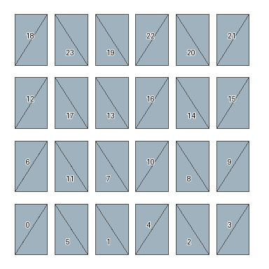
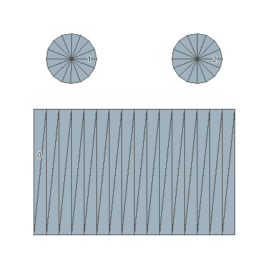
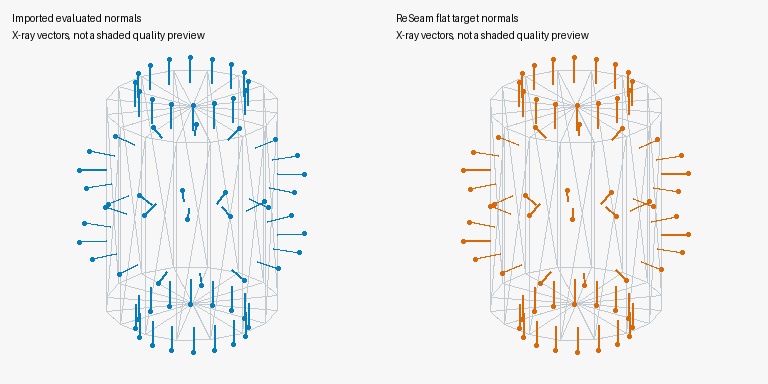
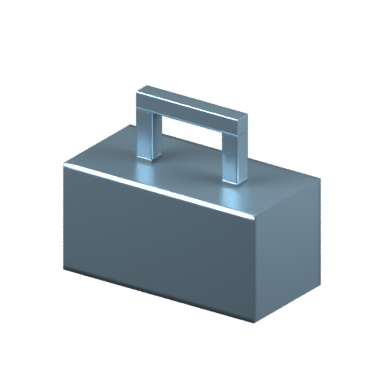
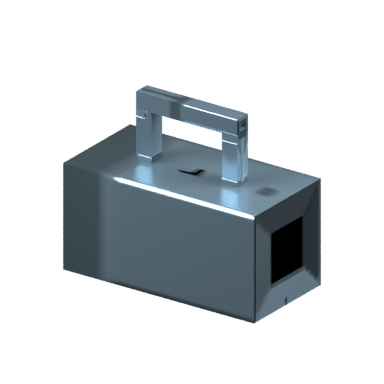

# UV 与法线烘焙预检：实现与实际验证

`material.preflight` 已接入 JSON 工具入口。首版交付包含纠错后的[生产流程](../uv-normal-baking-workflow.md)、只读诊断、两个构造案例、两份真实 128² 法线烘焙及蓝龙导入失败证据。正常工具箱的投射通过，但指定 mip 下间距不足一个像素；蓝龙尚未进入投射阶段。`[verified: ../assets/normal-baking-preflight/summary.json cases、blue_imports；verification.json examples]`

## 实际结果

冻结运行目录为 `artifacts/normal-preflight/examples05`，后端 Blender 4.5.11 LTS。所有三角形每面固定 16 个内部样本；完成运行与预检通过分别记录。[汇总数据](../assets/normal-baking-preflight/summary.json)包含输入、源码及逐样本文件哈希。`[verified: summary.json round、cases、code_sha256]`

| 案例 | 预期行为 | 实际结果 | 结论与证据 |
|---|---|---|---|
| 硬边工具箱，倒角高模对齐 | 法线断开的边均拆 UV；投射应命中 | 768/768 范围内正面命中；源/目标均无缺缝；mip 2 有效间距 0.96 像素 | **warn**，投射 pass、采样空间 warn。[完整报告](../assets/normal-baking-preflight/toolbox_aligned.json)。`[verified: checks.normal_uv、projection、uv_sampling；opinion: 预期]` |
| 同一低模，高模沿 X 平移 0.45 | 应定位投射问题 | 正面命中 170、背面命中 20、超出射程 128、未命中 450，共 768 | **fail**；不能将全部错误统称为错位或黑斑。[完整报告](../assets/normal-baking-preflight/toolbox_shifted.json)。`[verified: checks.projection.counts；scripts/preflight_example_worker.py；opinion: 预期与归因边界]` |
| 光滑圆柱，纵向 UV 接缝及两端盖独立岛 | 源平滑法线允许纵缝仍为软边；当前 flat 目标应暴露差异 | 投射 1024/1024 命中；源缺缝 0，目标缺缝 15 | **fail**；定位的是源/实际目标法线合同不一致，不能据此说源光滑圆柱错误。[完整报告](../assets/normal-baking-preflight/cylinder.json)。`[verified: checks.normal_uv、projection；opinion: 预期与解释]` |

工具箱由箱体及三个把手段组成，共四个独立长方体、48 个三角形、24 个面岛；把手各段内部也逐硬边拆开。预检按显式部件配对隔离高模。UV 配置是 128²、要求 gap/border 各 2 像素、扩边 1 像素、检查 mip 0/1/2；实际最小 gap 为 3.84/1.92/0.96 像素。`[verified: scripts/preflight_examples.py BOXES、toolbox、BAKE_CONFIG；toolbox_aligned.json config、checks.uv_sampling.mips]`

| 硬边工具箱：24 个面岛 | 圆柱：侧面连续展开、端盖独立 |
|---|---|
|  |  |

以上 UV 图来自本轮 `view.render` 输出，编号对应实际连通岛。下图是源逐角法线与当前目标法线的 X-ray 示意，不能作为着色质量评分。`[verified: manifest.json toolbox_uv.png、cylinder_uv.png、cylinder_normals.png；opinion: 证据边界]`



## 实际烘焙与同视角预览

两份贴图均通过现有 `bake_variant` 运行 Cycles CPU 烘焙，输出分辨率 128²、Cage extrusion 0.06、margin 1。两张预览使用同一相机、灯光及中性材质，仅比较烘焙 Normal 通道；图像分辨率为 384²。[烘焙记录](../assets/normal-baking-preflight/toolbox_aligned_bake.json)、[损坏对照记录](../assets/normal-baking-preflight/toolbox_shifted_bake.json)、[预览设置](../assets/normal-baking-preflight/preview_contract.json)。`[verified: 两份 bake JSON worker.backend、worker.projection、claims；preview_contract.json]`

| 对齐高模 | 故意平移的高模 |
|---|---|
|  |  |
| [实际 Normal 贴图](../assets/normal-baking-preflight/toolbox_aligned_normal.png) · [实际 GLB](../assets/normal-baking-preflight/toolbox_aligned.glb) | [实际 Normal 贴图](../assets/normal-baking-preflight/toolbox_shifted_normal.png) · [实际 GLB](../assets/normal-baking-preflight/toolbox_shifted.glb) |

Agent 实际查看了以上同一斜视角的两个渲染、工具箱 UV 图及圆柱法线示意：错位配置在箱体右侧出现大片黑块，顶面和把手附近出现不连续阴影。此观察只说明该构造对照产生了可见差异，不是完整环视、mip、PBR 或人工验收。`[verified: 本轮实际查看 toolbox_aligned.png、toolbox_shifted.png、toolbox_uv.png、cylinder_normals.png；opinion: 外观解读与边界]`

有限探针使用自动几何 Cage 与部件过滤，Cycles 烘焙使用现有选中到活动对象设置；两者采样与投射合同不同。报告可以定位可疑面与射线，不能把“768/768 命中”升级为整张法线贴图连续覆盖通过，也不能把渲染黑斑逐像素归因于某一探针。`[verified: toolbox_aligned.json config.part_pairings、checks.projection；toolbox_aligned_bake.json worker.projection；opinion: 对照边界]`

完整射线记录已归档，可用 `low_face`、`sample_id`、重心坐标与 `high_face` 定位：[正常工具箱](../assets/normal-baking-preflight/toolbox_aligned_samples.jsonl)、[错位工具箱](../assets/normal-baking-preflight/toolbox_shifted_samples.jsonl)、[圆柱](../assets/normal-baking-preflight/cylinder_samples.jsonl)。最近点距离单独保存，范围外命中不会计入成功。`[verified: 对应 JSONL 的 nearest_surface_distance、classification、hit.within_requested_range 字段]`

## 蓝龙真实资产：导入拒绝保留

本轮尝试导入 `model/dragon/pbr_bake_test/high/source_pbr` 与 `low/pbr_tri_3113` 下的指定 FBX，开启 `collect_normal_evidence=true`。两者都在原始索引网格构建阶段被拒绝，因此没有可用于预检的合法快照；未运行实际射线或法线烘焙。`[verified: artifacts/normal-preflight/blue01/high_request.json、low_request.json；归档 blue_high_import.json、blue_low_import.json]`

| 输入 | 实际导入证据 | 状态 |
|---|---|---|
| `high/source_pbr` | 导入后 10,832 三角形；首个错误 `Nonmanifold edge (7, 8)`；计数发现 124 条邻面数大于 2 的边 | `REJECTED`。[工具结果](../assets/normal-baking-preflight/blue_high_import.json) · [日志](../assets/normal-baking-preflight/blue_high_import.log)。`[verified: summary.json blue_imports.high；日志末尾异常]` |
| `low/pbr_tri_3113` | 导入后 3,113 三角形；首个错误 `Nonmanifold edge (305, 312)`；计数发现 55 条邻面数大于 2 的边 | `REJECTED`。[工具结果](../assets/normal-baking-preflight/blue_low_import.json) · [日志](../assets/normal-baking-preflight/blue_low_import.log)。`[verified: summary.json blue_imports.low；日志末尾异常]` |

非流形边 ID 对应本轮导入后的顶点索引，不能直接当作 FBX 软件界面里的顶点编号。原 FBX 与导入前冻结副本 SHA256 一致，原资产保持不变。需要先定位这些拓扑，再在另一个独立变体中修复并重新导入；本轮没有自动焊接、拆点或替换原模型。`[verified: summary.json blue_imports.*.original_matches_frozen、nonmanifold_edges；opinion: 后续处理建议及编号边界]`

## 工程验证、复现与边界

新增与受影响测试共 **80 passed**；指定修改文件 `ruff check` 通过；全仓 `basedpyright` 为 0 errors / 0 warnings / 0 notes。[检查记录](../assets/normal-baking-preflight/verification.json)保存实际完整命令及输出。测试覆盖缺失法线、硬边/软缝、零间距、共享组成员关系、原多边形内部真实断法线、有限射线、显式 Cage、开放面、变换、错误部件、过期状态、缺失 Blender 与不完整超时。`[verified: verification.json checks；tests/test_material_preflight.py 测试定义]`

正式 CLI 的 `tools describe` 与 `tools run` 均已运行；本轮独立复核三份完整样本文件的数量、分类及重心坐标，确认快照/源 FBX/烘焙输入哈希不变，归档 GLB 的贴图引用完整。[交付核对记录](../assets/normal-baking-preflight/delivery_audit.json)保存链接、归档哈希及实际输入核验结果。`[verified: verification.json cli_and_delivery；delivery_audit.json samples、glb、blue_inputs_unchanged、bake_inputs_unchanged]`

```powershell
uv run reseam tools describe material.preflight
uv run python scripts/preflight_examples.py --output artifacts/normal-preflight/new_round --bake
uv run pytest tests/test_material_preflight.py tests/test_agent_tools_hard_edges.py tests/test_agent_tools_assets.py tests/test_agent_tools_material.py tests/test_agent_tools_views.py tests/test_agent_tools_state.py -q
```

`examples01` 的预览曾因空 World 失败；`examples02` 至 `examples04` 为中间运行，目录均保留。最终 `examples05` 在镜像源法线方向显示限制补充后重新运行，报告只引用最终轮次数据；历史失败没有改成成功。`[verified: summary.json history、round；verification.json examples]`

首版支持单个 0–1 材质图集；UDIM、多材质采样路由、外部引擎自定义法线与完整 PBR 验收未覆盖。预检不会放宽既有门禁，`final_quality_passed` 为 null、`appearance_acceptance` 为 NOT_RUN。原教程仅作带纠错的参考资料，实际修正继续由 Agent 选择现有工具完成。`[verified: preflight.py uv_sampling_audit、preflight；opinion: 使用边界]`
