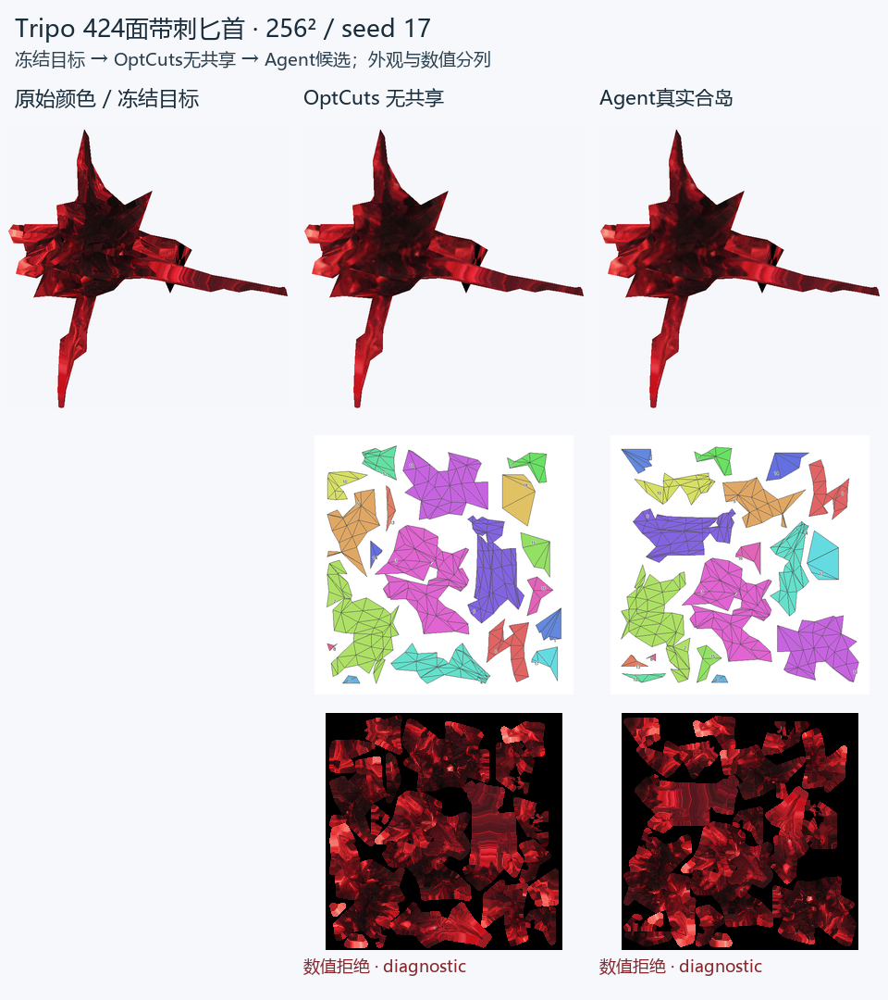
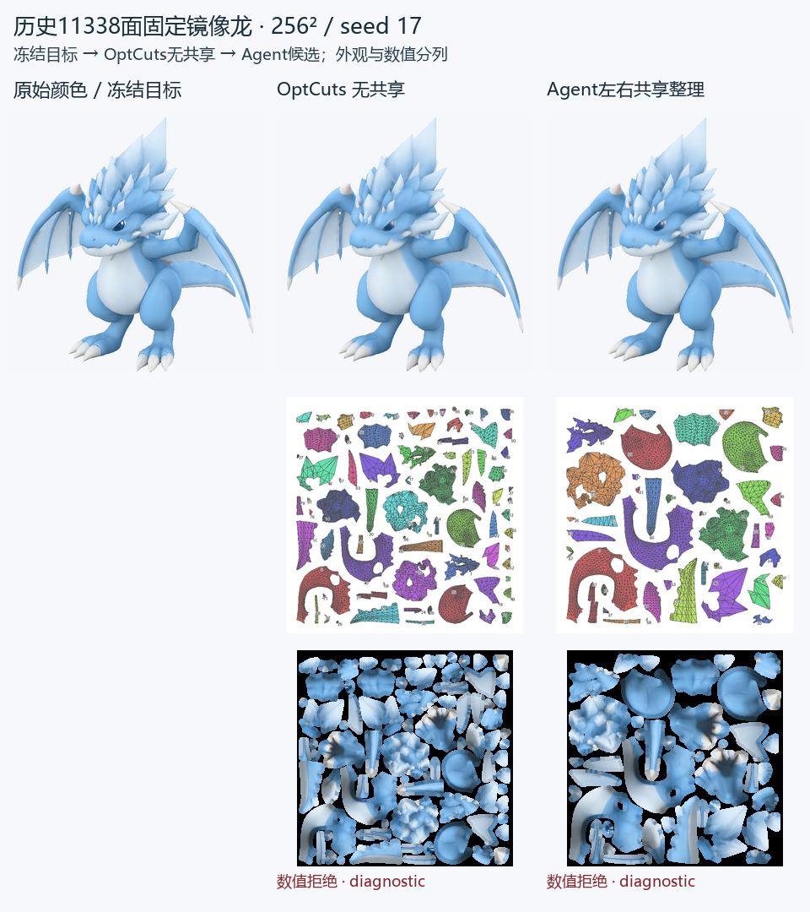

# OptCuts 提缝 → Agent 合岛与整理：Tripo 刺模型和历史镜像龙

流程收敛为一个现有Skill入口：OptCuts生成初始UV及切缝，Agent看图决定保留、删缝或局部重展开，再调用已有排布、烘焙与导出工具；本轮没有增加registry工具或另建Skill。`[opinion]`

两个资产分别固定原几何与颜色目标，256×256、4像素gap/border/padding、统一密度规则，正式排布种子17/29/43；OptCuts初始化seed=0且不输入旧UV。数值质量与Agent外观判断分列。`[verified: 对应 initial/optcuts/request.json、evaluate/*/seed*/pack/request.json、target/freeze/request.json]`

本轮只检验静态UV＋BaseColor，LOD 0/1/2；写出完整9级mip不表示全部LOD通过。normal/AO可供选边，本轮不重烘焙这些材质通道，也没有PBR、GPU或人工验收。`[verified: 对应quality/request.json与export/result.json；opinion: 范围界定]`

## Tripo 424面带刺匕首

OptCuts为19岛。Agent先试相邻岛10/12，保留其它开口，只删共同原边377，局部LSCM重展开到18岛；局部最大拉伸1.261。三种子最佳覆盖45.17%→43.87%，因此最终保留OptCuts。第二处候选也到18岛，但最佳覆盖43.84%，在排布筛查后停止，未烘焙/导出。`[verified: tripo/merge1/final_decision.json、state.json merge_attempts、merge0/packing_comparison.json、final_decision.json]`

覆盖下降本身不是外观质量证明；此处没有观察到足以补偿覆盖损失的局部外观改善。保留真实合岛候选作诊断，不宣称Agent优于OptCuts。`[opinion]`

|路径 / 种子|连通岛 / 独立图块|P95 / 最大拉伸|覆盖 / 实际共享表面|数值 / 回载|实际GLB|
|---|---|---|---|---|---|
|OptCuts / 17|19 / 19|1.619 / 3.479|45.17% / 0.00%|False / True|[模型](../assets/optcuts-agent-uv/round01/models/tripo/optcuts/seed17/asset.glb) `[verified: tripo/evaluations.json 对应行；inspect/uv_metrics.json]`|
|OptCuts / 29|19 / 19|1.619 / 3.479|45.17% / 0.00%|False / True|[模型](../assets/optcuts-agent-uv/round01/models/tripo/optcuts/seed29/asset.glb) `[verified: tripo/evaluations.json 对应行；inspect/uv_metrics.json]`|
|OptCuts / 43|19 / 19|1.619 / 3.479|43.34% / 0.00%|False / True|[模型](../assets/optcuts-agent-uv/round01/models/tripo/optcuts/seed43/asset.glb) `[verified: tripo/evaluations.json 对应行；inspect/uv_metrics.json]`|
|真实合岛候选 / 17|18 / 18|1.619 / 3.479|41.12% / 0.00%|False / True|[模型](../assets/optcuts-agent-uv/round01/models/tripo/agent_merge/seed17/asset.glb) `[verified: tripo/evaluations.json 对应行；inspect/uv_metrics.json]`|
|真实合岛候选 / 29|18 / 18|1.619 / 3.479|43.86% / 0.00%|False / True|[模型](../assets/optcuts-agent-uv/round01/models/tripo/agent_merge/seed29/asset.glb) `[verified: tripo/evaluations.json 对应行；inspect/uv_metrics.json]`|
|真实合岛候选 / 43|18 / 18|1.619 / 3.479|43.87% / 0.00%|False / True|[模型](../assets/optcuts-agent-uv/round01/models/tripo/agent_merge/seed43/asset.glb) `[verified: tripo/evaluations.json 对应行；inspect/uv_metrics.json]`|

## 历史11338面固定镜像龙

固定原边拓扑有80个连通分量，OptCuts已经80岛，没有可直接沿原边删缝的相邻岛；这只是当前几何/身份约束下的结论。Agent改做左右部件堆叠与排布，不把这种复用叫真实合岛。`[verified: dragon/initial/component_audit.json；opinion: 结论范围]`

40组左右候选实际接受37组；被拒绝组保留独占，失败原因及耗时全部保留。`[verified: dragon/state.json accepted_groups；dragon/calls.json organize/*]`

历史交付已经是80岛/40图块，本轮OptCuts重新初始化后只有37组通过，不替换旧交付。旧结果是2048图且密度/留边不同，只列历史计数，不能与本轮256图的覆盖和画质混排。`[verified: dragon-midplane-cleanup.md 修复后的UV与外观表、排布说明；opinion: 比较边界]`

Agent斜视对照中未见共享后新增的大片错色，身体、白肚皮与爪子保留；两条256图路径的眼部细节都比冻结目标模糊，只接受为流程诊断预览。`[verified: dragon/appearance_review.json evidence；opinion: 有限视角外观判断]`

|路径 / 种子|连通岛 / 独立图块|P95 / 最大拉伸|覆盖 / 实际共享表面|数值 / 回载|实际GLB|
|---|---|---|---|---|---|
|OptCuts / 17|80 / 80|1.767 / 115.511|38.23% / 0.00%|False / True|[模型](../assets/optcuts-agent-uv/round01/models/dragon/optcuts/seed17/asset.glb) `[verified: dragon/evaluations.json 对应行；inspect/uv_metrics.json]`|
|OptCuts / 29|80 / 80|1.767 / 115.511|38.35% / 0.00%|False / True|[模型](../assets/optcuts-agent-uv/round01/models/dragon/optcuts/seed29/asset.glb) `[verified: dragon/evaluations.json 对应行；inspect/uv_metrics.json]`|
|OptCuts / 43|80 / 80|1.767 / 115.511|36.99% / 0.00%|False / True|[模型](../assets/optcuts-agent-uv/round01/models/dragon/optcuts/seed43/asset.glb) `[verified: dragon/evaluations.json 对应行；inspect/uv_metrics.json]`|
|左右共享整理 / 17|80 / 43|1.767 / 114.677|44.44% / 67.05%|False / True|[模型](../assets/optcuts-agent-uv/round01/models/dragon/agent_merge/seed17/asset.glb) `[verified: dragon/evaluations.json 对应行；inspect/uv_metrics.json]`|
|左右共享整理 / 29|80 / 43|1.767 / 114.677|44.62% / 67.05%|False / True|[模型](../assets/optcuts-agent-uv/round01/models/dragon/agent_merge/seed29/asset.glb) `[verified: dragon/evaluations.json 对应行；inspect/uv_metrics.json]`|
|左右共享整理 / 43|80 / 43|1.767 / 114.677|44.44% / 67.05%|False / True|[模型](../assets/optcuts-agent-uv/round01/models/dragon/agent_merge/seed43/asset.glb) `[verified: dragon/evaluations.json 对应行；inspect/uv_metrics.json]`|

## 证据与限制

完整中位数/P95/最大拉伸、超限面ID、接缝长度、覆盖、实际共享表面、耗时见 [summary.json](../assets/optcuts-agent-uv/round01/summary.json)，失败见 [failures.json](../assets/optcuts-agent-uv/round01/failures.json)。原始请求、状态哈希、提案与棋盘格在不可变实验目录。`[verified: 对应文件]`

所有成功导出均重新读取GLB核对几何、UV和内嵌BaseColor；固定几何按顶点/原面数组逐项比较，并保留快照geometry_hash作追溯。旧实验只作来源与历史参考，未混入本轮数值排名。`[verified: summary.json geometry_integrity；opinion: 对照规则]`

实验执行源码已冻结归档；运行结束后只修复编排器的失败处理/候选回退/缺图证据检查，并同步简化Skill路由，未重算或升级本轮结果。检查与差异记录见 [verification.json](../assets/optcuts-agent-uv/round01/verification.json)。`[verified: verification.json post_experiment_changes]`

每种几何使用2400秒工具预算，每次工具至多300秒。工具账包含失败；单次编排的外层时间未完整测量，另外记录原始命令文件创建至报告的墙钟跨度，包含期间编程、看图与等待，不能把工具耗时冒充精确端到端耗时。`[verified: frozen_code/scripts/run_chloe_hard_surface.py Trial._call_serial；summary.json timing]`
