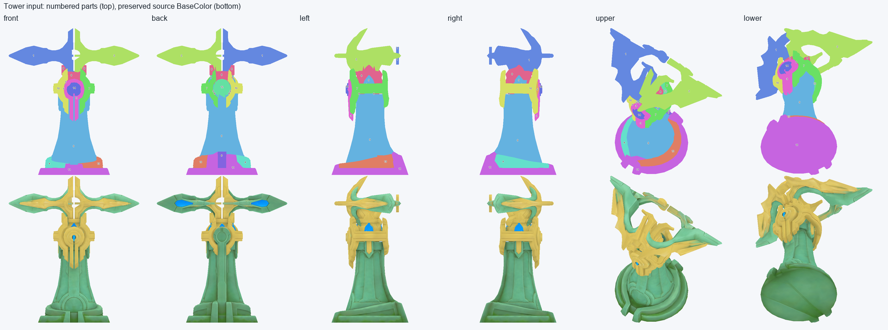
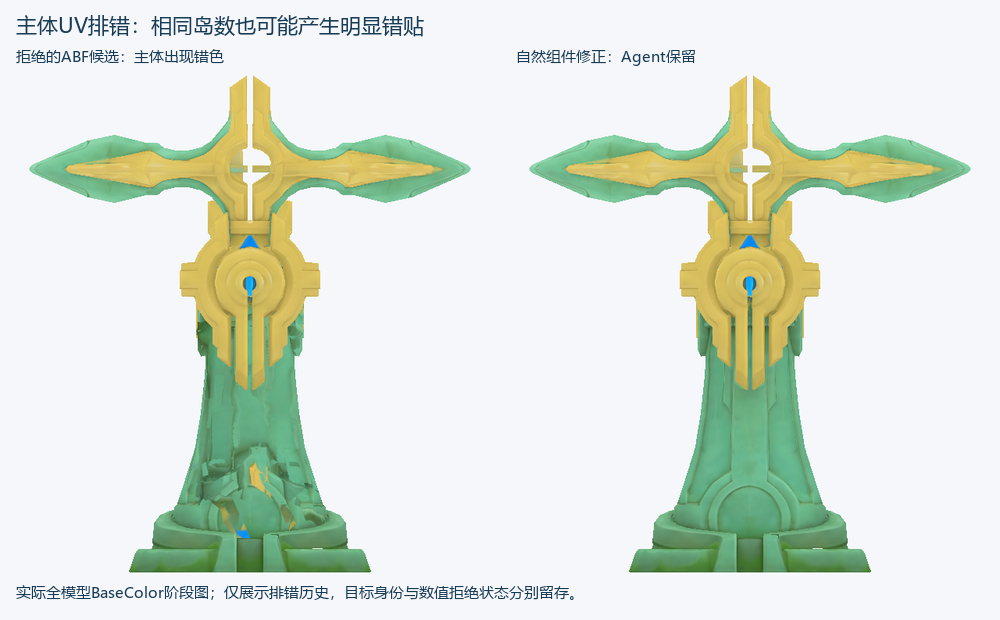
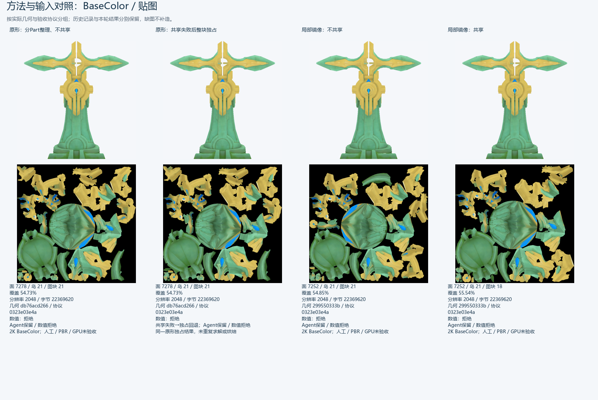
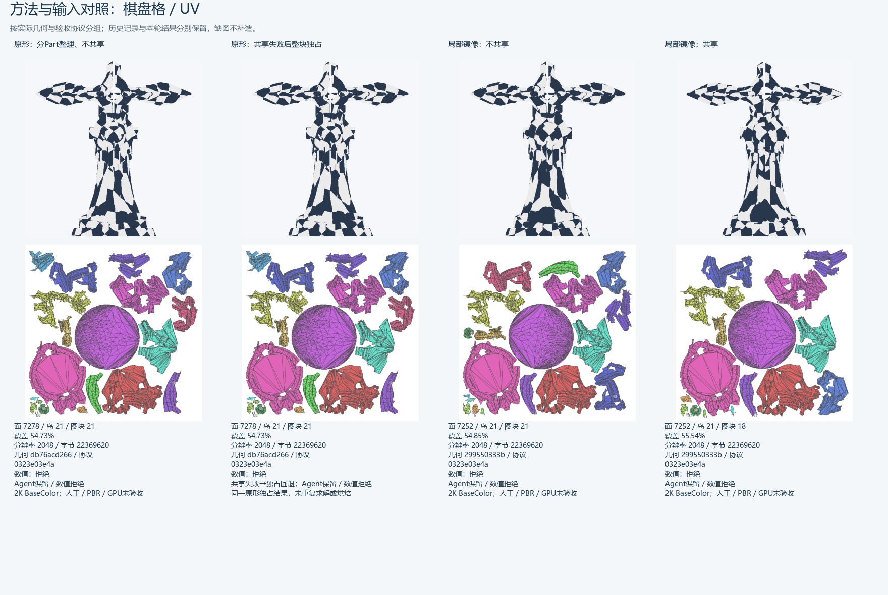
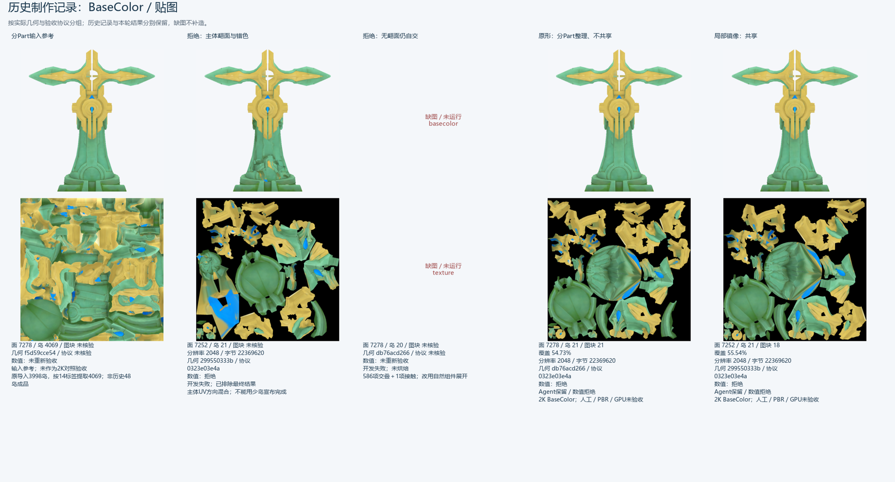
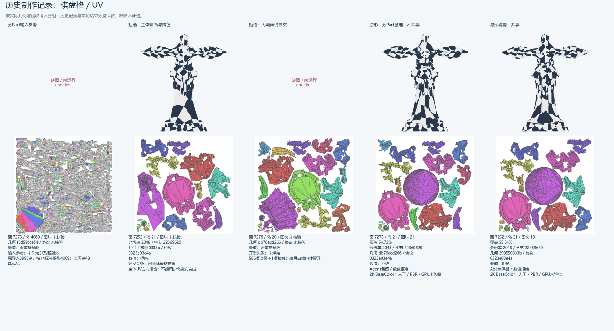

# 防御塔分Part UV整理与复用

已完成14标签、12处理区的UV＋BaseColor实验，交付四个逻辑配置、三份唯一烘焙。原几何的两组整部件共享尝试回退独占；局部镜像对照从21独立图块变为18，双方实际共享表面积占整模型16.09%。三份唯一结果均为Agent目视保留、数值渲染探针拒绝，仍有明显局部拉伸。`[verified: docs/assets/tower-parts/round01/evidence.json final_summary.logical_configurations、unique_bakes、rows、warnings]`

## 输入、配准与小片归位

- 原塔来源为 `artifacts/tower_uv_comparison/round02/clean_import/snapshot/snapshot.json`，7,278面，父状态哈希 `c03d415cbed12589846e12a8945252f5800e7f3e3e8e20e431dee915a5f7d686`。新分割文件 `fantasy_cross_statue_3d_model.fbx.glb` 有14个部件、7,281个三角形，只有位置与法线，没有UV或贴图，只供应标签；其SHA-256为 `1b8bdabe07bfbc867ede16e1a49a042b6e61a59cbd985ad735061dd3b4989aca`。`[verified: artifacts/tower_parts/round01/preparation/registration.json source_face_count、source_state_hash、original_segmentation_sha256；docs/assets/tower-parts/round01/evidence.json segmented_input]`
- 对分割参考的派生副本应用全局相似变换，原塔不移动。14标签均非空，原塔面完整唯一覆盖，逐角位置误差为0，面中心和三处内部采样没有争议面；最大参考表面距离为原塔对角线的0.5213%。这些是标签迁移与来源核验，不是UV或外观验收。`[verified: artifacts/tower_parts/round01/preparation/preparation-audit.json complete_unique_source_face_coverage、position_max_l2_error、maximum_witness_distance_fraction、boundary_disputed_faces、empty_labels]`
- 33面的Part12是正面圆饰左侧窄补片，沿9条权威原边并入Part10；19面的Part13是底座背面中央小楔片，沿7条权威原边并入Part6。14个输入标签因此组成12个处理区，全部7,278面保留，不按坐标焊接。`[verified: artifacts/tower_parts/round01/preparation/preparation-review.json parts；artifacts/tower_parts/round01/preparation/regrouping-audit.json inherited_original_interface_edges_now_internal、deleted_faces；artifacts/tower_parts/round01/preparation/regrouping.json processing_region_count、coordinate_welding]`
- 当前保守导入身份下，原塔UV统计为3,998岛；按14标签提取后为4,069岛，归位为12处理区后为4,062岛。这些数字描述不同准备状态，不能混作整理收益，也不能与历史镜像成品的48岛直接相减。`[verified: artifacts/tower_parts/round01/preparation/preparation-review.json source_uv_chart_count、prepared_uv_chart_count；artifacts/tower_parts/round01/preparation/regrouping-audit.json regrouped_uv_chart_count；opinion: 比较口径]`

上排是14个部件标签，下排是相同六视角的来源BaseColor；标签颜色不作为材质来源。编号按字典序排列，不能把图中的数字直接当作Part后缀。`[verified: docs/assets/tower-parts/round01/evidence.json figures；artifacts/tower_parts/round01/preparation/preparation-review.json parts.numbered_view_label]`

## 原几何的整部件共享尝试

|部件对|默认候选检查|明确宽探索与回退|
|---|---|---|
|Part5→Part2，中部圆饰两侧支架|距离门限0.005、法线角45°时，9,814个采样中51个失败，`SURFACE_CORRESPONDENCE_REJECTED`。`[verified: artifacts/tower_parts/round01/analysis/whole-reuse-summary.json attempts whole-5-2-strict]`|距离门限0.05、法线角120°时采样均通过，但UV转移方向不一致；共同域还因多边界／组件拒绝，整部件保留独占。`[verified: artifacts/tower_parts/round01/analysis/whole-reuse-summary.json attempts whole-5-2-wide、whole-5-2-wide-similarity]`|
|Part11→Part8，底座两侧上阶|相同默认门限下，2,464个采样中79个失败，`SURFACE_CORRESPONDENCE_REJECTED`。`[verified: artifacts/tower_parts/round01/analysis/whole-reuse-summary.json attempts whole-11-8-strict]`|宽探索采样通过后仍有方向不一致；共同域因边界非单调拒绝，整部件保留独占。`[verified: artifacts/tower_parts/round01/analysis/whole-reuse-summary.json attempts whole-11-8-wide、whole-11-8-wide-similarity]`|

每对共尝试三个假设，没有应用失败提案，没有按三角面剔除局部来拼出共享。距离门限0.05表示相对模型对角线的搜索距离，不是“95%相似”或最终外观评分；宽探索不改写默认门限的失败。`[verified: artifacts/tower_parts/round01/analysis/whole-reuse-summary.json applied_proposals、decision、threshold_semantics；opinion: 指标解读]`

## 主体展开的失败记录

- 主体OptCuts首次在90秒工具期限内未完成；完整开口后的另一尝试仍超时，失败目录分别为 `original/rebuild/part_6` 和 `original/body-complete-cuts/part_0`。`[verified: artifacts/tower_parts/round01/original/rebuild/part_6/result.json；artifacts/tower_parts/round01/original/body-complete-cuts/part_0/result.json]`
- 后一次OptCuts日志反复保留一个Euler特征为2的闭合组件；原边审计另确认一个原有2面闭合组件。两种记录保留，后续改为按自然连通组件处理，不把超时解释为数学上不可展开。`[verified: artifacts/tower_parts/round01/original/body-complete-cuts/part_0/native/process.log “component 12”“euler_characteristic 2”“1 components to cut to disk”；artifacts/tower_parts/round01/original/body-cutplan/closed-cap-opening.json components；opinion: 停止重试与解释边界]`
- 少岛ABF候选曾出现混合面方向；补开口并按完整相邻UV岛合并后，虽无混合方向，全模型检查仍记录587项未经授权的接触／交叠。20岛是被拒绝的中间结果，不能作为完成指标。`[verified: artifacts/tower_parts/round01/cases/original_unshared/inspect/inspection.json geometry.errors；opinion: 结果身份]`
- 因此，正的逐面UV方向只排除局部翻转，不能替代全图块自交检查。优先检查完整部件的开口、自然连通块和边界，再修订整块展开；不要把少岛或图块减少当成烘焙完成。`[opinion]`

随后将主体按权威原边分为1,264面主组件与原有2面闭合组件：主组件使用过滤后的实际切口做harmonic展开；闭合组件沿原3条边开口，以LSCM保留两个UV片。修正后的全塔21岛通过了硬几何核验，没有删面；这一步只确认UV合法性与可测量指标，BaseColor烘焙和目视另行验收。`[verified: docs/assets/tower-parts/round01/evidence.json body_repair.strategy、geometry.hard_valid、geometry.hard_errors、acceptance_boundary]`

两图是完整模型的实际BaseColor阶段图，未用选面裁剪的锯齿边界解释模型破损；这里只展示排错过程，不把不同阶段的冻结目标当成同协议误差消融。`[verified: docs/assets/tower-parts/round01/evidence.json figures 中 body-repair.png 的来源与操作记录；opinion: 解释边界]`

## 逐部件处理记录

下表的准备岛数取14标签归位后的12处理区状态；结果岛数取正式原形／镜像分支。它们均有Agent目视记录，人工状态仍为未运行；本轮原几何尝试的两组共享候选全部回退独占。`[verified: docs/assets/tower-parts/round01/evidence.json processing_regions、reuse_attempts、final_summary.rows；opinion: 统计边界]`

|输入Part|来源面数|准备UV岛→结果岛|镜像分支处理|
|---|---|---|---|
|0|1,230|682→3|保持原形，独占。`[verified: docs/assets/tower-parts/round01/evidence.json processing_regions tripo_part_0]`|
|1|1,073|598→3|保持原形，独占。`[verified: docs/assets/tower-parts/round01/evidence.json processing_regions tripo_part_1]`|
|2|704|382→2|用Part5镜像替换为698面，与Part5形成2个共享组。`[verified: docs/assets/tower-parts/round01/evidence.json processing_regions tripo_part_2]`|
|3|764|461→1|保持原形，独占。`[verified: docs/assets/tower-parts/round01/evidence.json processing_regions tripo_part_3]`|
|4|1,266|712→3|保持原形；主组件harmonic＋闭合组件LSCM，独占。`[verified: docs/assets/tower-parts/round01/evidence.json processing_regions tripo_part_4、body_repair.strategy]`|
|5|698|379→2|保持主件，与镜像Part2共享。`[verified: docs/assets/tower-parts/round01/evidence.json processing_regions tripo_part_5]`|
|6＋13|450|249→2|微片按原边归位，保持几何，独占。`[verified: docs/assets/tower-parts/round01/evidence.json processing_regions tripo_part_6_plus_13、regrouping]`|
|7|287|158→1|保持原形，独占。`[verified: docs/assets/tower-parts/round01/evidence.json processing_regions tripo_part_7]`|
|8|186|101→1|用Part11镜像替换为166面，与Part11形成1个共享组。`[verified: docs/assets/tower-parts/round01/evidence.json processing_regions tripo_part_8]`|
|9|173|91→1|保持原形，独占。`[verified: docs/assets/tower-parts/round01/evidence.json processing_regions tripo_part_9]`|
|10＋12|281|156→1|微片按原边归位，保持几何，独占。`[verified: docs/assets/tower-parts/round01/evidence.json processing_regions tripo_part_10_plus_12、regrouping]`|
|11|166|93→1|保持主件，与镜像Part8共享。`[verified: docs/assets/tower-parts/round01/evidence.json processing_regions tripo_part_11]`|

## 正式四配置与交付

原几何共享失败的配置引用同一份原形独占结果，并单独标记回退，没有再算一次独立求解或烘焙。镜像共享／独占绑定相同几何哈希与同一冻结目标；正式配置统一2048²、种子17、gap／border／padding各8px，图块平均纹素密度归一化。`[verified: docs/assets/tower-parts/round01/evidence.json final_summary.rows original_shared_fallback、protocol、comparison]`

数值协议为每面16个采样、48px固定渲染探针，检查LOD0／1／2；实际全模型颜色视图为640px。它使用本轮记录，不沿用恐龙案例的4采样／32px设置。`[verified: docs/assets/tower-parts/round01/evidence.json final_summary.protocol；artifacts/tower_parts/round01/cases/original_clean/case.json size；opinion: 案例迁移边界]`

|配置|三角形|UV岛／独立图块|共享组|实际共享表面|图集覆盖率|
|---|---|---|---|---|---|
|原形：不共享|7,278|21／21|0|0|54.73%。`[verified: docs/assets/tower-parts/round01/evidence.json final_summary.rows original_clean.metrics]`|
|原形：共享失败回退独占|7,278|21／21|0|0|54.73%，同一原形烘焙。`[verified: docs/assets/tower-parts/round01/evidence.json final_summary.rows original_shared_fallback]`|
|局部镜像：不共享|7,252|21／21|0|0|54.85%。`[verified: docs/assets/tower-parts/round01/evidence.json final_summary.rows mirror_unshared_clean.metrics]`|
|局部镜像：共享|7,252|21／18|3|16.09%|55.54%。`[verified: docs/assets/tower-parts/round01/evidence.json final_summary.rows mirror_shared_clean.metrics]`|

16.09%按双方参与共享的三维表面积计，分母是当前整模型表面积；它不是纹理字节节省比例。共享／独占的覆盖率相差约0.69个百分点；镜像改模的26面净变化另列，不归因于UV共享。`[verified: docs/assets/tower-parts/round01/evidence.json comparison、final_summary.rows.metrics；opinion: 收益口径]`

|唯一产物|BaseColor mip0 PNG字节|具名GLB字节|完整mip解码RGBA8字节|
|---|---|---|---|
|原形独占／回退共享|3,001,104|3,535,328|22,369,620。`[verified: docs/assets/tower-parts/round01/evidence.json final_summary.rows original_clean.metrics]`|
|镜像独占|2,990,192|3,511,888|22,369,620。`[verified: docs/assets/tower-parts/round01/evidence.json final_summary.rows mirror_unshared_clean.metrics]`|
|镜像共享|2,974,119|3,495,820|22,369,620。`[verified: docs/assets/tower-parts/round01/evidence.json final_summary.rows mirror_shared_clean.metrics]`|

同2K完整mip解码字节没有减少。PNG和GLB文件大小单独报告，不把其编码差异写成已实测的GPU显存节省。`[verified: docs/assets/tower-parts/round01/evidence.json comparison.decoded_bytes_equal、final_summary.rows.gpu_status；opinion: 存储解读]`

## 验收、拉伸与收益边界

三份唯一结果均通过硬几何、颜色采样和当前输入边的接缝检查，但综合数值拒绝：12个固定渲染探针中，原形5个通过，镜像独占6个通过，镜像共享5个通过；最大误差分别为0.3255、0.3379、0.3377，均超过0.2门限。接缝检查没有提供原FBX跨拆点／跨部件的权威原拓扑见证，范围仅为 `canonical_input_edges_only`。`[verified: docs/assets/tower-parts/round01/evidence.json final_summary.rows render_probe_pass_count、render_max、seams_scope、authoritative_original_topology_supplied；numeric_validation]`

独立拉伸诊断开启质量约束后仍拒绝。形状均值按原三维面面积加权，CVaR95为最差5%表面积上的形状误差尾部均值；原形均值1.3939、CVaR95为25.1295，镜像约为1.3973、25.1848，最大各向异性约1,795，最大相邻面密度比约53.95。图块平均密度归一化不保证每个面的低拉伸；本轮不是低畸变UV成品验收。`[verified: artifacts/tower_parts/round01/cases/original_clean/stretch_diagnostic/inspection.json geometry.geometry_protocol；docs/assets/tower-parts/round01/evidence.json final_summary.rows.metrics、stretch_diagnostic_passed；opinion: 交付定位]`

Agent实际看过三份结果的LOD0六视角、顶部／圆饰／柱身／底座的正面／背面／斜视近景，以及LOD1／2的正面／背面／斜上视图，记录 `KEEP`；人工、完整PBR和GPU均未运行。首份独占结果的自比视图只用于绑定看图记录，保真判断来自另存的源／冻结目标／实际烘焙及数值证据，不使用零自差作为保真结论。`[verified: artifacts/tower_parts/round01/cases/original_clean/visual_keep/review.json notes；docs/assets/tower-parts/round01/evidence.json final_summary.rows viewed_lods、viewed_lod0_cameras、viewed_lod1_2_cameras、closeup_regions、human_status、pbr_status、gpu_status]`

三份唯一结果均交付12个具名对象的GLB，独立回读核对面覆盖、逐角位置、UV与贴图一致；回退配置复制同一原形模型并保留来源身份。本轮Normal只保留来源，没有烘焙或接受；历史7,650面、48岛／24图块的PBR结果继续按原轮次保存。`[verified: docs/assets/tower-parts/round01/evidence.json delivery_verification、final_summary.protocol.normal、final_summary.rows original_shared_fallback；skills/reseam-uv/examples/tower-pbr-reuse.md “适用条件与输入”；opinion: 历史与当前边界]`

截至结果汇总的自动执行账目，原形893.376秒、镜像838.060秒，均包含失败尝试并低于各2,400秒预算；最终报告开销另记，Agent编程、看图和文档耗时不计入这份自动执行账目。混用工具内部wall与CLI总wall的计时范围如实保留，不当作精确端到端工时。`[verified: docs/assets/tower-parts/round01/evidence.json final_summary.budget_as_of_summary、budget_limit_per_geometry_seconds、timing_scope]`

## 请求与继续处理入口

本轮所有请求、结果、日志、不可变快照和中间失败保存在仓库根相对目录 `artifacts/tower_parts/round01/`。正式入口为 `summary.json`、`delivery/{original_clean,original_shared_fallback,mirror_unshared_clean,mirror_shared_clean}/`；图解为 `report/index.html` 和 `report/comparison-book.pdf`。标签准备见 `preparation/`，共享诊断与最终主体修正见 `analysis/`，早期失败见 `original/` 和被排除的旧case。继续处理前读取当前快照、哈希与 [浓缩证据](../assets/tower-parts/round01/evidence.json)，不从路径名中的 `final` 推定其已经通过。`[verified: artifacts/tower_parts/round01/summary.json development_candidates_excluded、rows；本轮实际报告文件检索；opinion: 继续处理规则]`

历史图保留被拒绝候选及缺图身份，正式四配置只取上表三份唯一结果。`[verified: docs/assets/tower-parts/round01/evidence.json final_summary.development_candidates_excluded、figures；opinion: 展示口径]`
