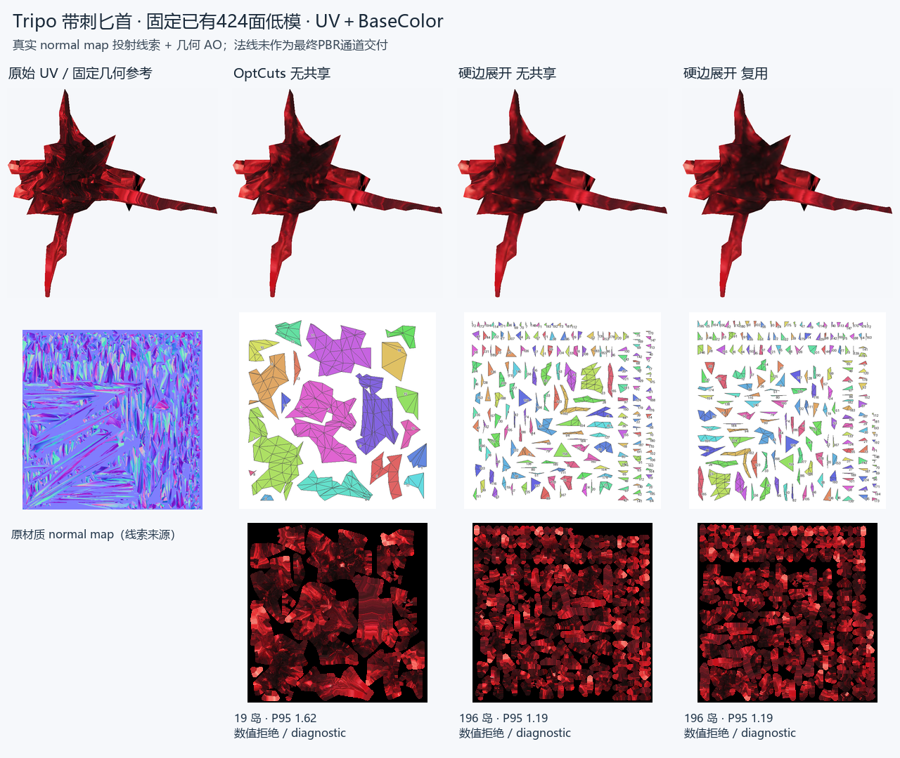

# Tripo 带刺匕首：normal 与 AO 辅助硬边展开

按用户选择使用已有424面重拓扑版本，固定其几何；原1061面版本因非流形边(708,709)被导入器拒绝，失败保留。原始约191万面高模未运行。`[verified: round01/original/prepare/import/result.json；round03/original/prepare/channel_sources.json]`

材质来自冻结的1061面GLB，含真实normalTexture；BaseColor及normal线索均按固定424面低模包围盒对角线的0.08距离界投射到原参考三角形。保存源面、重心坐标、距离和有效性。AO来自16射线几何查询，AO贴图与height/displacement未绑定。`[verified: prepare/channel_sources.json；projected_normal_cues.json；target/freeze/target.json]`

normal用于候选切口判断，不是最终法线重烘焙；切线框架近似不代表Mikk/PBR验收。记录G通道翻转以补偿glTF与内部UV的V方向差异。保留OptCuts开口，加入强normal变化或AO+折角线索，再尝试LSCM与minimum-stretch。阈值是启发式，不是理论最优。`[opinion]`

|路径 / 种子|岛 / 图块|拉伸P95 / 最大|实际共享表面比例|数值 / GLB回读|
|---|---|---|---|---|
|OptCuts 无共享 / 17|19 / 19|1.619 / 3.479|0.000|False / True `[verified: 对应 inspect/uv_metrics.json、quality/validation.json、reimport.json]`|
|OptCuts 无共享 / 29|19 / 19|1.619 / 3.479|0.000|False / True `[verified: 对应 inspect/uv_metrics.json、quality/validation.json、reimport.json]`|
|OptCuts 无共享 / 43|19 / 19|1.619 / 3.479|0.000|False / True `[verified: 对应 inspect/uv_metrics.json、quality/validation.json、reimport.json]`|
|硬边展开 无共享 / 17|196 / 196|1.192 / 1.898|0.000|False / True `[verified: 对应 inspect/uv_metrics.json、quality/validation.json、reimport.json]`|
|硬边展开 无共享 / 29|196 / 196|1.192 / 1.898|0.000|False / True `[verified: 对应 inspect/uv_metrics.json、quality/validation.json、reimport.json]`|
|硬边展开 无共享 / 43|196 / 196|1.192 / 1.898|0.000|False / True `[verified: 对应 inspect/uv_metrics.json、quality/validation.json、reimport.json]`|
|硬边展开 复用 / 17|196 / 195|1.194 / 1.898|0.004|False / True `[verified: 对应 inspect/uv_metrics.json、quality/validation.json、reimport.json]`|
|硬边展开 复用 / 29|196 / 195|1.194 / 1.898|0.004|False / True `[verified: 对应 inspect/uv_metrics.json、quality/validation.json、reimport.json]`|
|硬边展开 复用 / 43|196 / 195|1.194 / 1.898|0.004|False / True `[verified: 对应 inspect/uv_metrics.json、quality/validation.json、reimport.json]`|

seed17清洁预览保留带刺轮廓和红黑大块结构；256像素下高频纹理明显丢失，不能当作保真交付。硬边无共享P95约1.19优于OptCuts约1.62，但196岛增加切缝与留边成本；少量共享另报实际面积，不宣称大面积复用完成。`[verified: original/appearance_review.json]`

诊断边线图见 original/review/normal_cue_edges 与 ao_cue_edges，实际贴图清洁预览见各 *_clean_views。cut_decision.json旧字段added_cue_edges记录候选边，真正新增边为cut_edges减base_openings；不混算为新增收益。`[verified: cue_selection_summary.json；cut_decision.json；summary.json actual_additional_cut_edges]`

两次诊断视图的并发记账遗漏按原result.json的wall_seconds补入，原账本和补录依据保留；未重算模型或指标，缺失的外层记账开销仍标未知。`[verified: original/ledger_reconciliation.json]`

[9项完整矩阵](../assets/tripo-spike-hard-surface/round03/summary.json) · [原始证据和实际模型](E:/ReSem/artifacts/tripo_spike_hard_surface/round03)

round01保留1061面导入拒绝；round02保留投射尺度混用的开发结果，不用于正式排名；round03统一尺度后重跑全部受影响路径。三种子分别从同一方法父快照排布。LOD为0/1/2；人工、GPU与完整PBR均未验收。`[verified: 各轮冻结源码、请求与validation.json profile]`
