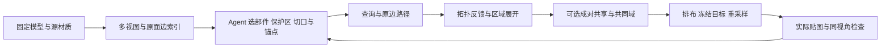

# Training-Free 语义引导 UV 重构

本方法把当前通用视觉 Agent 的部件判断转成原网格上的边集合，再调用确定性展开、共享和烘焙工具。重构接缝及 UV 组织，保留固定父资产的几何和原面；不训练或微调 UV 网络。工业可用性与跨资产泛化仍是待验证目标。`[opinion]`

## Agent 到底做什么

Agent 读取 `view.render` 的真实颜色、线框、接缝和编号图，以及 `mesh.query` 返回的实际面／边 ID。它决定“保留头脸”“翼膜正反面分开”“圆柱腿背面纵切”等制作意图，输出 `region.define`、`seam.select`、`seam.submit_plan` 的 JSON。几何工具解析依赖、找真实路径、生成 UV；Agent 不直接猜测成千上万个逐角 UV 数值。`[opinion]`

工具失败后，Agent 读取具体证据再改一个主要机制。例如带孔区域补一条连接边界环的路径，内部翻转改展开后端，颜色覆盖不足检查 padding 与 mip。每次修改保存请求、前后图、父子哈希、失败原因和耗时；同一假设最多三次。修改区外优先保留原 UV，不能用先拆成单面岛的方法制造后续“合并收益”。`[opinion]`

当前执行者就是调用 CLI 的 Agent，没有新增强制外部 VLM API。可见的任务、JSON、图像和决定保存到实验目录；未暴露的精确服务模型 ID、token 与费用记为 unknown，不伪造计费数字。`[verified: ../artifacts/meshquery_v1/root_decisions.json agent/exact_serving_model_id/token_count/price]`

## 工具与身份合同

- 观察：`mesh.index/query` 的 SQLite 属性与邻接，`region.propose` 的几何候选，`view.render` 的固定镜头与原面拾取。查询表及十种选边算子见[工具说明](meshquery-tools.md)。`[verified: src/reseam/agent_tools/registry.py TOOLS]`
- 决策与执行：计划保存具名选边程序、最终原边集合和拓扑结果；`seam.apply` 调用 LSCM、ABF++、Minimum Stretch、调和或 OptCuts，后端显式指定。`[verified: seam_plans.py apply_seams；reparameterize.py reparameterize]`
- 共享：对称切缝不等于实际堆叠。使用独立的 `reuse.check_pair/apply`，近似部件使用共同域与原面角映射；检查后才能形成共享组。`[verified: registry.py reuse.check_pair/reuse.apply；paired_domain.py]`
- 材质：`material.target` 从固定来源生成目标；共享成员先独立取样，避免写入顺序覆盖。保留眼嘴与爪子等保护集合，记录外观改动量和重建误差两类结果。`[verified: color_reuse.py freeze_target；用户已接受的颜色对称化范围]`
- 回退：每个修改写新快照。计划绑定资产、状态与索引；失败不能改父状态，重新展开或排布后旧烘焙失效。选取旧计划恢复的是其父状态，不是一份自动认可的烘焙结果。`[verified: seam_plans.py _load_plan/manage_plan；state.py load_snapshot]`

只有三角网格时不猜测原四边形边环；FBX／OBJ 导入可保存的原多边形证据与三角化映射单独记录。位置重合不等于顶点身份相同。`[verified: agent_asset_worker.py polygon_topology；seam_selection.py _quad_topology；用户身份不变量]`

## 已有机制、项目选择与研究假设

|类别|内容|
|---|---|
|已有公开机制|MeshQuery 的查询、选边算子、计划预览与反馈作为工具设计依据；[论文附录](https://arxiv.org/html/2610.02507v1#A1.SS2)。不声称逐行复现作者代码。`[verified: MeshQuery Table4；opinion: 实现定位]`|
|已有后端|Blender 展开、OptCuts、现有 ReSeam 共同域／烘焙内核；实际版本和调用结果由每轮后端记录提供。`[verified: ../artifacts/meshquery_backend_smoke01/summary.json；configs/runtime.local.json]`|
|项目实现选择|SQLite 模式、角亏损曲率、离散原边各向异性路径、不可变状态、局部保留原 UV 与整块回退。SeamCut 离散路径不是作者连续流线算法等价证明。`[verified: mesh_query.py；seam_selection.py _path；seam_plans.py]`|
|项目扩展|颜色球、近似部件共享、源目标冻结、实际 mip 与导出重导入验证。`[verified: registry.py reuse.check_color/material.target；../artifacts/meshquery_v1/reimport_smoke02/verification.json]`|
|待验证假设|语义制作规则能在相同预算下稳定减少碎片、增加可用共享，且泛化到更多生成资产。单模型成功、工具运行和 Agent 偏好均不能证明此假设。`[opinion]`|

PartField 使用同一资产输入和原面标签合同，作为独立研究分区路径；主流程不依赖其 GPU、权重或许可。其代码许可、checkpoint 哈希与已知许可边界见[依赖记录](../artifacts/meshquery_v1/verification_and_dependencies.json)。`[verified: region_proposals.py backend 分支；依赖记录 partfield]`

## 比较口径

从同一父资产派生原 UV 统一排布、OptCuts 无共享、通用规划无共享、项目规则无共享及相同复用后端的候选；同布局解除共享提供额外对照。通用与项目规则改变部件范围时，明确标记端到端比较；只有范围、起点、目标与后端一致才解释为单机制比较。`[opinion]`

连通岛、独立图块、共享组和实际共享面积分别报告。重展开把多个旧岛连成一块，与两个部件堆叠在同一贴图位置是不同收益；固定 2048 的运行时字节不会仅因图块减少而自动降低。历史 energy_blade／dragon 没有原 UV，起点是已冻结的 xatlas 初始化，不称为 Tripo 原生 UV。`[verified: bootstrap load_snapshot 500/2000面父状态 source_uv_present；opinion: 指标解释]`

相同原面角来源支持 `basecolor_reuse`；不同高低模来源需要显式投射，`basecolor_diagnostic` 的真实贴图与 GLB 仅为诊断，不产生可用于正式验收的 bake.json。本轮 UV＋BaseColor、完整 PBR、GPU 与人工认可分别记录。`[verified: color_reuse.py _source；color.py bake_color_diagnostic；material.py _load_bake]`
