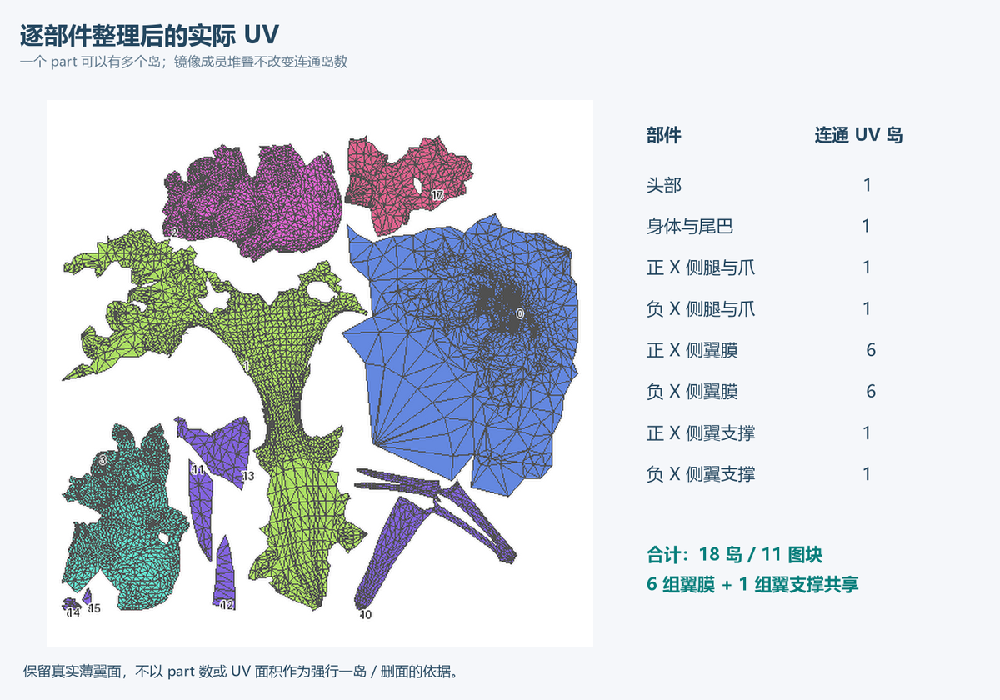
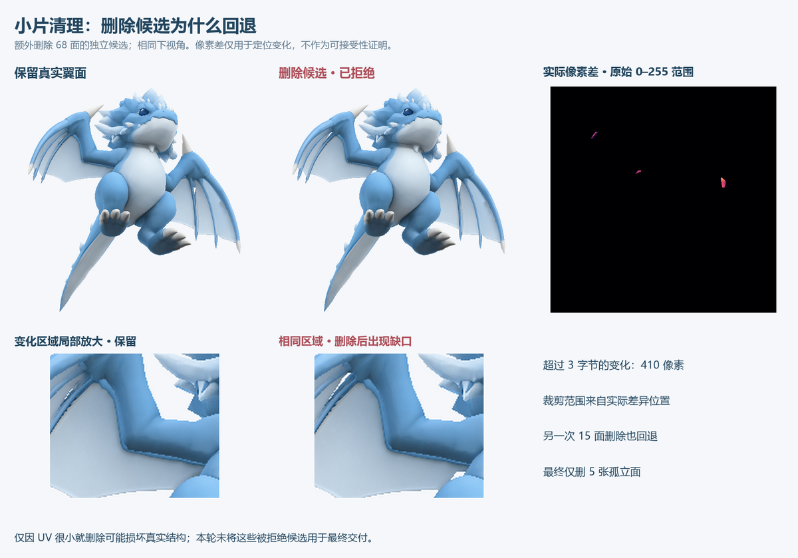
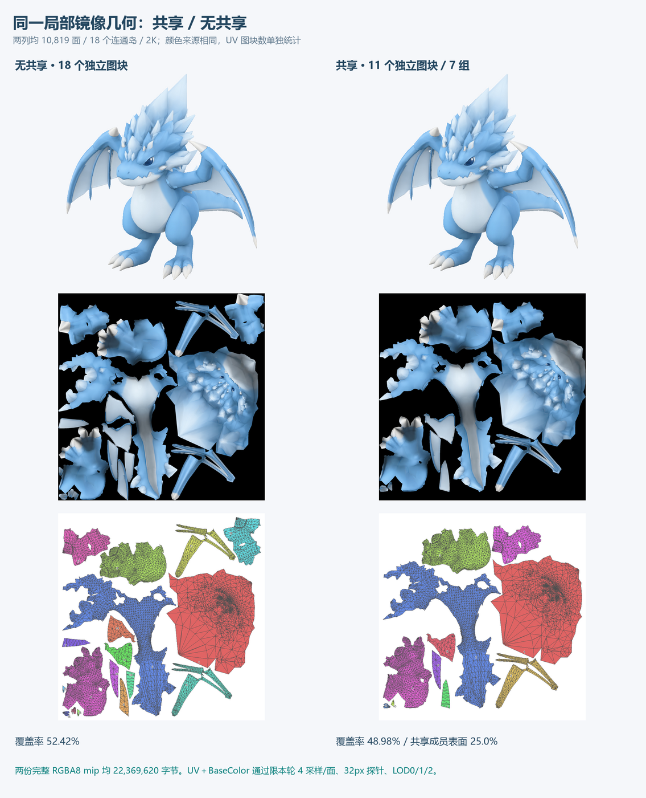

# Tripo 分割参考：按Part合岛、小片清理与共享

适用于用户交来分割结果，希望逐部件整理UV、选择镜像／共享并统一图集的任务。先读 [分割部件流程](../references/segmented-parts.md)；批量执行、预览、交付和出图使用 [工作流工具](../references/workflows.md)。部件展示色仅表示身份，部件数量也不等于连通曲面数量。`[opinion]`

## 选择几何与颜色来源

实际Tripo分割输入有9对象、10,832面，没有UV／贴图。直接初始化得到664岛，两侧翼膜含119／135个原边连通片。最终选择原FBX保留的权威顶点／边身份与原UV采色，以分割位置提供面标签；最近分割表面只是分区候选。原FBX非流形边通过显式 `split_fans` 独立变体处理，保留逐面逐角位置。`[verified: docs/results/dragon-segmented-parts.md “输入与路线选择”；docs/results/dragon-parts-clean-final.md “小碎片如何处理”]`

早期只沿用旧UV再尝试共享的版本仍有199岛，保留为中间记录。按Part整理需要进入部件内部重建切口和连接，不能以识别、编号或堆叠代替完成。当前资产先评估直接使用分割网格，还是仅迁移分割标签，再保存来源理由。`[verified: docs/results/dragon-parts-clean-final.md “验收、交付与继续处理”；opinion: 迁移决策]`

## 部件内部重建与小片处理

|动作|本次处理及可迁移判断|
|---|---|
|标签归位|将小 `part_8` 归回对应腿，修正25面的分区归属；这不是删面或UV合岛。`[verified: docs/results/dragon-parts-clean-final.md “小碎片如何处理”第1项]`|
|连接修复|沿权威原边组织完整选区；不按空间接近自动焊接，也不把独立变体的拓扑变化归因于UV共享。`[opinion]`|
|UV真实合岛|头部在OptCuts十块基础上，增加后侧开口并以ABF重展为一岛；头、身体与尾巴、两条腿、两侧翼支撑各一岛，两侧翼膜各六岛。`[verified: docs/results/dragon-parts-clean-final.md “逐部件结果”]`|
|几何删面|仅在新变体删除5张完全孤立的小面，约占表面积0.0222246%；有限视角变化检查不证明所有表面都不可见。`[verified: docs/results/dragon-parts-clean-final.md “小碎片如何处理”第2项]`|

图：最终具名部件布局，保留必要的薄翼和翼骨片。小图为实际制作图的等比例缩图，来源及哈希见 [图源清单](../assets/segmented-dragon-figures.json)。历史面ID和数字用于查证，不作为新资产参数。`[verified: assets/segmented-dragon-figures.json；opinion: 使用边界]`

## 失败分支与回退

- 腿一岛ABF试做曾使白爪在512烘焙中丢失；脚底／爪尖切口试验恢复白爪，最终清理连接后保留OptCuts完整腿一岛。岛数减少不能替代眼嘴、爪子和连接处检查。`[verified: docs/results/dragon-parts-clean-final.md “小碎片如何处理”第4项；opinion: 检查要求]`
- 额外删除翼根／翼骨的68面和15面候选在正、背或底视角露洞，均已回退。UV小只能触发调查；有实际表面贡献的薄片保留。`[verified: docs/results/dragon-parts-clean-final.md “小碎片如何处理”第3项；opinion: 保留依据]`
- 清理后原几何的共享尝试被拒绝，回退为19岛／19图块独占结果。没有要求每个部件都共享；完整独占是有效的局部回退。`[verified: docs/results/dragon-parts-clean-final.md “四配置对照与收益边界”；opinion: 回退选择]`

图：额外删片后出现缺口的失败候选。同镜头差异图用于定位变化，接受与否仍要看实际模型；另一个15面失败分支通过下方证据入口读取。`[verified: 图源清单 source=07-fragment-rollback.png；docs/results/dragon-parts-clean-final.md “小碎片如何处理”第3项；opinion: 判断方式]`

## 同几何共享对照与验收范围

局部镜像后相同10,819面几何的共享／无共享对照，连通岛均为18，独立图块由18降到11，形成7组共享。共享成员表面积约占25.036%；该比例不是内存节省，也不是授权UV交叠面积。共享版覆盖率48.977%，无共享52.418%，本轮覆盖率未提高。两者2048²完整RGBA8 mip均为22,369,620字节。`[verified: docs/results/dragon-parts-clean-final.md “四配置对照与收益边界”]`

三份2K结果通过的是当轮UV＋BaseColor协议：4采样／面、32px CPU渲染探针、LOD0/1/2，形状设置为visual/advisory。Agent六视角、眼嘴爪子及翼支撑近景保留，GLB独立回读通过；完整PBR、真实GPU和人工验收未执行。1K仅诊断，不能写成同质量节省75%。新任务冻结自身协议，不继承这些历史阈值。`[verified: docs/results/dragon-parts-clean-final.md “验收、交付与继续处理”“四配置对照与收益边界”；opinion: 协议迁移]`

## 迁移到当前任务

1. 检查原网格身份、分割对象、组装位置、UV及实际材质，选择来源路线。每个部件保存当前面集合、保护区与处理理由。`[opinion]`
2. 用 `rebuild` 或 `uv.reparameterize pack_after=false` 逐部件重建必要切口，记录全模型和局部前后岛数。失败保留父快照，整块修订切口或回退；暂存UV没有全局排布／交叠验收。`[opinion]`
3. 用 `preview`（`stage=prepare`）冻结目标并查看原始／目标／差异，记录实际观察后再运行同命令的 `stage=bake`。统一排布后重新烘焙；修改几何、UV或目标后重新检查。`[opinion]`
4. 在同一几何和冻结目标上比较共享／无共享，再以 `collect` 核对具名多对象交付，以 `report` 输出同视角历史与baseline对比。数值、Agent目视、人工、PBR和GPU状态分别记录。`[opinion]`

## 证据入口

以下路径从ReSeam仓库根定位；安装包的小图仅用于阅读，完整历史资产可能未随包分发。缺失时注明“当前checkout缺失”，不能凭摘要宣称重新验证成功。`[opinion]`

- 最终制作记录：`docs/results/dragon-parts-clean-final.md`；早期199岛分支：`docs/results/dragon-segmented-parts.md`。`[verified: 本案例已读取的报告路径]`
- 结果与对照：`artifacts/dragon_parts/final/summary.json`、`artifacts/dragon_parts/final/compare_shared/review.html`。`[verified: docs/results/dragon-parts-clean-final.md “验收、交付与继续处理”]`
- 白爪失败／恢复：`artifacts/dragon_parts/round07/mirror512/actual_views/front.png`、`artifacts/dragon_parts/round08/feet_rebuilt.json`；最终：`artifacts/dragon_parts/final/closeup_claws/lower.png`。`[verified: docs/results/dragon-parts-clean-final.md “小碎片如何处理”第4项]`
- 删片失败：`artifacts/dragon_parts/round13/source_views/`、`round13/image_differences.json`、`round14/views/`、`round14/image_differences.json`；均以前缀 `artifacts/dragon_parts/` 解析。`[verified: docs/results/dragon-parts-clean-final.md “小碎片如何处理”第3项]`
- 交付与续做：`output/dragon-parts-clean-20261125/verification.json`、`artifacts/dragon_parts/final/mirror_shared2048/pack/snapshot/snapshot.json`。`[verified: docs/results/dragon-parts-clean-final.md “验收、交付与继续处理”]`
