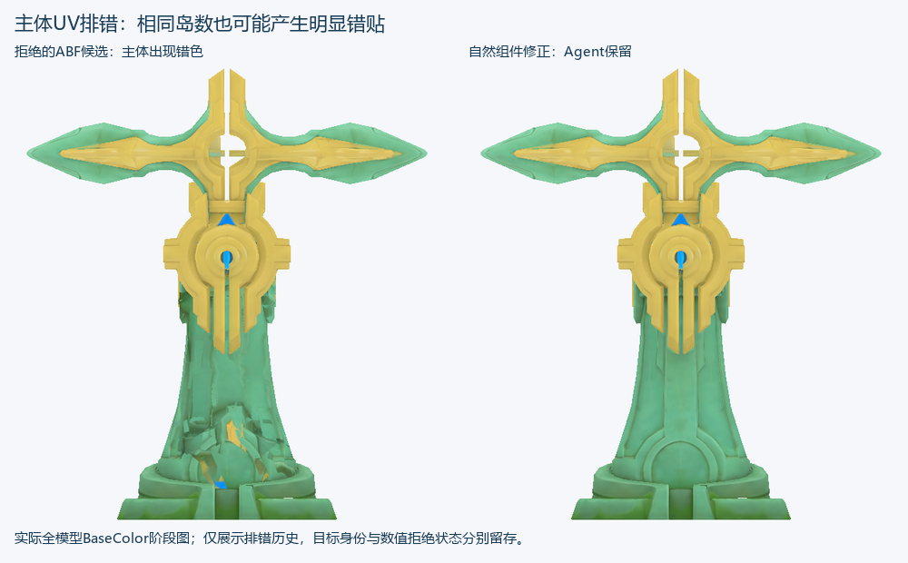
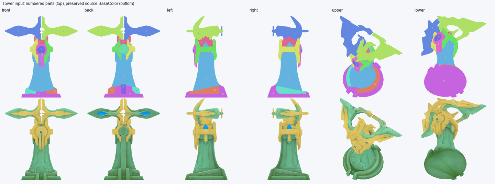
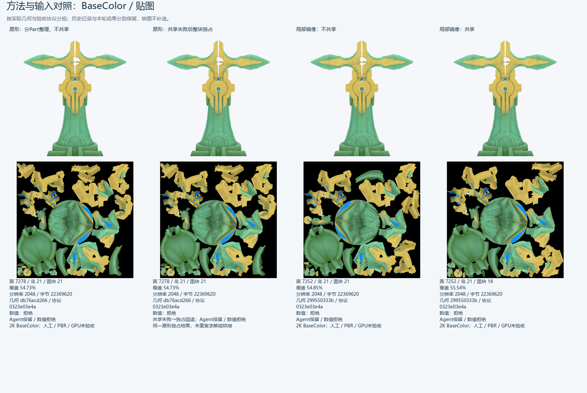
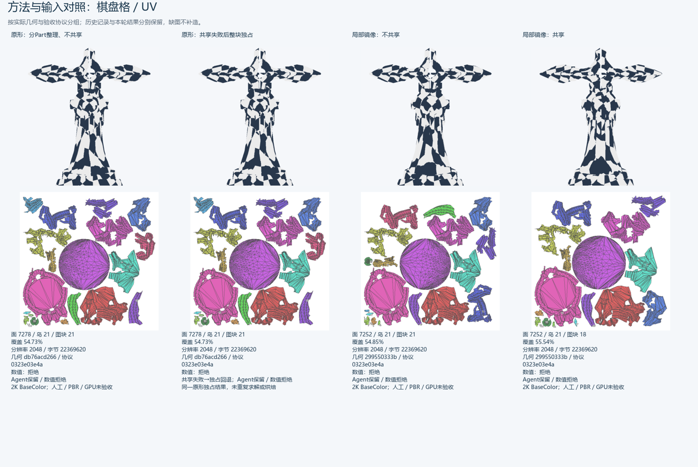

# 防御塔的共享、合岛与PBR交付

## 适用条件与输入

适用于已有PBR材质的重复装饰或对称建筑，需要比较原形整理、镜像共享、继续合岛与交付展示的任务。镜像阶段以当前资产的明确授权为前提。`[opinion]`

本例原材质含8192² BaseColor和2048² Normal，Roughness固定0.6、Metallic固定0、AO取1。最终镜像版7,650三角形，48连通岛／24独立图块，另有相同几何48图块无共享对照。`[verified: docs/assets/tower-pbr-process/round01/README.md L9；docs/assets/tower-uv-comparison/README.md L15]`

## 历史过程与关键决策

1. 保存原UV参考，比较六种基线、原形接缝整理及原形共享，再从已授权的半边镜像路线继续合岛。制作过程按输入、基线、整理、镜像、合岛和近景六部分保留。`[verified: docs/assets/tower-uv-comparison/README.md L5；docs/assets/tower-uv-comparison/report/report.md L9–L28]`
2. 镜像保留负X侧，记录源三角形和重心坐标，反射法线与切线并修正切线方向符号。颜色与法线沿同表面面角来源重采样，法线先恢复表面空间方向，再转换至目标切线坐标系。`[verified: docs/assets/tower-pbr-process/round01/README.md L10–L11]`
3. 共享成员先独立采样，再在一致目标方向下合成。写出2K BaseColor、Normal、ORM，并将AO、Roughness、Metallic拆分展示。12级mip中的Normal逐级重归一化。`[verified: docs/assets/tower-pbr-process/round01/README.md L11–L13]`
4. 最终共享与无共享对照绑定同一镜像几何和2K尺寸。实际整理了全方法PBR对照、关键部位近景、线框与模型/贴图包。`[verified: docs/assets/tower-uv-comparison/README.md L3–L17；README.md L3–L7]`

## 失败、取舍与结果

- FlattenAnything保留UV重叠结果，OptCuts保留原生失败及修复后超时，归档含ReSeam失败候选与修正步骤。`[verified: docs/assets/tower-uv-comparison/README.md L19–L25]`
- 最终48岛／24图块、覆盖56.82%，Agent结论VISUAL_KEEP，数值DIAGNOSTIC，人工和游戏Shader状态NOT_RUN。`[verified: docs/assets/tower-uv-comparison/README.md L15–L17]`
- 同尺寸共享与无共享完整mip解码字节均为67,108,860。粗糙度、金属度和AO的展示值沿用本例固定材质参数。`[verified: docs/assets/tower-uv-comparison/README.md L15；docs/assets/tower-pbr-process/round01/README.md L9–L15]`

## 迁移到当前资产

先用 `uv.inspect`、真实材质视图与来源记录选择原形整理或已授权的镜像路线，共享后检查连续表面的多余接缝。通过当前 `tools describe` 核实 `asset.mirror_variant`、`uv.reparameterize`、`uv.pack` 和材质工具的参数，使用新快照重烘焙。`[opinion]`

沿每个通道的真实来源处理色彩空间与切线转换，分别记录纹理载荷、文件体积及目视/数值状态。交付时保留同几何无共享版本、通道图和实际近景。`[opinion]`

## 证据入口

以下路径按 [索引的仓库定位方法](index.md) 读取。`[opinion]`

|用途|仓库根相对路径及读取位置|
|---|---|
|过程、归档与恢复方法|`docs/assets/tower-uv-comparison/README.md` 的“完整实验归档”“还原方法”。`[verified: docs/assets/tower-uv-comparison/README.md L21–L61]`|
|方法结果与失败|`docs/assets/tower-uv-comparison/report/report.md` 的逐方法表。`[verified: docs/assets/tower-uv-comparison/report/report.md L9–L28]`|
|PBR来源、图表、贴图包|`docs/assets/tower-pbr-process/round01/README.md` 的“这次贴图怎样得到”“来源索引”。`[verified: docs/assets/tower-pbr-process/round01/README.md L3–L39]`|
|实际模型|`artifacts/tower_uv_comparison/round02/evaluation/mirror_negative_exhaustive_minimum_shared_2048/export/asset.glb`。`[verified: docs/assets/tower-uv-comparison/README.md L59]`|
|真实BaseColor与Normal|`docs/assets/tower-pbr-process/round01/maps/mirror_negative_exhaustive_minimum_shared`。`[verified: docs/assets/tower-pbr-process/round01/README.md L22–L25]`|
|制作图解|`output/pdf/tower-making-process/防御塔制作过程图解.pdf`，六页制作与近景。`[verified: docs/assets/tower-uv-comparison/README.md L5]`|
|八视角线框|`docs/assets/tower-wireframe/round01/README.md`。`[verified: README.md L3]`|

全量请求、日志、快照与19模型Blender场景的恢复入口在上述分卷归档说明中。`[verified: docs/assets/tower-uv-comparison/README.md L23–L25]`

## 分Part参考迁移与主体展开（2026-11-26）

本轮单独使用Tripo的14标签分割参考与7,278面原塔来源，不接续历史7,650面PBR镜像成品。原塔位置、原面和BaseColor来源保持，先在派生参考上配准，再用 `asset.prepare_parts segmentation_reference` 迁移标签。面中心与三处内部采样无标签分歧，最大距离为原塔对角线0.5213%，全部原面唯一覆盖；这是来源与选区核验，不能代替颜色验收。`[verified: artifacts/tower_parts/round01/preparation/registration.json scope、source_face_count；artifacts/tower_parts/round01/preparation/preparation-audit.json complete_unique_source_face_coverage、maximum_witness_distance_fraction、boundary_disputed_faces]`

小片归位先核对权威原边：Part12的33面并入Part10，Part13的19面并入Part6；14标签形成12处理区，原面全部保留。应从原来源按合并后的整面选区重新提取，以保留区内原边连接；已分开提取的两个Part不能凭坐标接近焊回。`[verified: artifacts/tower_parts/round01/preparation/regrouping.json policy、coordinate_welding、geometry_change；artifacts/tower_parts/round01/preparation/regrouping-audit.json inherited_original_interface_edges_now_internal、deleted_faces；opinion: 采用规则]`

原塔的保守导入UV为3,998岛，14标签提取后为4,069岛，归位后为4,062岛。标签边界可以增加UV碎片，必须分别报告输入、分区与重展开后的全模型数量；14个Part不要求14个UV岛。`[verified: artifacts/tower_parts/round01/preparation/preparation-review.json source_uv_chart_count、prepared_uv_chart_count；artifacts/tower_parts/round01/preparation/regrouping-audit.json regrouped_uv_chart_count；opinion: 后续统计规则]`

原几何两组候选均先被默认对应门限拒绝；显式宽探索虽通过曲面采样，仍因UV方向、非双射或共同域边界问题拒绝。它们保留整部件独占，没有应用失败提案。距离门限0.05是相对模型对角线的候选搜索距离，不是“相似度95%”；不能把宽探索的采样通过写成UV共享成功。`[verified: artifacts/tower_parts/round01/analysis/whole-reuse-summary.json successful_shared_groups、attempts、applied_proposals、threshold_semantics；opinion: 结果解读]`

主体的少岛ABF结果在没有混合面方向时仍出现586项未经授权的交叠和1项接触，因此20岛中间状态被保留为失败。只检查逐面正方向会遗漏图块全局自交；先查完整部件开口和自然连通块，再重展开、排布与实际烘焙，不通过孤立问题三角面来换计数。`[verified: docs/assets/tower-parts/round01/evidence.json rejected_20_chart_candidate.error_counts；opinion: 诊断与修订规则]`

OptCuts在闭合组件切盘阶段反复超时后，改按自然组件处理：1,264面主组件用实际切口做harmonic；原有2面闭合组件沿原边开口，以LSCM保留两个UV片。全塔21岛随后硬几何通过，没有删面。多组件的harmonic报错要先核对选区拓扑，不能等同于该部件不可展开；这个后端选择也不成为所有硬表面的默认。`[verified: docs/assets/tower-parts/round01/evidence.json body_repair.strategy、geometry.hard_valid、geometry.hard_errors；opinion: 选择依据与迁移边界]`

这张图使用完整模型的实际BaseColor阶段图，保留被拒绝的错贴；选面近景的裁剪边界另有用途，不用于声称模型破损。不同历史目标的阶段图只展示排错，不充当同协议误差消融。`[verified: docs/assets/tower-parts/round01/evidence.json figures 中 tower-parts-body-repair.png 的来源与操作；opinion: 图片边界]`

图中上排为部件标签，下排为来源颜色；编号与Part后缀的对应在仓库根相对路径 `artifacts/tower_parts/round01/preparation/preparation-review.json`，标签颜色不代表材质。`[verified: docs/assets/tower-parts/round01/evidence.json figures；artifacts/tower_parts/round01/preparation/preparation-review.json parts.numbered_view_label]`

本轮完成四个逻辑配置、三份唯一烘焙：原形共享失败后引用同一独占模型，不重复计一次求解。局部镜像共享／独占使用同一几何和冻结目标，21连通岛保持，独立图块21→18，3共享组，双方实际共享表面积占整模型16.09%，覆盖率54.85%→55.54%。两者完整2K BaseColor mip解码RGBA8字节同为22,369,620。`[verified: docs/assets/tower-parts/round01/evidence.json final_summary.logical_configurations、unique_bakes、rows、comparison]`

三份唯一GLB均以12个具名对象独立回读，位置、UV、面覆盖和贴图核对通过。Agent实际检查LOD0六视角、四个部位近景及LOD1／2的正／背／斜上视图后保留；颜色采样和当前输入边接缝通过，但默认渲染探针最大误差超过0.2，综合数值拒绝。实际协议为16采样／面、48px探针、LOD0／1／2；接缝仅覆盖当前输入边，没有原FBX跨部件权威拓扑见证。首份独占自比只绑定看图记录，保真依据另存源／目标和实际烘焙，零自差不作保真结论。`[verified: docs/assets/tower-parts/round01/evidence.json delivery_verification、final_summary.protocol、rows；artifacts/tower_parts/round01/cases/original_clean/visual_keep/review.json notes]`

低岛数仍伴随高拉伸：原形形状均值1.3939、CVaR95为25.1295，镜像约1.3973、25.1848，最大各向异性约1,795。图块平均密度归一化不代表逐面低畸变；本轮是Agent保留的UV＋BaseColor测试交付，人工、完整PBR和GPU均未运行，后续编辑仍须观察棋盘格与拉伸诊断。`[verified: docs/assets/tower-parts/round01/evidence.json final_summary.rows.metrics、warnings、human_status、pbr_status、gpu_status；opinion: 适用边界]`

继续定位读取仓库根相对路径 `docs/results/tower-parts.md`、`docs/assets/tower-parts/round01/evidence.json`、`artifacts/tower_parts/round01/summary.json`，从 `delivery/` 和正式case哈希继续。被排除的 `mirror_shared_final`、`original_unshared` 仍是失败记录，不按名字选成品。本轮状态与上文历史PBR状态分开。`[verified: docs/assets/tower-parts/round01/evidence.json final_summary.development_candidates_excluded、rows；opinion: 继续处理规则]`
